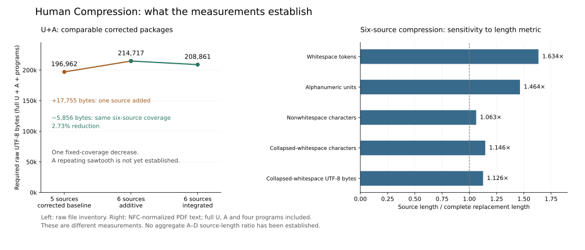

# Complexity checkpoints and compression rates



The left panel compares complete U+A packages with mandatory corrections
included. The five-source baseline costs 196,962 raw UTF-8 bytes. Adding
the sixth source yields 214,717; integrating the common arguments yields
208,861. The last step preserves six-source coverage and saves 5,856 bytes,
or **2.73%**. The checkpoints are comparable corrected packages, not
equally spaced observations in time. They establish one downward step,
not a repeating sawtooth.

The right panel shows every admitted NFC length metric for the same
six-source contract. It includes the full umbrella theory, Module A and
all four required programs. The token factor is **1.634×**; the smaller
character and byte factors make the representation sensitivity visible.
These PDF-text measurements differ from the raw-file inventory on the left.
See the [complete measurement and retained-input scope](MEASUREMENT_A.md).

Modules A–D cover sixteen distinct principal-result contracts. Their
source counts do not establish a length ratio. A combined comparison
must measure the matched source bodies, charge the shared umbrella once,
and include every required application argument and computational artifact.
That aggregate measurement remains unfinished. Corrections and open-question
results are recorded separately; neither supplies an automatic multiplier.

The [machine-readable points](research/case_study/phase190_complexity/measurements.json)
bind the existing measurement records. The [plotting script](scripts/build_complexity_figure.py)
recomputes the arithmetic and draws the figure; it does not rerun the
mathematical proofs or claim new primary-source measurements. Reproduce it
with Python and matplotlib in a fresh directory:

```sh
python3 scripts/build_complexity_figure.py --output-dir /tmp/NEW-complexity
```
