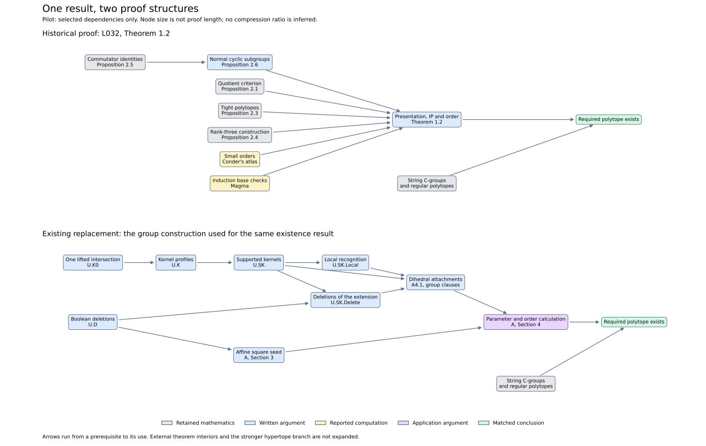

# Two proof structures for prescribed polytope orders

The first pilot compares the proof of Theorem 1.2 in Hou, Feng and Leemans,
*On regular polytopes of 2-power order*, with its existing deduction from
our umbrella and two-group application manuscript. The source edition is
dated 8 November 2019; the published paper has
[DOI 10.1007/s00454-019-00119-5](https://doi.org/10.1007/s00454-019-00119-5).

The conclusion is the same: for d ≥ 3, n ≥ 5 and kᵢ ≥ 2 with
Σ kᵢ ≤ n−1, a regular polytope exists with rank d, automorphism group
of order $2^n$ and type $\{2^{k_1},\ldots,2^{k_{d-1}}\}$.



The source already reuses the quotient criterion, an earlier construction
of tight polytopes, and an earlier construction in rank three. It also uses
an atlas and reported finite computations for small parameters. Its local
commutator argument supports a presentation and an induction proving the
exact order. Those earlier results retain their original attribution.

Our existing proof uses a lattice construction of a square seed and one
theorem for attaching local kernels. The local application chooses
δ = n−1−Σ kᵢ and B = C₂^(d−3) × H_(δ+5), attaches dihedral groups with
the requested adjacent orders, and checks the resulting order and commuting
distant generators. A common correspondence gives the regular polytope.
The same parameter calculation also gives the existence part of L035 at
d = 3; it does not give L035's classification by itself.

This is a graph of selected mathematical dependencies. It is **not yet a
weighted graph or a complete topic comparison**. In particular, the short
parameter calculation is not a complete application paper until its context
and every required hypothesis check have been assigned and paid for. The
stronger hypertope conclusion of A4.1 has further dependencies which are
irrelevant to this selected existence result and are not drawn here.

The [data and evidence for every edge](research/case_study/phase202_dependency_pilot.json)
identify exact source pages, replacement statements, frozen editions and
omissions. Arrows show use in these written arguments, not logical necessity
among all possible proofs. The graphs do not replace a proof review, certify
a full Lean formalization or recover every assertion in the source paper.

The next step is the [topic-level measurement](TOPIC_COMPLEXITY.md): isolate
a complete U_A and the source-matched application papers, give both graphs
audited proof lengths, and plot c(U_A), c(Aᵢ) and c(LAᵢ). Node or edge counts
alone are not a compression factor.

The existing source-result ledger is
[A.U.D1](research/case_study/phase138_module_A_v2_ledger.json), with the written
proofs in [U](research/case_study/phase138_umbrella_v3.md) and
[the two-group manuscript](research/case_study/phase138_module_A_v2.md).
The old ledger's broad section spans are explicitly not complete dependency
closures and are not used as paper lengths here.

To redraw the pilot with Python and matplotlib:

```sh
python3 scripts/build_dependency_pilot.py --output-dir /tmp/NEW-dependency-pilot
```

The script checks both graphs for cycles and verifies the checksums of the
specified replacement files. It does not execute the historical computations
or prove the edges.
