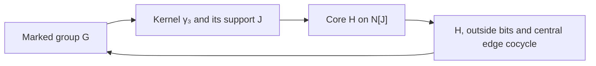

# An introduction to mathematical compression

This project asks how much of a connected body of mathematics can be recovered
from a small collection of arguments that remain useful as the examples change.
The initial subject is finite groups acting on polytopes, incidence geometries
and graphs. The working bibliography extends over several decades; one concrete
bridge developed below connects a construction published in 2005 with questions
and constructions studied in 2026.

The central proposal is to retain the **marked action**, not just the abstract
group. A group can act on several sets, have several generating tuples, and
support different incidence structures. Those distinctions are often the entire
classification problem. Keeping them makes several recurring calculations
exact: intersections become products of relation matrices, geometric symmetry
becomes an orbit condition, and some growing group classifications become
linear congruences over a fixed finite quotient.

These ideas come from established group actions, coset geometry, extension
theory and linear algebra. Their value here is in the derivations they enable.
A common notation alone does not shorten a proof. A successful compression
must supply the missing generation, intersection, incidence or completeness
argument, and identify the external results it still uses.

There is also recent general theory within the literature itself. Piedade
and Tranchida's [2025–2026 work](https://arxiv.org/html/2505.24662v1)
develops compatible amalgamations, HNN extensions,
semidirect products and twisting for coset geometries. Its Proposition 2.2
collects the flag-transitivity/Helly equivalences used in this subject.
Those established constructions are part of the comparison baseline. Our
specific reductions and certificates must be assessed against them;
introducing a common language is not itself a new unification theorem.

This introduction develops the machinery through examples. The linked notes
contain full hypotheses, source attribution, proofs and certificates. Proposed
new consequences are research drafts with internal checks; they have not yet
received external peer review.

## 1. The object: a torsor with marked partitions

A **left torsor** for a group $G$ is a nonempty set $X$ on which $G$ acts
freely and transitively. For any two points $x,y$, exactly one group element
maps $x$ to $y$. Choosing a base point identifies $X$ with $G$, but the
torsor itself does not privilege an identity point.

Why start with a torsor? In a regular polytope or a regular thin chamber
geometry, the automorphism group acts freely and transitively on chambers.
A chamber can therefore be represented by a group element. Faces and residues
are obtained by grouping chambers into blocks. The relevant object is the
torsor together with those distinguished partitions.

Choose a base point and identify $X=G$. A subgroup $H\leq G$ defines the
partition into left cosets $xH$. Its relation matrix is

$$
A_H[x,y]=\begin{cases}1&x^{-1}y\in H,\\0&\text{otherwise.}\end{cases}
$$

This relation is invariant under simultaneous left translation. Conversely,
every left-invariant equivalence relation $R$ on $G$ comes from a subgroup:
take $H=\{h:R(1,h)\}$. Symmetry, transitivity and translation invariance give
closure under inverses and multiplication, and recover

$$R(x,y)\quad\Longleftrightarrow\quad x^{-1}y\in H.$$

Thus the subgroup and partition descriptions contain exactly the same
information. This is a reconstruction theorem, not an approximation.

There is also an intrinsic algebraic description. For finite $X$, form

$$\mathcal A=\mathbb Q^X$$

with coordinatewise multiplication. The point indicators $e_x$ are precisely
its primitive idempotents, so every algebra automorphism permutes them:

$$\operatorname{Aut}_{\mathbb Q\text{-alg}}(\mathbb Q^X)=\operatorname{Sym}(X).$$

Unital subalgebras correspond to partitions: a partition gives the functions
constant on its blocks. For the converse, declare two points equivalent when
every function in a subalgebra agrees on them. For a point $x$, choose a
function $f_y$ separating it from each point $y$ outside its block. Then

$$\prod_{y\text{ outside the block of }x}
  \frac{f_y-f_y(y)}{f_y(x)-f_y(y)}$$

is the indicator of that block and belongs to the subalgebra. Hence every
block indicator is recovered. Invariant subalgebras correspond to invariant
partitions under the pullback action of $G$.

This answers a natural linear-algebra question: permutation matrices really
are linear operators, and the whole object can be expressed algebraically.
However, arbitrary changes of vector-space basis do not preserve it. One must
retain the point basis, or retain the multiplication that reconstructs that
basis.

For example, let $V=C_2^2$. The six-point $V$-sets

$$X=V\sqcup\{*\}\sqcup\{*\},\qquad
Y=\bigsqcup_{K\text{ of order }2}V/K$$

have orbit sizes $4+1+1$ and $2+2+2$, so they are different actions. Yet
their rational permutation representations are isomorphic: both decompose
as three trivial characters and one copy of each nontrivial character.
Ordinary simultaneous linear similarity forgets the distinction. The split
algebra retains it. The [torsor note](research/case_study/torsor_matrix_theory.md)
gives an explicit invertible intertwining matrix and the formal subgroup–
partition correspondence.

## 2. Three products, three group operations

The relation matrices support three useful calculations. They should not be
confused with one another.

**Entrywise multiplication computes intersection.** For subgroups $H,K$,

$$A_H\odot A_K=A_{H\cap K}.$$

Both entries are one exactly when $x^{-1}y$ belongs to both subgroups.

**Ordinary multiplication counts factorizations.** Define $A_S$ by the same
membership rule for any subset $S\subseteq G$. Then

$$A_HA_K=|H\cap K|A_{HK}.$$

The $(x,z)$-entry counts decompositions $x^{-1}z=hk$. If one exists, all
others have the form $(ht,t^{-1}k)$, with $t\in H\cap K$. This proves the
formula without a commutativity assumption. The product set $HK$ need not
be a subgroup; it is a subgroup precisely when $HK=KH$.

**Boolean reachability computes generation.** The transitive closure of
the union of the relations $A_H,A_K$ is $A_{\langle H,K\rangle}$.
Walking through their blocks is the same as multiplying elements from the
two subgroups.

Sizes and indices also become visible:

$$A_H^2=|H|A_H,\qquad
\operatorname{rank}_{\mathbb Q}(A_H)=|G:H|.$$

After ordering points by cosets, $A_H$ consists of all-ones diagonal blocks.
Its normalization by $|H|$ averages a function over each coset.

Now mark generators $\rho_0,\ldots,\rho_{r-1}$ and put

$$G_I=\langle\rho_i:i\in I\rangle.$$

The **intersection property**, abbreviated IP, is

$$G_I\cap G_J=G_{I\cap J}\quad\text{for every }I,J.$$

It is exactly the family of identities

$$A_{G_I}\odot A_{G_J}=A_{G_{I\cap J}}.$$

For involutory generators, adding commutation of nonadjacent generators
gives the string C-group conditions used for regular abstract polytopes.
The marking matters: changing generators can change whether IP holds.

None of this requires storing $|G|\times|G|$ dense matrices. Translation
invariance determines every row from the identity row. Subgroup lists,
generators and normalizers can provide the compact implementation. The
matrix language explains what is being computed; it need not dictate an
inefficient data structure.

## 3. Geometry adds a Helly condition

Suppose subgroups $H_i\leq G$ represent the maximal parabolics. Vertices of
type $i$ are cosets $gH_i$; two vertices of different types are incident
when their cosets intersect. A flag is a collection of mutually incident
vertices of distinct types.

Pairwise intersection does not generally imply common intersection. This
gap is exactly the geometric condition that the matrix encoding must retain:

> Every pairwise-intersecting collection of cosets of distinct types has a
> common point.

This **typed Helly condition** is equivalent to transitivity of $G$ on each
flag type. A common point $g$ makes the entire flag a translate of the base
flag $\{H_i\}$. Conversely, such a translate contains $g$ in all its
cosets. A common point also supplies missing types, so every flag extends
to a chamber.

Write $B=\bigcap_i H_i$. Under this condition the chamber set is $G/B$.
It is the original $G$-torsor only when $B=1$. A panel missing type $i$
has exactly

$$\left|\bigcap_{j\ne i}H_j:B\right|$$

completions; **thinness** means this index is two.

Connectivity has an equally precise group formulation. For a flag of types
$J$, put $K_J=\bigcap_{j\in J}H_j$. Flag transitivity identifies its
residue with the coset system inside $K_J$. When at least two types remain,
that residue is connected exactly when

$$K_J=\left\langle K_J\cap H_i:i\notin J\right\rangle.$$

This is a Boolean reachability test. The flag-transitivity hypothesis is
essential to this identification. Without it, a suggested internal coset
model can miss incident pairs.

For standard C-group parabolics $H_i=G_{I\setminus\{i\}}$, IP supplies
the panel indices and residue-generation equalities. In a general non-string
diagram it does not by itself supply the Helly condition. The repository
includes an exact small example demonstrating this failure.

The same language counts multiple flag orbits. If $G$ is transitive on
flags of type $J$, extensions by type $k$ are classified by

$$K_J\backslash\left(\bigcap_{j\in J}H_jH_k\right)/H_k.$$

Normalize the $J$-flag first; the remaining freedom is its stabilizer
$K_J$. This double-coset formula explains why certain chirality tests reduce
to product-set cardinalities. A chiral action has two alternating chamber
orbits, so two torsors may be needed. Identifying the designated acting group
with the full automorphism group is a separate step. The
[incidence reductions](research/case_study/incidence_compression.md) keep that
distinction explicit.

There is an additional terminology boundary in the older literature.
Jacobs–Leemans's 2004 intersection-property problem concerns **geometric
shadows**, not the subgroup identity above. A type-$i$ shadow $\sigma_i(F)$
consists of the type-$i$ elements incident with a flag $F$. Their condition,
required in every residue of rank at least two, asks that a nonempty intersection
$\sigma_i(x)\cap\sigma_i(F)$ be the shadow of a suitable flag $F'$ incident
with $x$ and $F$. An intersection of two zero-one shadow vectors is easy to
compute; proving that it has the required flag witness is an additional
existence condition. Neither the Hadamard subgroup identity nor a C-group
certificate proves it automatically. The old classification tables are not
claimed as consequences of the present subgroup-IP machinery. The separate
[shadow-witness reduction](research/case_study/phase4_shadow_ip.md) develops
the Boolean test appropriate to that condition.

## 4. Counting actions by their orbits

Every finite $G$-set decomposes uniquely as a multiset of transitive actions
$G/H$, where $H$ is taken up to conjugacy. Its normal form is therefore
a vector of nonnegative multiplicities $m_H$, with

$$|X|=\sum_Hm_H|G:H|.$$

The action is faithful exactly when the intersection of the cores of its
occupied stabilizers is trivial. For an abelian group, each core is just
the stabilizer itself. This can replace a permutation search in a large
symmetric group with a calculation on a small subgroup lattice.

For $V=\mathbb F_2^2$, there are only five orbit types: the regular orbit,
three two-point quotients, and the fixed point. Two independent commuting
involutions acting on $N$ points are precisely a faithful $V$-action
with a chosen basis of $V$. Conjugacy of the permutations is equivalence
of the actions. Forgetting the order of the two generators adds the basis
swap on this five-coordinate normal form.

Parity is also local to the orbit types. For $V=\mathbb F_2^r$, a quotient
of size $2^d$ makes a nontrivial element act as $2^{d-1}$ transpositions.
Only $d=1$ contributes an odd permutation. Thus the total sign is the sum
modulo two of the linear characters attached to the occupied hyperplane
quotients, counted with multiplicity.

Three classical tools now have distinct jobs. Geometric-series products
count multiplicities. Möbius inversion on the subspace lattice selects
faithful actions. Burnside averaging handles allowed permutations of the
marking. A character average imposes zero total sign. The
[all-rank formula](research/case_study/elementary_action_theorem.md) spells out
this calculation and its precise equivalence relation.

The [commuting-pair reduction](research/case_study/commuting_pairs_compression.md)
recovers all principal results of its 2013 source using this normal form,
while retaining the exceptional degree-six automorphism input explicitly.
The all-rank extension illustrates useful compression: the replacement
argument computes cases beyond the original theorem, with complexity driven
by $r$, rather than by enumeration of $S_N$.

## 5. Covers: isolate the obstruction in the kernel

Let $\pi:\widetilde G\to G$ be a homomorphism with kernel $K$, and let
$\widetilde G_I$ be a monotone family of subgroups mapping onto $G_I$.
Suppose the image family has IP. Put $K_I=K\cap\widetilde G_I$. Then

$$\widetilde G_I\cap\widetilde G_J
=\widetilde G_{I\cap J}(K_I\cap K_J).$$

Indeed, an element in the left side has image in $G_{I\cap J}$. Choose
an element of $\widetilde G_{I\cap J}$ with that image and divide by it.
The remainder lies in both kernel subgroups. The reverse inclusion is
immediate. Hence IP upstairs is equivalent to

$$K_I\cap K_J=K_{I\cap J}.$$

No centrality or finiteness is needed. The difficulty has been localized,
but not automatically solved: one must still construct the cover and
identify its kernel diagram.

A useful case makes the diagram a coordinate system. Suppose
$K=\prod_eK_e$, with each coordinate attached to a set of generator
indices, and

$$K_I=\prod_{e\subseteq I}K_e.$$

Intersecting supported coordinate products immediately gives the required
identity. The [coordinate certificate](research/case_study/formal/CoordinateKernels.lean)
formalizes this abstract implication.

The construction behind several applications is **dihedral edge inflation**.
Start with a marked C-group $B$ whose standard coset geometry is a regular
hypertope. Require retractions onto the selected two-generator dihedral
subgroups that fix their two generators and kill the others. Replace a pair
product of even order $q_e$ by one of order $m_e$, where $q_e\mid m_e$, and take the
simultaneous fiber product over those retractions. Its new kernel coordinate
has order $m_e/q_e$.

The word $(\rho_i\rho_j)^{q_e}$ isolates that coordinate: other pair
coordinates see at most a single involution, killed by the even exponent.
This proves generation of the entire kernel, the exact group order, and
the formula for every parabolic kernel. The coset Helly condition is also
proved: each lifted parabolic coset specifies certain coordinates, and
pairwise intersection says that repeated specifications agree.

Starting with $B=C_2^r$ therefore constructs regular hypertopes for arbitrary
even pair orders, with order

$$2^r\prod_{i<j}\frac{m_{ij}}2.$$

For a string this becomes $2\prod_i m_{i,i+1}$. Affine square-grid seeds
allow additional powers of two in the group order while preserving prescribed
types. The [construction note](research/case_study/compression_phase2.md)
derives the seeds, retractions and actual source presentations. Its
retraction assumptions are substantive; arbitrary marked groups do not
automatically satisfy them.

## 6. Growing classifications become affine congruences

Construction answers “does one exist?” Classification must also prove that
every object arises. A cyclic-core argument supplies that stronger direction
for a particular family.

Fix $s\geq3$. Consider marked rank-three string C-groups $(G;a,b,c)$
of order $2^{t+s}$, type $\{4,2^t\}$, with $t\geq s-1$. Thus $a,b,c$
are involutions, $a,c$ commute, and the two adjacent product orders are
four and $2^t$. Set

$$\ell=2^{s-2},\quad h=2^{2s-2},\quad k=t-s+2,\quad n=2^k.$$

Using Lucchini's cyclic-core bound, the
[classification reduction](research/case_study/phase3_classification.md)
proves that

$$A=\langle(bc)^\ell\rangle\trianglelefteq G,\qquad |A|=n,$$

and that $Q=G/A$ is a marked string C-group of order $h$ and type
$\{4,\ell\}$. As $t$ grows,
the quotient size stays fixed. Its marked classification is a finite retained
input; the growing part is one cyclic kernel.

Identify $A$ with $R=\mathbb Z/n\mathbb Z$, sending the canonical element
$(bc)^\ell$ to $1$. For a fixed marked quotient, its action on $A$ has

$$\rho(\bar b)=\rho(\bar c)=-1,\qquad \rho(\bar a)=u,\qquad u^2=1.$$

There are at most four choices for $u$; each must satisfy the relations
of $Q$. Once the action is fixed, introduce a normalized function
$f:Q\times Q\to R$ and define

$$ (x,g)(y,h)=(x+\rho(g)y+f(g,h),gh). $$

Associativity is exactly the linear cocycle equation

$$\rho(g)f(h,j)-f(gh,j)+f(g,hj)-f(g,h)=0.$$

Normalization $f(1,g)=f(g,1)=0$ gives the identity. Choose lifts
$a=(x_a,\bar a)$, $b=(x_b,\bar b)$, $c=(x_c,\bar c)$, and impose

$$a^2=b^2=c^2=(ac)^2=(ab)^4=1,\qquad (bc)^\ell=(1,1).$$

These are affine linear equations in the values of $f$ and the three
shifts. In evaluating a word, all quotient coordinates are known. Each
step adds a specified multiple of a shift or one cocycle value; it never
multiplies two unknowns. There are at most $(h-1)^2+3$ unknowns, independent
of $t$. The arithmetic is over a ring, so field Gaussian elimination
cannot be used indiscriminately.

These equations suffice. The last relation generates the full kernel;
the quotient marking generates $Q$. The pair $a,b$ maps injectively to
its dihedral quotient, while $b,c$ contains the kernel. The intersection
criterion then gives $\langle a,b\rangle\cap\langle b,c\rangle=\langle b\rangle$.
Conversely, choosing a section of any group under consideration produces
exactly such a cocycle and marking shifts. This proves completeness.

There is a final redundancy to remove. A normalized function $v:Q\to R$
changes section by

$$ (f,x_a,x_b,x_c)\longmapsto
(f+\delta v,x_a-v(\bar a),x_b-v(\bar b),x_c-v(\bar c)),$$

where $\delta v(g,h)=v(g)+\rho(g)v(h)-v(gh)$. This is exactly the relevant
marked isomorphism relation: the marking fixes the canonical kernel
generator and the marked quotient.

The action is free. A stabilizer has $\delta v=0$ and vanishes on all
three quotient generators. The resulting derivation identity forces it to
vanish on every word. Thus for the affine solution set $S$, the exact
number of marked classes for this quotient and action is

$$\frac{|S|}{n^{h-1}}.$$

The [general theorem](research/case_study/phase3_bounded_families.md) also
proves a bound independent of $t$. If $N_s$ counts the possible marked
quotients, one explicit bound is $16\ell N_s h^{h^2}$. It is deliberately
crude. A uniform bound does not imply eventual stabilization, and no such
stabilization is claimed. For the eight-family source classification, the
remaining bounded order-256 census is identified as an external catalogue
input rather than hidden inside the word “uniform.”

## 7. Intersection tests without enumerating the extension

In more general extensions, the quotient may fail IP. The same coordinates
still allow exact filtering without constructing every element upstairs.

Let $H_I$ be a subgroup generated by some marked lifts, with image $Q_I$.
Choose a word lifting each $q\in Q_I$, with coordinate $\alpha_I(q)$.
Schreier generators calculate $H_I\cap A$ from boundedly many words.
If their cyclic coordinates are $\xi_1,\ldots,\xi_m$, put

$$d_I=\gcd(n,\xi_1,\ldots,\xi_m).$$

Then the fiber of $H_I$ above $q$ is exactly

$$\{(x,q):x\equiv\alpha_I(q)\pmod{d_I}\}.$$

Two such fibers meet precisely when their constants agree modulo
$\gcd(d_I,d_J)$; their common fiber is then a congruence class modulo
$\operatorname{lcm}(d_I,d_J)$. Consequently full IP reduces to

$$d_{I\cap J}=\operatorname{lcm}(d_I,d_J)$$

and exclusion of every extra quotient fiber: for
$q\in(Q_I\cap Q_J)\setminus Q_{I\cap J}$, require

$$\alpha_I(q)\not\equiv\alpha_J(q)\pmod{\gcd(d_I,d_J)}.$$

The number of quotient elements and words depends on the bounded quotient
and rank. The growing parameter enters only through integer arithmetic.
This is a genuine algorithmic reduction, although its gcd and inequality
filters are additional to solving the affine equations.

## 8. A bridge from 2005: identify the residue before proving connectivity

The 2005 Van Nypelseer construction applied to Hermitian unitals left a
uniform connectivity and symmetry conjecture. The proposed
[proof here](research/case_study/hermitian_unital_proof.md) identifies the
difficult block residue with a concrete group action.

Let $W$ be a nondegenerate Hermitian plane over $\mathbb F_{q^2}$.
The relevant points form the norm shell

$$X=\{v\in W:h(v,v)=-1\}.$$

Two points have a common neighbor in the residue exactly when their
difference is isotropic. The group $SU(2,q)$ acts freely on $X$, and
both sets have size $q(q^2-1)$, so the action is transitive. Its upper and
lower unipotent subgroups generate it; their displacements are isotropic.
Every generating move therefore stays inside a connected component, and
transitivity forces the residue to be connected.

The reusable statement is short: a transitive group action connects a
relation if a generating set moves every point within its reachability
class. The substantial work is the norm-shell identification and verification
of the permitted moves. Other residues, panel sizes and flag transitivity
are checked separately. The Lean connectivity lemma certifies the abstract
propagation step, not the entire Hermitian construction.

A distinct 2026 triangle construction illustrates another bridge. On flags
of a uniform linear space with at least three points per line and three
lines through each point, let $A,B$ record equality of point and equality
of line. The directed relation $D=(A-I)(B-I)$ creates a three-part incidence
matrix with cyclic blocks $D,D^T$. Cyclic permutation of the parts supplies
triality. More significantly, common-neighbor counts in $DD^T,D^TD$
reconstruct the original two partitions. This recovers the automorphisms
and correlations of the constructed geometry from those of the original
linear space. The [incidence note](research/case_study/incidence_compression.md)
proves the reconstruction, including the distinction between a duality and
an involutory polarity. The 2005 and 2026 geometries are different objects;
the shared method is to solve their local relations explicitly.

### A 2003 gap: local primitivity forces a scalar field

Buekenhout, Dehaye and Leemans asked whether their one-dimensional
flag-transitive RWPRI spread spaces must be Desarguesian. Here a spread
partitions the nonzero vectors of $\mathbb F_{p^d}$ into additive
$l$-dimensional subspaces, and its translates are the lines. The two local
conditions say that the semilinear group acts primitively on the spread
and each line stabilizer acts irreducibly on its line.

The [descent argument](research/case_study/phase4_old_problem_audit.md)
identifies the lines, rather than testing candidates. A primitive action
of a group with cyclic normal subgroup and cyclic quotient has prime
degree. Hence

$$r=\frac{p^d-1}{p^l-1}\text{ is prime},\qquad
d=u^{e+1},\quad l=u^e,\quad p\not\equiv1\pmod u,$$

where $u$ is prime. On one line $U$, let $C$ be the scalar subgroup and
$K=\mathbb F_p[C]$ its generated field. The faithful line action has a
cyclic $u$-group quotient by $C$. Choose a $u$-element $y$ generating this
quotient. If its induced automorphism of $K$ has order $m$, then $y^m$
is central. Irreducibility places this central operator in a finite field
whose degree divides $u^e$. Its multiplicative group has no $u$-torsion,
so $y^m=1$.

Cyclic Galois descent, using the fixed-vector mechanism behind Hilbert 90,
now supplies a nonzero fixed vector $w$. The
$K$-line $Kw$ is invariant, so irreducibility forces $U=Kw$. Every other
spread member is a scalar-Frobenius image, giving precisely the lines
over $\mathbb F_{p^l}$ and the Desarguesian affine space.

This gives an affirmative answer under the paper's exact one-dimensional
and local primitivity hypotheses. The [internal review](research/case_study/phase4_spread_descent_audit.md)
passed; external review and priority remain unverified. Later
non-Desarguesian flag-transitive constructions omit these local
hypotheses. The argument uses them to force the field structure. The
candidate new contribution is this application to the 2003 gap; the
Galois descent mechanism itself is classical.

There is also an explicit converse. On these subfield lines,
$T_F\rtimes F^\times$ acts flag-transitively. Its pencil action is the
regular prime-degree action of $F^\times/K^\times$, and its line stabilizer
acts sharply two-transitively on $K$. Thus prime $r$ is the exact existence
criterion, and the space is uniquely determined. This classifies the spaces
in that remaining case; it does not enumerate every possible acting subgroup.

## 9. Three examples of short matrix equations doing the hard work

**Suzuki pentagons.** For the specified graph built from $Sz(q)$,
$q=2^{2e+1}$, vertices are cosets of $H=ZT$. A next neighbor has a unique
parameter $a\in\mathbb F_q$, represented by $z(a)w$. Starting with a
fixed directed edge, a five-step return is equivalent to

$$wz(a)wz(b)wz(c)wz(d)w\in H.$$

Three forced zero entries imply $bc=1$, $ab=1$, and $d=b$.
The only possibilities are

$$(a,b,c,d)=(a,a^{-1},a,a^{-1}),\qquad a\ne0.$$

A complete matrix identity proves the converse. Shorter words exclude
triangles and nonbacktracking four-step returns. Thus every closing word
is a pentagon, and there are $q-1$ through each edge. There is no factor
of two: an undirected cycle containing a fixed directed edge has one
traversal beginning with that edge. The
[proof](research/case_study/suzuki_cycle_proof.md) checks the source graph
identification; the Lean module checks the full word-membership equivalence.

**Pauli supports in dimension four.** Projectively commuting involutions
need not have commuting matrix lifts: the lifts can anticommute. For a
rank-seven string C-group in odd-characteristic $PGL_4$ with noncommuting
adjacent generators, four alternating
generators yield a nondegenerate commutator form on $V=\mathbb F_2^4$.
Their sixteen lifted products give a basis $P_v$ of the matrix algebra,
with

$$P_vP_w=(-1)^{\omega(v,w)}P_wP_v.$$

Projective commutation constrains a matrix's support in this basis to an
affine subspace. IP forces two endpoint supports to span their available
two-dimensional directions. Because those directions intersect trivially,
product labels have unique decompositions: coefficients cannot cancel
between different pairs. Comparing coefficients forces orthogonality,
then a tensor decomposition $k^4=k^2\otimes k^2$.

All seven generators consequently preserve the symmetric form $J\otimes J$
up to scalar, where $J$ is the alternating form on $k^2$. The natural
$PSL_4(q)$ cannot preserve such a form. The
[tensor proof](research/case_study/phase3_psl4_rank7.md), together with earlier
rank exclusions, gives the upper bound six.

A subsequent [rank-five argument](research/case_study/phase7_psl4_zero_product.md)
uses the same principle through the multiplicative Jordan decomposition.
Each endpoint product separates into commuting semisimple and unipotent
parts. The left endpoint involutions invert their own unipotent part and
centralize the right one; the right endpoints satisfy the reversed rules.
These constraints drastically restrict the algebra generated by the two
unipotent parts on a four-dimensional space.

Semisimple endpoint modules and larger Jordan blocks first give invariant
forms or invariant subspaces. A nonzero product of the two square-zero
nilpotent parts forces a two-by-two tensor representation. In the remaining
case, the nilpotents $N,M$ satisfy

$$N^2=M^2=NM=MN=0.$$

Their ranks are one or two. Three cases now suffice: ranks $(1,1)$,
$(1,2)$ and $(2,2)$. Common images, kernels and weight spaces either force
reducibility or produce an alternating form preserved by all five
generators. The proof treats odd characteristic uniformly, including three;
exact symbolic checks corroborate the displayed matrix identities. This
excludes rank five. A rank-five parabolic inside a rank-six geometry need
not generate the whole group, so rank six requires its own argument.

The [rank-six extension](research/case_study/phase8_psl4_rank6.md) supplies
that argument. There are now two middle generators, each centralizing an
entire endpoint pair. In a reducible endpoint module, an adjacent pair
commutes on one summand but has an invertible additive commutator on the
other. A matrix block intertwining those actions must therefore vanish:

$$AC=CX,\quad BC=CY
\quad\Longrightarrow\quad (AB-BA)C=C(XY-YX).$$

If $AB=BA$ and $XY-YX$ is invertible, then $C=0$. Lean certifies this
abstract implication. The endpoint normal forms supply its hypotheses;
the other cases force a tensor form or a common image or kernel. This
completes the proposed maximum-rank-four proof, retaining the published
rank-four existence construction.

The structural conclusion is broader: a finite irreducible projective
string action in dimension four, in odd characteristic, with noncommuting
adjacent generators and rank at least five preserves a nondegenerate
symmetric or alternating bilinear form up to scalar. This theorem is
proved by the same case analysis; its full normal-form coverage remains
written mathematics, independently reviewed internally.

The [linear and unitary application](research/case_study/phase9_linear_unitary.md)
shows how this structural theorem can do new work without repeating the
normal-form classification. In $SU_4(q)$, take the determinant-one diagonal
torus with norm-one entries, together with the even permutation matrices.
The torus's ten unordered degree-two characters are distinct, including at
$q=3$. A bilinear similarity form therefore has nonzero entries in at most
one unordered coordinate pair, so has rank at most two. Its radical would
be a proper invariant subspace, whereas this monomial subgroup is
irreducible. Thus the unitary group preserves no ordinary bilinear similarity
form. Its familiar Hermitian form is sesquilinear and does not conflict
with this conclusion.

For $SL_4(q)$, an elementary transvection has order equal to the field
characteristic, so its similarity multiplier must be one. From

$$ (I+E_{ij})^{\mathsf T}B(I+E_{ij})=B, $$

the $(j,b)$ entry with $j\notin\{i,b\}$ gives
$B_{jb}+B_{ib}=B_{jb}$. Every entry of $B$ vanishes. The new
[Lean certificate](research/case_study/formal/TransvectionForms.scope.md)
checks this matrix argument over any ring, including the four-dimensional
instance; the multiplier reduction remains in the written proof.

Both simple groups have trivial projective centralizer. This prevents an
intermediate group's string diagram from splitting into a direct product,
so the form theorem applies. Consequently every group between $PSL_4(q)$
and $PGL_4(q)$, or between $PSU_4(q)$ and $PGU_4(q)$, has string C-group
rank at most four for odd $q$. The determinant quotient gives a further
test: an index-four extension has cyclic quotient $C_4$, which cannot be
generated by images of involutions. These are uniform upper bounds and
nonexistence statements. Field or graph automorphisms require further arguments.

An explicit [four-matrix certificate](research/case_study/phase10_unitary_matrix_certificate.md)
now establishes rank-four existence for $PSU_4(5)$. Each matrix has determinant
one and preserves a specified Hermitian form over $\mathbb F_{25}$. Their action
on 756 totally isotropic planes has order 14,742,000,000, the order of
$PSU_4(5)$. Since scalars act trivially, containment and equality of orders
identify the projective group. The checker then verifies all 256 ordered
intersections of the 16 generated subset groups. The same example is therefore
both a short matrix object and an exactly checked permutation object. It gives
maximum rank four at $q=5$. Section 19 extends existence to every odd
$q\equiv1\pmod4$ and adds a finite certificate at $q=7$; the remaining
existence range here is $q\equiv3\pmod4$, $q\ge11$.

**Vandermonde cycle counts.** A coordinate change puts the classical Wenger
graph $W_2(q)$ into the incidence equations

$$u+r=xy,\qquad v+s=xy^2.$$

For a closed eight-step walk, let $y_0,\ldots,y_3$ be the successive line
parameters and $d_i$ the point-coordinate increments. Closure is

$$\sum_i d_i=\sum_i d_iy_i=\sum_i d_iy_i^2=0.$$

Nonbacktracking requires nonzero $d_i$ and distinct adjacent $y_i$.
Normalize the starting edge so $y_0=0$. Four distinct parameters give a
one-dimensional Vandermonde kernel with every coordinate nonzero. Three
distinct parameters give none. Two distinct parameters must alternate,
giving $d_2=-d_0,d_3=-d_1$. Counting these cases gives

$$\lambda=(q-1)^2(q-2)(q-3)+(q-1)^3
=(q-1)^2\big((q-2)^2+1\big).$$

The same rank argument excludes shorter cycles. This characteristic-free
calculation agrees with an already published formula and exposes a conflicting
odd-characteristic claim for the same graph. The
[source audit](research/case_study/phase3_egr_conjecture_audit.md) distinguishes
correcting that construction from disproving an existential conjecture about
other graphs. Exact identification of the graph is as important as the count.

## 10. Older classifications through the same action data

The older literature supplies useful tests of whether the language does real
work. Several reductions now reach beyond an encoding and actually recover
classification or characterization statements.

**Tree cuts.** Start with a tree $T$ on $N$ points, and attach to each edge
the transposition of its endpoints. For an edge subset $I$, these generators
give exactly

$$K_I=\prod_{C\text{ a component of }(V(T),I)}\operatorname{Sym}(C).$$

The unique-path property gives $K_I\cap K_J=K_{I\cap J}$. Rooting the tree
makes its edge cuts a nested-or-disjoint family of subsets. Coset vertices
are subsets of the prescribed sizes, and incidence means that their pairwise
intersection sizes agree with those of the original cuts. Any pairwise
incident family has the same nested structure and atom sizes; bijections
between its atoms assemble into one permutation. This proves the coset Helly
property and flag transitivity directly.

Residues come from deleting edges. A leaf cut gives a maximal point stabilizer;
a balanced cut gives the intermediate unordered two-block stabilizer. These
two observations produce all four principal primitivity and local-property
tests of a 1998 paper. The stronger geometric shadow intersection property
has an equally concrete test. A branching vertex contains a claw residue
that fails it. For a path, the geometry is the proper Boolean lattice, and
every nonempty shadow on $k$-subsets is

$$\{Y: |Y|=k,\ L\subseteq Y\subseteq V\},$$

where $L$ is the union of lower-rank constraints and $V$ the intersection of
upper-rank constraints. The boundary subsets give a witness flag of at most
two vertices, with singleton and empty-boundary cases handled explicitly.
The [Boolean shadow certificate](research/case_study/formal/BooleanShadow.scope.md)
now proves this exact bounded-size witness theorem in Lean for arbitrary
finite query families at every proper rank.
This recovers the advertised 2005 path characterization. The known tree model
and the foundational classification identifying all inductively minimal
pairs remain credited inputs; these are rederivations of published results.
See the [tree proof and exact scope](research/case_study/phase5_tree_cuts.md).

**Dihedral arithmetic.** In a subgroup-closed class with a simple rank-two
rigidity property, residual weak primitivity forces every parabolic lattice
edge to be maximal. Cyclic and dihedral groups satisfy that rigidity by
elementary subgroup arithmetic. Consequently every dihedral example is built
from prime-index reflection subgroups, with either one rotation subgroup or
one doubled prime. Chinese remainders solve their simultaneous coset equations
and prove flag transitivity. Their geometries are joins of prime-sized sets
and at most one polygon.

For $D_{2n}$ with $n>2$ and $m$ distinct prime divisors, the resulting number
of rank-$r$ group–geometry pairs, modulo group automorphisms and type
permutations, is

$$\binom mr+\binom m{r-1}+m\binom{m-1}{r-2}.$$

The Klein four group is an explicit exception. This recovers the complete
published all-rank theorem, available in a later primary restatement. The
original 2000 full text is unavailable, so a comparison with every printed
statement is still outstanding. The [dihedral note](research/case_study/phase5_dihedral_classification.md)
states the action and source conventions carefully.

**Finite panel actions.** For a fixed chamber stabilizer $B\le G$, let the
normalizer $N_G(B)$ act on the finite set of admissible panel overgroups of
$B$. This is another concrete permutation representation. A geometry is
reconstructed by joining selected panels, checking their exact intersections
and the typed Helly condition, and testing local axioms. RWPRI guarantees a
maximal parabolic in every residue, which gives a complete augmentation rule.
This is a proof of completeness for the enumeration, with a finite subgroup
catalogue as an explicit input.

Applied to $J_2$, the method exhausts all 146 chamber-stabilizer anchors and
recovers the 2002 principal census: eight rank-two, nineteen rank-three and
three rank-four geometries, with no higher ranks. All thirty representatives
pass a separate parabolic verifier. The source geometry lists are not search
inputs. GAP's subgroup catalogue and exact algorithms remain trusted; the
enumeration is not formalized end to end in Lean. See the
[complete reduction and certificate](research/case_study/phase5_j2_theory.md).

The next step removes local two-transitivity as an assumption. The older
J₁ problem allows every primitive panel action. A single nontrivial orbit
test is then insufficient: the rank-two check must consider every relevant
double coset. With that change the same engine exhausts J₁, M₁₁ and M₁₂,
giving respectively 32, 40 and 55 geometries of rank at least two under
group automorphisms and type permutations. All 226 Borel anchors terminate
and every representative passes independent parabolic recognition.

This also recovers the 1998 statement excluding M₁₂ rank at least six.
The [source comparison](research/case_study/phase6_sporadic_source_audit.md)
keeps the old papers' different hypotheses explicit. In particular M₁₁'s
classification based on all maximal element stabilizers is a different
problem. A later M₁₂ numerical table and an inspected supplementary archive
show discrepancies under the documented conventions; these are recorded
without claiming a correction to an unread original article.

**Subfield positions.** The same torsor viewpoint emphasizes relative position:
knowing the isomorphism types of several subgroups does not establish that
they can meet as prescribed. In a Suzuki group, a maximal split dihedral
subgroup determines its overlying subfield group uniquely. Two such dihedral
subgroups in one torus normalizer, sharing a reflection, force the corresponding
subfield groups into their standard simultaneous position. Their intersection
is then the group over the intersection field. A second rigidity argument
uses the center of the unique Sylow 2-subgroup containing an involution.
Together these exclude four candidate intersection patterns from 1999.

There is a complementary constructive argument. The matrices $wz(x)$ have
distinct nonzero traces $x^\theta$, giving a transversal of the nonidentity
odd-order conjugacy classes. Selecting their orders and adjusting torus
parameters supplies all prescribed prime-case patterns, including repeated
prime parameters. The higher-field patterns follow from the same field
intersections, except that one printed lattice fails RWPRI: its central
additive modules have proper invariant subspaces between the purported
maximal intersections. The subgroups do have the printed intersections, so
this is a failure of the extra axiom, not of bare embedding.

Together the two notes give proposed uniform decisions for every displayed
parameter shape. Exact coordinate checks include the intermediate subgroups
over $\mathbf F_{2^{45}}$. The
[complete decision table](research/case_study/phase5_suzuki_higher.md#e-exact-scope-of-the-proposed-resolution)
retains standard Suzuki structure and decides the printed cases individually.
The earlier assumption that the source's candidate list was exhaustive has
now been withdrawn: the following exact example lies outside it.

Choose a binary matrix $M$ with $M^4+M+I=0$ and an order-four binary matrix
$r$ with $r^{-1}Mr=M^2$. The commutative algebra $\mathbf F_2[M]$ is
$\mathbf F_{16}$. Appropriate powers of $M+\lambda I$ over two subfields
give commuting matrices $a,b$ of orders $13,41$ in $\operatorname{Sz}(2^{15})$.
Their common normalizing element $r$ gives $K=\langle a,b,r\rangle=C_{533}:C_4$.
With the standard subfield groups $S=\operatorname{Sz}(8)$ and
$T=\operatorname{Sz}(32)$, exact arithmetic gives

$$|S\cap K|=52,\quad |T\cap K|=164,\quad
|S\cap T|=20,\quad |S\cap T\cap K|=4.$$

These intersections satisfy every RWPRI maximality step, using classical
subfield and torus-normalizer maximality. The applicable printed case
requires the two Suzuki groups to meet in order eight, so it misses this
example. This is a concrete counterexample to the stated exhaustiveness;
it does not depend on assuming that list complete.

There is an especially short geometric certificate:
$K=(K\cap S)(K\cap T)$, since the product has size $52\cdot164/4=2132=|K|$.
For arbitrary subgroups, such a factorization makes every three typed cosets
in a flag share a point. The new
[Lean theorem](research/case_study/formal/RankThreeFactorization.lean)
proves that implication. Thus this example is flag-transitive as well as
firm, residually connected and RWPRI. Its matrices and maximality inputs
remain outside the formal certificate.

The same binary algebra supplies a rank-four subgroup lattice over
$\mathbf F_{2^{105}}$. The
[proof and exact witnesses](research/case_study/phase6_suzuki_realization.md)
separate the rank-three counterexample from this higher construction, whose
flag transitivity remains unproved. A corrected exhaustive classification,
relative embedding classes and publication priority remain separate work.

**Truncation by weighted contraction.** The tree model extends when types
are removed. Contract every omitted edge and give each resulting vertex
the number of original vertices merged into it. The retained edge cuts,
and hence their symmetric-group parabolics, remain exactly the same.
Conversely every positive weighted tree arises in this way, by expanding
each vertex into a tree of the prescribed size.

The weights encode the chamber stabilizer, a product of symmetric groups.
Residues are weighted subtrees. An edge joining weights $a,b$ has
$\binom{a+b}{a}$ panel elements. Three elementary tests now work in all ranks:

| Property | Exact weighted-tree condition |
|---|---|
| RWPRI | Adjacent weights are unequal, or both equal one |
| Local two-transitivity | Every edge has an endpoint of weight one |
| Rank-two intersection | Every nonleaf vertex has weight one |
| Full geometric intersection, rank at least two | The tree is a path and all internal weights equal one |

For the third row, an adjacent pair of edges with weights $a,b,c$ gives
disjointness between $a$- and $c$-subsets of an $(a+b+c)$-set. Two $c$-subsets
differing in one point have $\binom{a+b-1}{a}$ common neighbors. This is at
most one exactly when the middle weight is one. In rank at least two this
condition also forces RWPRI and local two-transitivity; rank one has its
own explicit exceptions.

For full intersection, a weighted branch gives the same kind of obstruction
as the thin claw. A path with internal weights one gives consecutive ranks
of a Boolean lattice. The union/intersection witness still has at most two
vertices, and its ranks remain among those retained. The new
[Lean theorem](research/case_study/formal/ConsecutiveShadow.lean) certifies
that last assertion for every finite universe and arbitrary query family.

For example, a path with weights $2,1,1,3$ is the inclusion geometry on
subset sizes $2,3,4$ of a seven-point set. Its panels have sizes $3,2,4$.
A path with weights $1,2,1$ has locally two-transitive panels but fails
rank-two intersection. These examples distinguish the tests rather than
assuming that one automatically implies all the others.

The [weighted-tree derivation](research/case_study/phase6_weighted_tree.md)
therefore includes every truncation of this family and the advertised
target of the 2003 truncation paper. That original full text remains
unavailable, so an exact whole-paper comparison is still outstanding.
The retained foundational identification of inductively minimal pairs is
the same one used in the unweighted derivation.

## 11. Descent turns compatible field cosets into one chamber

The torsor language becomes especially useful when the subgroups are fixed
groups of field automorphisms. It then connects the incidence problem to
classical nonabelian descent. This supplies a uniform existence argument
in every rank, without enumerating the ambient finite group.

Let $\mathbf H$ be a connected algebraic group with a Steinberg endomorphism
$F$, and put $G=\mathbf H^{F^m}$. For pairwise coprime divisors $b_i$ of
$m$, use the subgroups $S_i=\mathbf H^{F^{m/b_i}}$. The claim is a typed
Helly theorem: pairwise intersecting cosets $g_iS_i$ have a common point.

Here is the mechanism. In the semidirect product of $G$ with its specified
cyclic field action, a coset $g_iS_i$ determines the conjugate of the field
automorphism $f_i=F^{m/b_i}$ by $g_i$. Two incident cosets have a common
representative, so their associated automorphisms commute. Their orders are
coprime. All these commuting automorphisms therefore generate one cyclic
subgroup projecting isomorphically onto the corresponding field-action
subgroup.

Lang–Steinberg descent supplies a common conjugating element in $G$. The
finite-field step is particularly short. If $u\in G$ has norm one for
$\sigma=F^d$, choose $x\in\mathbf H$ with $u=x^{-1}F^d(x)$ by Lang's
theorem. Multiplying the norm factors telescopes to $x^{-1}F^m(x)=1$.
Thus $x$ is already in $G$, rather than merely in the algebraic closure.
The resulting common conjugator belongs to every original coset.

This is an actual use of descent to solve an incidence constraint. Its
substantial input is classical Lang–Steinberg theory, which remains credited
and charged as a dependency. The proof applies to the exceptional Suzuki
endomorphism as well as ordinary Frobenius powers.

One further type can be attached by independent coordinates. Suppose
$K= (V_1\times\cdots\times V_k)\rtimes B$, and
$K\cap S_i=(\prod_{j\ne i}V_j)\rtimes B$. A coset of $K\cap S_i$
inside $K$ specifies just the $V_i$ coordinate. Any tuple of such choices
has a simultaneous representative. Hence any flag containing a $K$-coset
has a common point there. Flags without that type are covered by descent.
The geometry axiom and flag transitivity follow for the enlarged family.
These are coordinates on **coset sets**; the stabilizers need not be normal.
The [Lean attachment theorem](research/case_study/formal/CosetCoordinates.lean)
checks the abstract common-point implication under precisely this coverage
hypothesis.

For Suzuki groups, a single binary four-by-four matrix algebra fixes the
relative positions of all the required tori. Its compatible cyclic torus
orders in odd field degrees are

$$\tau_d=2^d+1-((1+i)^d+(1-i)^d),$$

beginning $1,13,41,113,481$ at degrees $1,3,5,7,9$. The algebraic
centralizer is a two-dimensional torus. On its character lattice the
exceptional endomorphism has eigenvalues $1+i,1-i$; its fixed-point
determinant gives the displayed formula. Exact binary matrices fix the
choice of sign, while classical Suzuki theory supplies cyclicity and
normalizer maximality.

Fix any odd $e\ge3$ and distinct odd primes $a_i$ not dividing $\tau_e$.
Each quotient $\tau_{ea_i}/\tau_e$ has a prime divisor $\ell_i$ that is
absent from $\tau_e$, and these primes are distinct between indices.
The proof uses the fixed-torus intersection formula and an elementary
valuation identity; it does not require infinitely many prime torus orders.
In $\operatorname{Sz}(2^{e\prod a_i})$, take the prime-degree subfields
$S_i=\operatorname{Sz}(2^{e\prod a_j/a_i})$ and
$K=C_{\tau_e\prod\ell_i}:C_4$. Their intersections remove precisely the
corresponding prime coordinates. Descent and coordinate attachment prove
flag transitivity, and classical maximality gives RWPRI in every residue.
The same intersection formulas prove thickness and residual connectedness.

The [full derivation](research/case_study/phase7_suzuki_descent.md) therefore
gives an all-rank family and completes the geometry proof for the earlier
rank-four example over $\mathbb F_{2^{105}}$. A
[companion argument](research/case_study/phase7_suzuki_torus_families.md)
recovers every admissible parameter choice of the older Constructions 8
and 9, using the split torus and both nonsplit torus branches. It also
handles a selected prime dividing the base torus order: the relevant cyclic
quotients still have distinct prime indices, so ordinary CRT supplies the
coset coordinates. Other relative embeddings and a corrected exhaustive
classification remain.

The same descent argument [settles the canonical pure-subfield family](research/case_study/phase8_suzuki_subfields.md).
For distinct selected relative primes $a_1,\ldots,a_k$, put
$e=n/\prod a_i$. The geometry is always thick, residually connected and
flag transitive; it is RWPRI exactly when $e>1$. Thus its sharp rank bound
is $\min(\omega(n),\Omega(n)-1)$, where the two functions count distinct
prime factors and factors with multiplicity. This recovers Construction 11
and includes a repeated-prime boundary omitted by its printed bound.

A second application turns a maximality question into a vector-space
calculation. Inside the mixed parabolic $Q=Z_qU_tH_t$, every relevant
intersection subgroup $H$ surjects onto $Q/Z_q$. Its overgroups are exactly
$Z_VH$, where $V$ ranges over the $\mathbb F_t$-subspaces containing
$H\cap Z_q$. Maximality is therefore equivalent to codimension one.
The prescribed intersections in Construction 10 always have larger
codimension, so none can satisfy the required RWPRI residue condition.
This obstruction applies to every embedding with those intersection types,
although the bare intersection pattern itself is realizable.

## 12. Two field coordinates recover rank and counting

The [Suzuki marked-field theorem](research/case_study/phase10_suzuki_marked_fields.md)
connects a 2006 rank/existence theorem with both principal counting theorems
of a 2010 paper. It illustrates what must follow a common parameterization:
one must prove that the coordinates determine generation, intersections and
the correct equivalence relation.

Let $q=2^N$, with $N>1$ odd. In the standard four-dimensional model of
$\operatorname{Sz}(q)$, write $z(b)$ for a central root-group involution
fixing the ovoid point $\infty$, and let $w$ interchange $\infty$ and $0$.
Every ordered triple of involutions whose distinct outer generators commute
and whose first two generators do not commute has a unique representative
up to inner conjugacy of the form

$$\bigl(z(1),\;wz(c)w,\;z(b)\bigr),
\qquad b\in\mathbb F_q\setminus\mathbb F_2,\quad
c\in\mathbb F_q^*.$$

Here is why the two coordinates suffice. Conjugate the first generator to
$z(1)$. Its centralizer is the root group $U$, and every involution in $U$
is central in $U$, so the third generator is a fixed $z(b)$. The middle
generator fixes a different ovoid point. The regular action of $U$ on the
remaining points gives a unique conjugation moving that point to $0$,
without moving either outer generator. The middle generator then has the
displayed form. This proves both existence and uniqueness of the coordinates.

The decisive step is the field test:

$$\langle z(1),wz(c)w,z(b)\rangle
=\operatorname{Sz}(2^d),\qquad
\mathbb F_{2^d}=\mathbb F_2(b,c).$$

All three matrices lie in that canonical subfield group. To exclude a
proper generated subgroup, use the retained maximal-subgroup classification.
A point stabilizer cannot contain involutions fixing different points;
an odd-torus normalizer cannot contain the outer four-group. A conjugate
subfield group containing the first and middle involutions has an embedded
ovoid containing $\infty,0$. Its double transitivity moves its conjugator
into the two-point torus. Containing $z(1)$ forces the torus parameter into
the smaller field, so the subfield group is canonical. It would then contain
both $b,c$ in a proper subfield, contrary to the definition of $d$.

The intersection property also follows from the retained structure.
Adjacent generators have an odd-order product. If the two adjacent
dihedral subgroups shared more than the middle involution, they would share
a nonidentity odd-order rotation. Its unique centralizer torus would then
be normalized by all three generators, contradicting generation of the
simple group. The outer four-group supplies the remaining intersections.
Thus the field test parametrizes actual regular polyhedra.

Field automorphisms and duality have especially short coordinate formulas:

$$F(b,c)=(b^2,c^2),\qquad D(b,c)=(b^{-1},bc).$$

They commute. A pair generating the full field has a Frobenius orbit of
length $N$. Duality fixes no such orbit: an equality
$b^{2^j}=b^{-1}$ would make $F^{2j}$ fix $b$, and odd orbit length would
then make $F^j$ fix it too. This forces $b=1$, which is excluded.

There are $(2^d-2)(2^d-1)$ admissible pairs defined over $\mathbb F_{2^d}$.
Möbius inversion removes pairs lying in proper subfields; division by $2N$
accounts for Frobenius and duality. The complete count is

$$P(N)=\frac{1}{2N}\sum_{d\mid N}\mu(N/d)(2^d-2)(2^d-1).$$

For $N=3,5,9,15$, this gives $7,93,14476,35788085$. Stratifying the
same coordinate set first by the degree of $b$, instead of the joint
degree of $(b,c)$, recovers the source's nested orbit-counting formula.
The written proof establishes their equivalence for every odd $N$.
Counting only the outer pair similarly gives the other principal theorem.

The older rank obstruction needs even less structure. In any center-free
group where the involutions commuting with any nonidentity involution
commute with each other, a generating string of nonidentity involutions
has length at most three. If a fourth generator $r_3$ existed, it would
commute with $r_0,r_1$ by the string relations and with every $r_j$ for
$j\ge2$ because both commute with $r_0$. It would be central, a contradiction.
[Lean proves this abstract argument](research/case_study/formal/InvolutionCentralizers.scope.md),
including the step from commutation with generators to commutation with the
whole group. Suzuki centralizer facts remain external inputs. Choosing $b$
of full field degree and $c=1$ supplies rank-three existence; proper
almost-simple extensions have an odd-order quotient and cannot be generated
by involutions.

The common derivation therefore recovers precise theorems from both papers.
It retains classical Suzuki structure, and the original 2006 article body
has not been compared in full. The finite checks exhaust the coordinate
orbits for $q=8,32,512$ and verify generation and every subgroup intersection
for all 42 matrix triples at $q=8$. Those checks support the written proof;
they do not extend a finite sample into an all-parameter theorem. No new
compression ratio or historical novelty claim is attached to this reduction.

## 13. A cyclic extension can obstruct a counterexample

The cyclic-extension idea is useful for lower bounds as well as constructions.
For the hypertope order conjecture, the earlier geometric reduction gives
three cyclic subgroups $A,B,C$ of $P=G'$ with the triple product property:
$abc=1$ forces all three factors to be the identity. The desired inequality
is $|A||B||C|\le |P|$. TPP alone does not make the multiplication map on
$A\times B\times C$ injective; using that shortcut would be an error.

The [metacyclic theorem](research/case_study/phase7_cyclic_tpp.md) proves the
inequality for every finite metacyclic $p$-group, for every prime $p$.
In a smallest counterexample, a central subgroup in one cyclic factor can
be quotiented away. A proper subgroup generated by two factors also reduces
the problem by induction and a coset count. Thus all three factors avoid
the center, and every pair generates the group.

If $P$ has a cyclic normal subgroup $N$ and cyclic quotient, these reductions
force $P=N\rtimes A$. The action of the cyclic complement is faithful;
otherwise its kernel would lie in the center. Write
$N=\langle x\rangle$ of order $p^m$ and $A=\langle y\rangle$ of order
$p^n$, with $yxy^{-1}=x^r$. Faithfulness gives $n\le m-1$.
A generator $x^s y^t$ of another cyclic factor must have $p\nmid s$,
because that factor and $A$ generate $P$. It must also have the same order
as its image in $P/N$, because its intersection with $N$ is trivial.

If that image has order $p^k$, raising the generator to this power requires

$$p^m\mid s(1+r^t+\cdots+r^{(p^k-1)t}).$$

For odd $p$, the geometric sum has valuation exactly $k<m$, which makes
the requirement impossible. For $p=2$, the three distinct Frattini lines
force one of the other two factors to have even $t$. That is precisely the
condition needed for the same valuation argument. A short norm calculation
has excluded an infinite class of potential counterexamples.

This proves the hypertope bound whenever $G'$ is metacyclic. A separate
exhaustion of two-generator groups of order512 extends the finite result to
hypertope groups of order at most $2^{12}$. The universal structural theorem
and the finite certificate have different scopes; neither alone settles the
unrestricted conjecture. The complete proposed argument in
§20 now subsumes these partial bounds.

A [further structural argument](research/case_study/phase10_cyclic_tpp.md)
settles every cyclic-TPP triple in a finite 2-group having a factor of
order at most four. Its main lemma is useful beyond TPP. Suppose the three
nonzero classes of $P/\Phi(P)\cong C_2^2$ contain generators of cyclic subgroups
disjoint from $Z(P)$, all of order at least four. Then every such factor
$D$ satisfies $|D|^2\le |P|/4$.

The elementary bound is $|D|^2\le |P|/2$: a conjugate with a different
involution intersects $D$ trivially, and both lie in the same maximal
subgroup. Equality would make their product that entire subgroup. Acting
on cosets of $D$ then gives an action regular on the oriented edges of
$K_{n,n}$, where $n=|D|$. The unique element reversing an oriented edge
is an involution $t$, and the maximal subgroup has marked cyclic factors
$\langle a\rangle,\langle a^t\rangle$ exchanged by $t$.

This is the precise setting of the retained classification of marked
isobicyclic 2-groups. In its metacyclic branch, a geometric-sum calculation
forces every element of one Frattini class to have a central involution
in its cyclic subgroup. In its other branch, squares in one Frattini class
lie in diagonal cyclic subgroups having the same central involution.
Neither branch supports the three required classes of center-free cyclic
factors. Equality is impossible, and powers of two give the stronger bound.

In a minimum TPP counterexample, write the factor orders as
$\alpha\ge\beta\ge\gamma$. The earlier reductions give
$|P|=\alpha\beta\gamma/2$, so the stronger bound implies
$8\alpha\le\beta\gamma$ and hence $\gamma\ge8$. The reductions
also preserve the small-factor subclass, proving its inequality by induction.
For the hypertope conjecture the factors are square-rotation subgroups,
of half the distinguished pair orders. Thus any case with a pair order
at most eight satisfies the desired bound, at any ambient order. Cases
where all pair orders are at least sixteen remained after this step; the
subsequent argument in §20 removes the restriction entirely.

The marked classification is a substantial retained theorem. The new
coordinate checker tests 48 models and 48,336 relevant elements; it checks
all associativity triples only at the smaller parameters and local equations
at larger ones. This is a historical partial argument: §20 supplies a
complete proposed proof that no longer retains the marked classification.

## 14. Frattini coordinates and a shorter odd-prime argument

The next reduction works with the subgroup of nongenerators,
$\Phi(P)=P^p[P,P]$, rather than a chosen normal cyclic subgroup. In a
smallest cyclic-TPP counterexample among finite $p$-groups, each pair of
cyclic factors generates $P$, so $|P:\Phi(P)|=p^2$. The triple
$A^p,B^p,C^p$ lies in $K=\Phi(P)$ and still has TPP. Minimality gives

$$\frac{|A||B||C|}{p^3}\le |K|=\frac{|P|}{p^2}.$$

The violating ratio is a power of $p$, so it must equal $p$. Hence
$|A^p||B^p||C^p|=|K|$. These three subgroups generate $K$: otherwise
their generated subgroup would be a smaller counterexample. Consequently

$$\Phi(P)=\langle a^p,b^p,c^p\rangle=P^p.$$

For odd $p$ this says that $P$ is **powerful**. A classical theorem of
Lubotzky and Mann says that any generating list of a powerful group gives
an ordered product of its cyclic subgroups. Apply it to $P=\langle a,b\rangle$:
then $P=AB$. Every nonidentity $c\in C$ now gives $c^{-1}=ab$, contradicting
TPP. This proves the inequality for every finite odd-prime-power group;
splitting cyclic factors into Sylow components proves it for every finite
nilpotent group of odd order. The full proof and exact retained theorem are
in the [odd-order note](research/case_study/phase11_odd_nilpotent.md).

This is a useful compression within the research itself: the odd-prime
norm calculation developed earlier is unnecessary for this stronger result.
The proof retains a substantial published factorization theorem and credits
it explicitly. No proof-length ratio has yet been measured for this argument.

At $p=2$, $\Phi(P)=P^2$ is automatic and does not make $P$ powerful.
The [abelian-Frattini theorem](research/case_study/phase11_abelian_frattini.md)
instead assumes that $K$ is abelian. Its cyclic square factors then give
an actual direct product

$$K=\langle x\rangle\times\langle y\rangle\times\langle z\rangle,
\qquad x=a^2,\quad y=b^2,\quad z=c^2.$$

Conjugation by $a,b$ induces commuting involutions $S,T$ on
$V=K/2K\cong\mathbf F_2^3$. They fix $x,y$ respectively. Writing
$d=[b,a]$ and $c=abf$ gives three further compatibility equations:

$$ (T-I)x=(S-I)d,\qquad (S-I)y=(T-I)d,$$
$$ z=x+y+Td+f+STf.$$

These equations leave exactly four action pairs: the identity pair, and
three pairs whose common correction image is one of the coordinate lines.
That line is fixed by both actions. The complete finite classification,
including its converse, is
[checked in Lean](research/case_study/formal/BinaryFrattiniActions.scope.md).
The written proof then lifts a fixed coordinate to the top involution of
one of the actual cyclic factors. Unequal factor orders are handled by
choosing a maximal-order coordinate: corrections in shorter factors vanish
at its top power. The resulting central involution contradicts the
minimal-counterexample reduction.

The [powerful-Frattini extension](research/case_study/phase11_powerful_frattini.md)
uses the same action lemma even when $K$ is nonabelian. Powerful-group
factorization supplies genuine coordinates, and successive power layers
supply an equivariant linear top-power map. It proves the inequality when
$\Phi(H)$ is powerful for **every** subgroup $H\le P$. The hereditary
condition is needed for induction; merely assuming that $\Phi(P)$ is
powerful has not been justified by this proof.

A [marked commutator lemma](research/case_study/phase12_class_three.md)
extends the inequality through nilpotency class three. Quotient K by
K⁴. Its square subgroup is now central elementary abelian. In Frattini
dimension at most two, the alternating commutator form forces K to be
abelian. In dimension three, the binary action lemma supplies a central
marked coordinate, and the collected commutator identities give the
same conclusion. Thus the original K is powerful, and the previous
contradiction applies. An exact group of order 4096 has nonpowerful
Frattini subgroup but is still covered by this class-three theorem.

For the unrestricted problem, [successive power layers](research/case_study/phase12_power_layers.md)
give a bounded quotient. An elementary induction shows that a normal
subgroup N with N≤G² and [N,G]≤N² is powerful. The small binary action
equations force both Φ(P) and Φ²(P) to need exactly three generators
in a smallest counterexample. The next layer P⁸ is powerful and has
index 256, and P/P⁴ is a specific group of order 32. Every deeper
power layer has genuine ordered cyclic coordinates. The proof of this
last restriction originally retained the earlier small-factor theorem and
its isobicyclic classification input. A fixed vector need not be one of
the marked coordinates, so these restrictions alone did not finish the
proof. Section 20 supplies the missing argument and removes that input.

For the hypertope order conjecture these results add the entire
abelian-Frattini and hereditary-powerful-Frattini classes of derived
2-groups, at every order. They are now subsumed by the proposed complete
2-group theorem in §20.
Numerical equality alone never supplies the coordinates: the exact
[order-32](research/case_study/phase11_tpp_equality_witness.g) and
[order-64](research/case_study/phase11_rank3_equality_witness.g) examples
have TPP and equality of factor-order product with group order, but their
three-factor multiplication maps are not injective.

## 15. One unitary template and two auxiliary forms

The [unitary construction](research/case_study/phase11_unitary_template.md)
turns the earlier finite example into four matrices over $E=\mathbf F_{q^2}$,
for $q=p^e\equiv1\pmod4$. Choose $i\in\mathbf F_q$ with $i^2=-1$ and
a nonzero trace-zero parameter $k$ such that $\mathbf F_p(k^2)=\mathbf F_q$.
The matrices preserve $H=\operatorname{diag}(1,-1,1,-1)$, have determinant
one, and become a string of involutions projectively.

Their generation proof first isolates a two-dimensional block. A unipotent,
an involution outside the special projective group, and the trace invariant
$-4k^2$ exclude the proper groups in the retained rank-one subgroup list.
A kernel word then produces a whole coordinate $\mathrm{SU}_2(q)$.
Conjugation gives such groups on a connected graph of coordinate pairs;
unitary elimination shows that they generate $\mathrm{SU}_4(q)$.

Generation leaves a genuine second problem: the intersection property.
The two adjacent rank-three groups preserve an explicit symmetric form $B$
and alternating form $A$, respectively, up to scalar. The
[intersection theorem](research/case_study/phase11_unitary_intersection.md)
uses these two forms to bound their common stabilizer. If the middle
projective rotation has order $m=q^2-1$ or $q^2+1$, its square is regular
semisimple in a descended symplectic group. Its centralizer is a torus
of order $m$. Accounting for the two form signs and scalar center bounds
the projective common stabilizer by $2m$; the middle dihedral group
already has that size. This proves the required equality. Explicit matrix
entries verify the two smaller rank-three intersections.

Thus one template gives type $\{4,m,2p\}$ whenever the stated parameter
condition holds. Exact natural-action checks give successful examples at
$q=5,9,13$, with $m=26,80,170$. A second parameter at $q=9$ generates
the same full group but fails the intersection property. This control
shows why generation alone cannot replace the stabilizer argument.
The parameter now exists for every $q\equiv1\pmod4$: §19 supplies the
elliptic-curve argument and its complete finite certificate. A construction
for the other odd congruence class remains unresolved here.

## 16. Tree cuts plus parity recover a complete 2002 classification

The [2002 reduction](research/case_study/phase12_N003_reduction.md) uses
the same forest partitions as the earlier tree geometry arguments. It
adds a single sign map to reach the second generator family and every
maximum-rank geometry in the stated range.

For a tree T and a set F of edges, its edge transpositions generate

$$K_F=\prod_{C\text{ a component of }(T,F)}\operatorname{Sym}(C),
\qquad K_F\cap K_D=K_{F\cap D}.$$

The unique tree path proves the intersection formula. The key converse
is that omission-subgroup orbits determine these cuts. After the retained
Whiston trichotomy and a permutation-module argument, all but possibly
one omission subgroup are intransitive. An edge crossing each such
orbit partition reconstructs a tree. Intersecting the other cut
stabilizers puts each generator in a group on at most three points,
or a product of two transpositions. Parity then identifies exactly two
families: ordinary edge transpositions, or one distinguished transposition
s together with products sτ_e, allowing inverses.

For the second family, every generated subgroup is either K_F or its
even part, with the distinguished edge retained in F. This is an
index-two kernel calculation, so the same forest formula proves all
subgroup intersections. Contract the distinguished edge to a vertex
of weight two. Its geometry is the resulting weighted-tree geometry
joined with a two-point parity type. Every cut stabilizer intersection
contains s, which lets a common representative take either parity.
The laminar subset proof of flag transitivity therefore works again.

Short quotient, counting, overgroup and panel arguments recover all
eight numbered results, for finite groups in the general bounds and
n≥7 in the symmetric-group classification. Whiston's maximum-family
bound and exact omission trichotomy remain substantial inputs; this
does not remove their CFSG dependence. The foundational 1997 geometry
classification is unnecessary for this particular reduction. Coverage
of the complete principal targets is established without claiming a
new proof-length ratio.

## 17. A character sum turns finite unitary examples into a family

The missing parameter in §15 can now be supplied for every q=9^e.
Choose a nonzero trace-zero δ in F_(q²), put λ=δx with x∈F_q*, and use
the Cayley transform μ=(λ−1)/(λ+1). Then λ² lies in the split torus
F_q*, while μ lies in the norm-one torus of order q+1. Seek λ²
primitive and μ² of order (q+1)/2.

The [parameter proof](research/case_study/phase12_unitary_parameters.md)
counts these simultaneous conditions by character orthogonality. A
mixed character lives on a projective line with four ramification
points; the retained curve-cohomology bound gives an error at most
2√q for each term. With m the odd part of q−1, n=(q+1)/2,
θ(d)=φ(d)/d and W(d)=2^ω(d), the count is at least

$$\theta(m)\theta(n)
 \bigl(q+1-2\sqrt q\,(W(m)-1)(W(n)-1)\bigr).$$

The q+1 term includes an exact boundary correction. An elementary
divisor bound makes this positive for every e≥8; exact arithmetic
handles e=1,…,7. Thus the existence argument covers infinitely many
fields, independently of the finite sample checks.

In characteristic three the Cayley identity gives
(λ−λ⁻¹)(μ−μ⁻¹)=2. These two quantities supply the quadratic factors
of the template's characteristic polynomial. Its four eigenvalues
give order q²−1; their different half-power signs show that passing
to the projective group does not shorten it. A proper-square-subfield
order bound proves the remaining field-generation hypothesis. The
preceding generation, intersection and rank proofs now give maximum
rank four and type {4,q²−1,6} for PSU₄(9^e), every e≥1. The character
bound and group arguments are written proofs, with their retained
inputs listed; they are not fully formalized in Lean.

## 18. Small binary coordinates can expose a failed kernel formula

Let V=F₂^d and Z=F₂^(d−1), with one Z-coordinate for each edge of a
path. The bilinear cocycle

$$\beta(v,w)=\sum_{i=1}^{d-1}v_iw_{i-1}c_i,
\qquad(v,z)(w,t)=(v+w,z+t+\beta(v,w))$$

defines a group of order 2^(2d−1). Its vertex generators are
involutions; adjacent commutators are independent central edge
coordinates. A subgroup generated by vertices I consists exactly of
the vertex coordinates in I and edge coordinates internal to I.
Intersections therefore become support intersections. This proves
the full string C-group condition uniformly in d.

The [path calculation](research/case_study/phase12_path_cocycle.md)
tests a 2026 preprint's specified kernel C, the intersection of
Frattini subgroups obtained by squaring one adjacent rotation at a
time. Here C is generated by the interior edge coordinates and has
order 2^(d−3), whereas the source formula predicts one. The squared
middle rotation is already a commutator of its neighboring rotations;
it is not an independent generator. Thus the stated auxiliary claims
fail for every d≥4. This does not refute the separate main existence
of a common quotient: this family maps to that quotient by the identity.

The same coordinates work on any simple graph, with one central
coordinate per edge. They prove the marked subgroup intersection
property; further geometric properties still require their own
hypotheses. This is a reusable calculation with a precisely limited
source consequence, not an open-conjecture resolution.

## 19. Curves and a primitive-character sieve supply the unitary parameters

The characteristic-three construction in §17 is one component of a broader
parameter curve. Outside characteristics two and three, choose a nonsquare
d∈F_q and δ²=d. The equation

$$dxy^2+2dx^2y-x-2y=0$$

is a smooth projective cubic after homogenization. Its rational point at
the origin makes it a genus-one curve with at least q+1−2√q rational
points. Put λ=δx and μ=(δy−1)/(δy+1). The curve equation says exactly

$$(\lambda-\lambda^{-1})(\mu-\mu^{-1})=2.$$

This is the relation needed to split the middle matrix's characteristic
polynomial into two quadratics. We want λ² primitive in F_q* and μ²
primitive in the square subgroup of the norm-one torus. Those two order
conditions make the four eigenvalues have combined projective order q²−1.
The previous large-order lemma then forces the full field generated by k².

The [elliptic proof](research/case_study/phase13_unitary_elliptic.md)
turns both conditions into character indicators. Their ramification sets
are disjoint: four points for the split coordinate and four for the
nonsplit coordinate. On a genus-one curve this gives a mixed error at
most 8√q. The one-character errors are smaller; removing four rational
boundary points gives an exact −4 correction in the nonsplit sum.
These constants and boundary terms are part of the argument.

A primitive-character sieve improves the coarse existence estimate.
Keep the small prime divisors in a core, then charge each remaining
non-power condition separately. For core a and s remaining primes, put
δ₀=1−Σ1/ℓ. If δ₀>0, a sufficient inequality is

$$q-3>\left[8\,2^{\omega(a)}
 \left(2+\frac{s-1}{\delta_0}\right)-6\right]\sqrt q.$$

The [exact sieve](research/case_study/phase13_unitary_sieve.md)
uses four primorial bounds to cover all q≥98,660. Below that threshold
there are exactly 4,795 eligible prime-power fields outside characteristic
three. Exact factorization and rational inequalities cover all but 406.
For each remaining field the repository supplies a defining polynomial
and the coordinates of an explicit successful parameter. The q=5 case
uses middle order q²+1=26; the other cases use q²−1.

An [independent checker](research/case_study/phase13_unitary_independent_check.py)
reconstructs the complete field list and all 406 polynomial fields using
only Python's standard library. It checks irreducibility, field membership,
torus orders, the full square field, the Hermitian matrix equations and
exact projective matrix order. Thus the finite part has a complete coverage
argument and portable witnesses. The universal character bound and the
matrix-to-geometry theorems remain written proofs with retained inputs.

Combining this with §17 proves maximum rank four for PSU₄(q) for every
odd q≡1 mod 4. The construction has type {4,q²−1,2p} for q>5 and
{4,26,10} for q=5. This is a uniform extension of the method; its
publication priority is assessed separately from correctness and scope.

A separate [four-matrix certificate](research/case_study/phase14_unitary_q7.md)
gives type {4,24,4} for PSU₄(7). The matrices have determinant one and
preserve the identity Hermitian form over $\mathbb F_{49}$. Their action
on 2,752 totally isotropic planes has order 1,165,572,172,800, exactly
$|PSU_4(7)|$. Scalar matrices act trivially, so unitary containment and
the order equality identify the projective group. The checker builds
all 16 subset-generated groups and verifies all 256 intersections.
Together with the retained upper bound, this gives maximum rank four
at $q=7$. This finite case is now part of a second uniform construction.

For $q\equiv3\pmod4$, put $i^2=-1$ and choose a point on the sphere

$$a=it,\qquad b=x+iy,\qquad t^2+x^2+y^2=1.$$

The [generation argument](research/case_study/phase15_unitary_generation.md)
finds a full projective SU₂ in a two-by-two block. Its kernel under the
other block projection has nontrivial image in that simple group; taking
commutators removes scalar first blocks and supplies an actual coordinate
SU₂. Conjugation supplies connected coordinate pairs, which generate SU₄
by the earlier elimination argument. Dickson's subgroup list remains an
explicit input; a full-field condition and three small-order exclusions
are the exact parameter tests.

The [intersection proof](research/case_study/phase15_unitary_intersection.md)
uses a symmetric form fixed up to sign by one maximal parabolic and an
alternating form fixed up to sign by the other. Their common exact stabilizer
centralizes a regular semisimple element in Sp₄(q). The torus orders bound
that stabilizer, forcing the two parabolics to meet in precisely the middle
dihedral group. Two direct two-by-two power calculations verify the remaining
rank-three intersections. The large projective middle order needed is
(q²−1)/2 or (q²+1)/2; the order-four scalar center must be accounted for.

The characteristic polynomial of the middle product is

$$P_a(X)=X^4+aX^3-aX+1.$$

It does not depend on b. This separates finding a large rotation from
choosing the rest of the generating matrices. The
[parameter lemma](research/case_study/phase15_unitary_parameter_reduction.md)
proves that for q≥27 a suitable a leaves enough norm-compatible choices
of b to satisfy both the generation and intersection tests.

One primitive element now supplies a. Seek λ∈F_(q²)* with

$$\operatorname{Norm}(\lambda-\lambda^{-1})=-2.$$

Writing u=λ−λ⁻¹ and a=ū−u gives roots
λ, −λ⁻¹, −λ^q and λ^(−q) for P_a. Primitivity makes their combined
projective order exactly (q²−1)/2. The norm equation is the twisted curve

$$ (X^2-1)(Y^2-1)+2XY=0,\qquad Y=X^q.$$

Outside characteristic three, its smooth closure has genus one. The
coordinate functions have eight distinct simple zeros and poles, with
none rational under the twist. The
[Lang-isogeny calculation](research/case_study/phase15_unitary_curve.md)
shows that every nontrivial character of F_(q²)*, including characters of
even order, has nontrivial monodromy at all eight points. The retained
Weil machinery therefore gives error at most 8√q. In characteristic three,
one rational component with four punctures gives the stronger error 2√q.

The same core-prime sieve now has q+1 on the left, since there are no
rational boundary points. Three exact primorial bounds reduce the threshold
to 1,029,254. Below it, the
[complete arithmetic check](research/case_study/phase15_unitary_sieve.md)
examines 40,389 prime-power fields and leaves 1,699 exceptions. The portable
certificate supplies 1,697 primitive norm witnesses and direct matrix
parameters for q=19 and q=43; q=23 also has a direct small-field check.
The independent verifier uses polynomial arithmetic and recomputes the
exact exception coverage. The separate q=7 certificate above and a
[full q=11 certificate](research/case_study/phase15_unitary_q11.md), with
type {4,60,10} and all 256 subgroup intersections, close the small cases.

Combining the two congruence classes gives a complete proposed proof that
PSU₄(q) has maximum rank four for every odd q≥5. Retaining the published
rank-three existence theorem gives rank set {3,4}. The source-backed
exception PSU₄(3) admits no string C-group representation. Current priority
and external peer review remain unverified. The common method is the
separation of matrix generation, form-controlled intersections and primitive
points on a torus curve; none of those steps is inferred from a finite
example alone.

## 20. Two square maps close the cyclic-TPP argument

The [complete proposed proof](research/case_study/phase14_cyclic_tpp.md)
now establishes the cyclic-subgroup TPP inequality in every finite 2-group.
Combined with the odd-prime argument in §14 and Sylow decomposition,
it gives

$$|A||B||C|\leq |P|$$

for every cyclic TPP triple in every finite nilpotent group. The proof
retains Lubotzky–Mann's powerful-group structure, but removes the earlier
isobicyclic classification, finite-group catalogue and order cutoff.

Suppose a counterexample has minimum order. Its three cyclic factors
avoid the center, every pair generates $P$, and their order product
is $2|P|$. Put

$$K=\Phi(P),\qquad S=\Phi(K),\qquad N=\Phi(S).$$

Elementary action and power-layer arguments force $K$ and $S$ to have
Frattini rank three. A weak-embedding lemma makes $N$ powerful. The
three marked generators at these levels are the squares,
fourth powers and eighth powers of $a,b,c$, respectively. Minimality
supplies generation and equality of orders; powerful factorization
supplies coordinate bijectivity only where it applies.

The largest power layer explains why the marked coordinates matter.
For a nontrivial normal powerful coordinate subgroup, one largest
coordinate would give a central involution. Two largest coordinates
give a two-dimensional binary space; pairwise generation and the
order-at-most-two image in $GL_2(2)$ again force a marked involution
to be central. Thus all three coordinate orders are equal and
nonzero. This observation closes the earlier small-factor gap.

For $N\neq1$, powerful-group theory identifies $W=N/N^2$ equivariantly
with its actual top involution subgroup. None of its marked basis
vectors is globally fixed. A three-dimensional module lemma now applies:
if $a,b,c$ fix their respective marked vectors and $c\in ab\Phi(P)$,
absence of a globally fixed marked coordinate forces $\Phi(P)$ to act
trivially. The proof uses the order-eight Sylow subgroup of $GL_3(2)$
and excludes its order-four actions. Consequently $[N,K]\leq N^2$.

This gives a well-defined equivariant square map

$$q:S/N\longrightarrow N/N^2,\qquad sN\longmapsto s^2N^2.$$

It carries each marked coordinate to its corresponding marked coordinate.
Therefore $S/N$ also has no globally fixed marked coordinate. Applying
the module lemma again gives $[S,K]\leq N$, which makes a second square
map well defined and equivariant:

$$r:K/S\longrightarrow S/N,\qquad kS\longmapsto k^2N.$$

But the binary square-compatibility equations from §14 force some marked
coordinate of $K/S$ to be globally fixed. Its image under $r$ must then
be fixed, contradicting the conclusion for $S/N$. Neither square map
is assumed additive or multiplicative. If $N=1$, the elementary abelian
group $S$ gives the same contradiction with just the second map; no
order-256 census is needed. The [Lean component](research/case_study/formal/MarkedSquareDescent.scope.md)
certifies its stated abstract descent step, not the complete group proof.

For a regular rank-three hypertope, the geometric adapter supplies a
cyclic TPP triple in $G'$ with orders $2^{s-1},2^{t-1},2^{l-1}$ and
$|G:G'|=8$. The inequality is exactly $n\geq s+t+l$. This is a complete
proposed proof of Hou–Feng–Leemans's published 2019 Conjecture 3.3;
flag transitivity remains essential to the adapter. Combined with the
source's construction theorem, it gives the exact parameter criterion
in the source range $n\geq10$, $s,t\geq2$, $l\geq1$.

The complete written argument has independent internal reviews. The
[bounded status audit](research/case_study/phase14_cyclic_tpp_status.md)
found no later resolution, but the latest explicit open checkpoint it
located is the original 2019 conjecture. Current priority remains
unverified, and no infinity marker or new proof-length ratio is assigned.


## 21. Graded support gives a canonical quotient in every class

The path cocycle in §18 is also a universal quotient. Let G be a finite
2-group generated by marked involutions, with the subgroup intersection
property. Join two vertices when their marked generators do not commute.
If this graph is a forest with d vertices and m edges, then

$$G/\gamma_3(G)\cong G_{\mathrm{forest}},\qquad
  |G/\gamma_3(G)|=2^{d+m}.$$

Here the right side is an explicit class-two group: its vertex coordinates
are in F₂ᵈ and its edge coordinates in F₂ᵐ. Choose an orientation of every
edge and multiply by

$$ (v,z)(w,t)=(v+w,z+t+\beta(v,w)),\qquad
   \beta(v,w)_e=v_{\mathrm{head}(e)}w_{\mathrm{tail}(e)}.$$

Bilinearity is exactly the cocycle identity that proves associativity.
The marked subgroup on a vertex set I consists of the coordinates on I
and edges wholly contained in I. Subgroup intersections are therefore
ordinary coordinate-support intersections. For a path, m=d−1: the quotient
has order 2^(2d−1), all adjacent products have order four, and it is the
source's common string C-group G(C_d). This holds in every nilpotency class.

The [short uniform proof](research/case_study/phase15_graded_support.md)
uses two reusable steps. First pass to the lower-central graded Lie algebra

$$L(G)=\bigoplus_{j\ge1}\gamma_j(G)/\gamma_{j+1}(G).$$

It is generated in degree one, and involutory generators make its homogeneous
components F₂-vector spaces. Suppose the edge commutators had a nonzero
linear relation in degree two. Root the forest and select a participating
edge furthest from the root in its component. Cutting it leaves no other
participating edge on its descendant side X; put all other vertices in Y.
The only possible cross bracket is now a sum of brackets wholly supported
in Y. The derivation identity propagates this containment to every bracket
word. Thus, in every degree, L is the sum of its pure-X and pure-Y parts.

The second step returns from this linear statement to the actual group.
Put A=G_X and B=G_Y, so A∩B=1 by the original intersection property. Suppose
the images of A∩γ_j and B∩γ_j generate every lower-central layer. Descending
from the final trivial term proves

$$\gamma_j(G)=(A\cap\gamma_j(G))(B\cap\gamma_j(G)).$$

To see the nontrivial step, assume factorization in degree j+1. If a and b
have the same image in degree j, write ab⁻¹=n_A n_B in that deeper term.
Then n_A⁻¹a=n_Bb lies in A∩B, hence is the identity. The two layer images
are disjoint. Their orders, multiplied by the deeper-term order, show that
the actual product of the two subgroup pieces fills γ_j. This uses finite
cardinalities and A∩B=1; it does not assume A and B are normal or commute.

Apply this at j=2 to the selected edge commutator c. Its factorization
c=uv, with u in A∩G′ and v in B∩G′, has support only at the two endpoints.
Intersecting supports forces u into the first endpoint subgroup and then
c into the second. Burnside's basis theorem gives G′∩⟨r_i⟩=1, so c=1,
contradicting the chosen edge. All edge commutators are independent.
Collection in the class-two presentation and the explicit cocycle then
identify the quotient and prove its intersection property.

This [recovers both principal statements](research/case_study/phase15_graded_support_scope.md)
of the 2026 common-quotient paper, using the standard marked
C-group/polytope-covering correspondence for its geometric formulation.
It leaves the earlier counterexamples to the specified auxiliary kernel
formula intact. The full written proof passed independent internal reviews;
it has no finite-census or bounded-class input. It is a replacement proof
of an already stated theorem, with priority for the forest extension
unverified.

There is a concrete reason to retain the lifting step. An independently
checked [group of order 256](research/case_study/phase15_quotient_ip.md),
with type {8,8}, has the intersection property, but its quotient by γ₄
does not. A diagonal central involution identifies two different parabolic
involutions and enlarges their intersection. Its eventual quotient by γ₃
does have the property. The uniform proof works in the original group and
therefore survives this failure of an intermediate quotient.

The same proof has an [all-prime version](research/case_study/phase15_graded_support_corollaries.md)
for order-p markings of finite p-groups. If the group order is p^(d+m+k),
its canonical kernel γ₃ has order pᵏ, so its nilpotency class is at most
k+2. In the involutory case, let the edge product orders be 2^(s_e).
Peeling leaves from the forest shows that the ordered product of the edge
fourth-power subgroups is injective inside γ₃. Consequently
Σ_e(s_e−2)≤k. For paths this recovers a known numerical type bound; the
support mechanism and canonical kernel place it within the same theory.
Classifying all extensions with that kernel remains a separate problem.

The [new partial Lean module](research/case_study/formal/GradedSupport.scope.md)
checks the split-kernel image argument, injectivity of a product of two
disjoint subgroups, and its exhaustion of a finite subgroup when the
stated cardinalities agree. The Lie spanning, cardinality calculation
and descending induction remain written proof steps.

## 22. Concentrating the non-class-two part into a bounded core

The canonical quotient gives a stronger way to compare whole families.
For a nondegenerate marked string C-group of order 2^(2d−1+k), call k
its excess over the class-two path group. Its kernel γ₃ has order 2ᵏ.
The [support theorem](research/case_study/phase16_fixed_excess.md) says
that this entire kernel is contained in a parabolic on at most 3k markers,
occupying at most k intervals of the path. Add one neighboring marker on
either side of each interval. The resulting core has at most 5k markers
and order at most 2^(11k−1), for k>0. These bounds are sharp.

Why should group order bound spatial support? Start with basic third
commutators, each using at most three markers. At most k independent
subgroup enlargements can occur inside a kernel of order 2ᵏ. When
conjugation introduces a fresh marker, the actual intersection property
forces another strict subgroup enlargement. Each new support vertex
therefore consumes part of the same finite budget. Distant markers commute,
so this process can grow intervals but cannot create a new disconnected
interval without an initial commutator. This is a structural bound,
independent of a finite catalogue.

The complete marked multiplication data of the bounded core, together
with the positions of those intervals, reconstruct the whole group by
the standard class-two relations outside it. Thus increasing the rank
adds specified path segments around a bounded amount of exceptional data.
For each fixed k the number of ordered marked groups is Θ_k(d^k): the
upper bound follows from the possible core positions, and the matching
lower bound comes from choosing k exceptional triple sections in the
construction below. This counts marked isomorphism classes, not ordinary
group isomorphism classes, and does not give their exact coefficients.

The [central-join theorem](research/case_study/phase16_central_join.md)
completes the converse: every core satisfying the stated finite conditions
attaches automatically. Take its direct product with one binary coordinate
per outside marker, and add a central binary coordinate per edge outside
the core. The multiplication receives the term
β_e(x,y)=χ_head(e)(x)χ_tail(e)(y), where each χ is a generator-parity
character. This cocycle makes the boundary interactions explicit.
Every parabolic has an exact coordinate-support description, proving
all intersections at once. Its third lower central subgroup is precisely
the original core kernel. Extracting the canonical core and performing
this attachment are inverse operations on ordered marked groups.



This also gives an exact counting consequence. At fixed k, only finitely
many core patterns remain. A long gap between them contributes one freely
variable nonnegative length, so each pattern contributes a rational term
m z^b/(1−z)^r to the rank-generating function. Hence the number of ordered
marked groups is a polynomial of degree exactly k for every d≥6k−1.
The finite core multiplicities m determine its coefficients; their full
census has not been computed here. The result supplies a classification
by a finite library and a sufficient stabilization bound, rather than
an unsupported list of coefficients.

## 23. Deletion maps connect the 2005 and 2025 reductions

An endomorphism that keeps selected generators and deletes all others
is a particularly useful projection. If these maps obey
e_S e_T=e_(S∩T), an element belonging to both generated subgroups
is fixed by their composite. Their intersection is therefore exactly
the subgroup on the common markers. This recovers the full intersection
property from one reusable identity, now checked abstractly in Lean.

Two marked groups A and B with compatible retractions to a common
parabolic C can be joined as the fiber product A×_C B. Its order is
|A||B|/|C|, and its Boolean deletion maps preserve the intersection
property. The [2025 reduction](research/case_study/phase16_fiber_products.md)
places a square-torus group of order 2^(n_i) on each three-marker window
and joins neighboring windows over their shared order-eight edge group.
The order formula becomes a product of local orders divided by separator
orders. The entire third lower central subgroup is a direct product of
the local kernels. A short four-marker identity then proves the complete
presentation, uniformly in every rank and parameter.

The same fiber operation makes the alternating finite construction.
For the three infinite extension theorems, the operation is instead a
free product with amalgamation: its normal form puts every finite-order
element inside a conjugate of an input group. This proves the required
two-primary torsion assertion. The source allows infinite-order elements;
its “infinite two-group” convention is explicitly preserved. These
arguments recover six principal theorems, with the geometric construction
and universal-extension correspondences listed as retained inputs.

The [2005 Frattini reduction](research/case_study/phase16_frattini_geometry_reduction.md)
uses another projection of the same coset data. A maximal intersection
chain forces the Frattini subgroup into the Borel subgroup. Quotienting
by that kernel preserves every typed coset and its incidence relations.
For finite p-groups the quotient is a vector space. Panel witnesses give
a basis modulo the Borel, and every subgroup becomes a coordinate
hyperplane. This recovers the complete geometric classification and the
residue tests without reproducing a group-by-group census. Its infinite
group hypotheses are audited separately: the unrestricted relative-
generator converse is false, while the geometric chain theorem remains
valid under its stated finite-rank assumptions.

These reductions share useful projections and coset coordinates, but a
matched proof-length comparison must still pay for their separate ladder,
coordinate, fiber-product and normal-form arguments. Their twenty-year
separation alone supplies no numerical compression factor.

## 24. A small triangular subgroup can certify a large matrix group

The new [linear diagonal construction](research/case_study/phase16_linear_diagonal.md)
uses four explicit projective involutions over F_q. Three of their
matrix lifts generate the lower unitriangular group over the prime field,
together with an eight-element sign group. Its order is 8p⁶ even when
q=p^e is much larger. The fourth matrix contains one field generator h.
Conjugation supplies one upper elementary matrix with coefficient −1/h;
elementary commutators multiply coefficients until every element of
F_p(h)=F_q is available. This proves generation of the full linear socle.
The determinant classes specify exactly its diagonal index-two extension.

For the intersection property, the first three generators preserve an
explicit symmetric form up to scalar. Instead of classifying that form's
full stabilizer, intersect it with the already known triangular subgroup.
Successive matrix entries leave exactly 4p possibilities. Those are exactly
the middle dihedral subgroup. Two smaller triangularity and root-coordinate
checks give the remaining rank-three intersections. The recursive criterion
then gives the full rank-four representation of type {4,2p,2p}.

The parameter restrictions are only F_p(h)=F_q and 1+4h≠0. A primitive
element avoids the one forbidden value for q≥5; h=1 handles q=3.
This replaces a potentially large subgroup search by elementary generation
and one small intersection calculation. Exact symbolic and finite checks
support the all-field written proof. With the retained upper bound, it
completes the maximum-rank question in the odd linear diagonal interval.
The broader almost-simple question includes field and graph extensions,
and remains outside this result; publication priority is unverified.

## 25. The first nontrivial core census has a short exact formula

The bounded-core theorem makes every fixed excess a finite classification
problem. At excess one it can be solved explicitly, with no database of
finite groups. The [classification](research/case_study/phase17_k1_classification.md)
gives

$$a_1(d)=5d-10\qquad(d\ge3),$$

where the objects are ordered marked nondegenerate string C-group
two-groups of order $2^{2d}$. Ordered means that an isomorphism must
preserve each generator's index. Nondegenerate excludes adjacent labels
two. Different markings of the same abstract group can count separately.

The canonical quotient has order $2^{2d-1}$, so its kernel here is a
central involution $z$. Every departure from the canonical group is
recorded by two kinds of binary parameter:

$$[r_i,r_{i+1}]^2=z^{\alpha_i},\qquad
[[r_i,r_{i+1}],r_{i+2}]=z^{\beta_i}.$$

The first belongs to an edge of the generator path, the second to a
consecutive triple. Endpoint inversion and the class-three commutator
identity determine all remaining commutators. Thus there are only
$2d-3$ possible active positions. The proof supplies a complete
presentation, not merely invariants which might fail to distinguish
groups.

Two small groups realize the individual parameters. A dihedral group
of order sixteen supplies one active edge, while upper unitriangular
four-by-four matrices over $\mathbb F_2$ supply one active triple.
The central-join construction extends each seed to the whole path.
Take the fiber product of any selected seeds over their common marked
quotient, then identify their central involutions by quotienting the
kernel by its even-sum subspace. Each parameter word isolates one
coordinate before this quotient. This proves both generation and the
exact order for every nonzero parameter vector.

The geometric restriction is particularly simple. A parabolic contains
$z$ exactly when its index set contains an active support. The full
intersection property holds **if and only if the active supports have
a least member under inclusion**. If two incomparable minimal supports
exist, their parabolics share $z$ but their common index set does not
generate it. That is an explicit failed intersection. If a least
support exists, exact intersections in the canonical quotient and the
kernel-membership rule lift every intersection correctly. The new
[Lean certificate](research/case_study/formal/PrincipalKernelIntersections.scope.md)
checks this latter general lifting implication; the seed constructions
and classification remain written proofs.

Counting is now local. An active triple with no active edge gives one
choice at each of $d-2$ positions. An active edge permits either choice
for each neighboring triple: two choices at each end edge and four at
each interior edge. Consequently

$$a_1(d)=(d-2)+2+2+4(d-3)=5d-10.$$

Identifying a marking with its reversal gives $(5d-9)/2$ classes at odd
rank and $(5d-8)/2$ at even rank. At rank five this recovers the eight
classes and type multiplicities in the specified part of the 2018
order-1024 classification. The source's rank-three and rank-four results
are outside this comparison. Exact checks of all nonzero parameter
vectors at ranks three through five agree with the theorem, including
every vector which fails the intersection property.

This gives an exact structural description cost: given the rank and
decoder, ceil(log₂(5d−10)) bits identify a class. The decoder and proof
are shared costs. This is separate from comparing the lengths of two
proofs of an already published theorem.

## 26. The same unitary matrices cover both diagonal branches

The [two unitary proofs](research/case_study/phase17_unitary_diagonal.md)
use a common matrix template, with a
[separate field-conjugation adapter](research/case_study/phase17_unitary_twisted.md).
For every odd $q=p^e$, the unique diagonal index-two extension of
$\operatorname{PSU}_4(q)$ has a rank-four marking of type
$\{4,2(q+1),2p\}$. Together with the retained rank upper bound this gives
maximum rank four throughout that extension family.

The distinction between the two congruence branches is concrete. When
$q\equiv1\pmod4$, the four matrices preserve a Hermitian form and generate
the full projective general unitary group. When $q\equiv3\pmod4$, one
matrix reverses the Hermitian form's sign. Rescaling it to an isometry
identifies its determinant class and puts the generated projective group
in the required proper subgroup of $\operatorname{PGU}_4(q)$. A cyclic
socle quotient of order four prevents the whole larger group from being
generated by involutions.

Generation uses a rank-one block whose trace invariant generates the
whole field, followed by coordinate copies of $\operatorname{SU}_2(q)$.
The intersection argument has a different small object at its center.
One maximal parabolic preserves a symmetric form $B$, while the other
fixes a line with one of four eigenvalues. Combining $B$ with Hermitian
conjugation gives a semilinear map $\sigma$. The chosen line and its
$\sigma$-image span a nondegenerate plane. On its orthogonal complement,
quadratic descent bounds the eigenvalue-one kernel by a binary
orthogonal group of order at most $2(q+1)$.

The scalar calculation matters. It starts with an arbitrary symmetric
similitude multiplier and derives its value from the nonzero cross-pair
of the two vectors. In the sign-reversing branch, a word's Hermitian
multiplier is the square of its vertex eigenvalue. This relation restores
the same bound in both branches. Four eigenvalue fibers and the two
actual scalar matrices give a projective intersection of size at most
$4(q+1)$; the middle dihedral subgroup already has that size. The two
smaller intersections then finish the string C-group criterion.

The rank-one perfection argument excludes $q=3$. That single generation
case is supplied by an exact natural permutation action with the full
ambient order, 6,531,840; the written intersection argument still applies.
The simple socle's published nonexistence theorem is compatible with its
extension having this rank-four marking. These results do not assert
rank-three existence for the extensions, settle field or graph
extensions, or establish publication priority.

## 27. All class-three markings become a two-state transfer

The first-excess construction extends to a complete classification when
the nilpotency class is at most three. The new kernel can have any
dimension. Keep the finite two-group, ordered involutory path marking,
actual intersection property and nondegenerate adjacent pairs. Put
$K=\gamma_3(G)$, and use the canonical quotient from section 21.
Centrality of $K$ makes it a binary vector space generated by the words

$$
\alpha_i=[r_i,r_{i+1}]^2,\qquad
\beta_i=[[r_i,r_{i+1}],r_{i+2}].
$$

An active edge has $\alpha_i\ne0$. A triple is intrinsic when its
$\beta_i$ lies outside the span of its two adjacent alpha values.
These local words might initially appear to have arbitrary global
linear dependencies. Actual IP rules out precisely that problem on
a path. The kernel generated by the first several triples meets the
next triple kernel in exactly their common edge kernel. Repeated
dimension addition proves that the active alpha words and intrinsic
beta words form a basis of the whole $K$.

This gives complete data: choose active edges and intrinsic triples;
at each other triple choose any sum of its active adjacent edge
vectors. The excess $k$ is the number of chosen basis vectors. Every
choice exists: take the fiber product of the elementary covers and
quotient its central kernel by the indicated linear relations.
Each marked parabolic then has a coordinate kernel, so the quotient
retains actual IP. The complete presentation and its order prove
uniqueness. The [full proof](research/case_study/phase18_class_three.md)
supplies both directions of this classification.

Let $c_k(d)$ count ordered marked classes of rank $d$ and order
$2^{2d-1+k}$ in this category, and put $P_d(x)=\sum_k c_k(d)x^k$.
For a binary edge sequence $a$, an active edge costs $x$. At the
next triple, an intrinsic vector costs $x$, while a dependent vector
has $2^{a_i+a_{i+1}}$ choices. Thus

$$
P_d(x)=\sum_{a\in\{0,1\}^{d-1}}
x^{\sum a_i}\prod_{i=1}^{d-2}(x+2^{a_i+a_{i+1}})
=[1,x]\begin{pmatrix}x+1&x(x+2)\\x+2&x(x+4)\end{pmatrix}^{d-2}
\begin{bmatrix}1\\1\end{bmatrix}.
$$

Only the previous edge bit is needed to process the next one. That
is why a two-state matrix replaces an enumeration of the groups.
For example,

$$
P_3(x)=1+5x+6x^2+x^3,\qquad
P_4(x)=1+10x+31x^2+35x^3+11x^4+x^5.
$$

The general excess-two coefficient is
$(25d^2-125d+162)/2$. This counts only class at most three.
Setting $x=1$ counts all excesses, giving the Fibonacci number
$F_{4d-5}$, with $F_0=0,F_1=1$. The transfer matrix at one is
conjugate to the fourth power of the Fibonacci matrix; the identity
follows from the same classification, rather than a numerical fit.

Independent finite checks enumerate every central-kernel subspace in
ranks three through five. A separate group calculation checks actual
subgroup intersections. They corroborate different parts of the model;
neither finite search substitutes for the basis and existence proofs.
Earlier nilpotent-map classifications require a careful comparison of
full groups with orientation-preserving groups, as recorded in the
[source-status audit](research/case_study/phase18_class_three_status.md).

## 28. Separated small cores determine the leading count

The complete bounded-core theorem counts all nilpotency classes at
fixed excess $k\ge1$, even though its larger core libraries have not been
enumerated. The class-three result now exposes its exact leading
coefficient. Write $a_k(d)$ for this unrestricted ordered-marking
count. A pattern with $t$ support intervals has a generating function
with pole order at most $t+1\le k+1$. Degree $k$ requires exactly
$k$ intervals, two positive end gaps and long gaps between all
successive intervals.

Those separated components each have excess one. An interior edge
support has four possible cores, and a triple support has one. Their
neighborhoods are disjoint path components whose marked groups form
a direct product. The attachment theorem proves that all choices
extend uniquely and independently. The exact subseries carrying
every maximal-degree term is therefore

$$
D_k(z)=\frac{z^{5k-1}(4+z)^k}{(1-z)^{k+1}}.
$$

Its numerator at one is $5^k$, so

$$
a_k(d)=\frac{5^k}{k!}d^k+O_k(d^{k-1}).
$$

There is also a structural explanation for why this leading term is
already present in class three. The $k$ nontrivial kernel components
are normal in the whole group, and their orders multiply to $2^k$.
Each has order two and is therefore central. A higher-class marking
must have fewer components, so it contributes only lower degree.
For uniform choice among ordered marked classes at fixed excess,
the proportion of class at most three consequently tends to one.
This is not a probability statement about unmarked abstract groups.

The [reviewed counting argument](research/case_study/phase18_leading_coefficient.md)
also refines the description bound to
$k\log_2 d+k\log_2 5-\log_2(k!)+O_k(1/d)$ bits before rounding,
conditional on the rank, excess and decoder. Exact unrestricted lower
coefficients remain outside this theorem. Its object-description cost
and the repository's matched proof-length ratios remain separate.

## 29. A form obstruction narrows rank-three generation

The rank-four constructions do not automatically give rank-three
markings. A [short dimension argument](research/case_study/phase18_rank3_forms.md)
explains why their two direct folds always generate proper subgroups.
Work over an algebraic closure in odd characteristic and normalize
the three involution lifts A,B,C to square one. Their projectively
commuting endpoints satisfy AC=CA or AC=−CA.

If the endpoints commute, the symmetric forms invariant under both
have dimension at least five unless all four joint characters occur
once. The forms fixed by B have dimension six or seven inside the
ten-dimensional symmetric-form space. Except for four distinct
endpoint characters and a balanced middle involution, the dimension
inequality forces a common nonzero form.

For anticommuting endpoints, use alternating forms with multiplier
minus one for both. Their space has dimension three; a balanced
middle involution has a four-dimensional minus-eigenspace inside
the six-dimensional alternating-form space. Again their intersection
is nonzero. Irreducibility makes every such form nondegenerate,
because its radical is invariant.

Consequently an irreducible triple without a bilinear similarity
form has only two possible configurations: commuting endpoints with
four distinct characters and a balanced middle generator, or
anticommuting endpoints with a reflection as middle generator.
The two direct folds of our linear and unitary rank-four templates
fall outside these possibilities. The full ambient groups have no
such form, so the folds cannot generate them. Different triples
remain possible; proving their generation is a separate problem.

## 30. A nested kernel completes the next census

The class-three transfer does not see every group at a given excess.
At excess two the missing cases can nevertheless be classified completely.
The canonical quotient gives a kernel $K=\gamma_3(G)$ of order four.
Its lower central series decreases strictly until it vanishes, so the
whole group has class at most four. Central $K$ is already covered by
section 27; a noncentral $K$ is either cyclic of order four or a Klein
four-group. This small kernel forces a short list of marked supports.

Write $c_i=[r_i,r_{i+1}]$, $\alpha_i=c_i^2$ and
$\beta_i=[c_i,r_{i+2}]$. When $K$ is cyclic, precisely one edge word
$\alpha_i$ generates it. Only its two neighboring triple words can be
nontrivial, and either is the square of that generator. When $K$ is a
Klein four-group, precisely one triple word $\beta_i$ is moved by
conjugation; only the middle marker moves it. A possible fixed kernel
element belongs to one of that triple's two edges. Actual subgroup
intersections exclude competing supports. The proof uses the exact
class-four commutator identities, including their weight-four terms.

These descriptions are realized by a dihedral seed and an affine seed
$(\mathbb Z/4)^2\rtimes D_8$, followed by the central attachments already
used above. The affine seed is small, but the argument works in every
rank. A useful new feature is its **nested parabolic kernel**. For an
edge $E$ inside a triple $T$, and subgroups $L\le K$, its profile is

\[
G_S\cap K=
\begin{cases}
K&T\subseteq S,\\
L&E\subseteq S\text{ and }T\not\subseteq S,\\
1&\text{otherwise}.
\end{cases}
\]

Because the supports are nested, these kernels have exact intersections.
The same lift-and-correct argument from section 5 transports IP from the
quotient to the group. The new
[Lean module](research/case_study/formal/NestedKernelIntersections.scope.md)
verifies this implication, and a version for arbitrary chains of supports.
It takes the exact kernel profile as a hypothesis; the seed construction
and the proof that it has that profile remain written mathematics.

Counting the noncentral cases gives $4d-8$ cyclic-kernel markings and
$5d-12$ Klein-kernel markings. Adding the central contribution produces
the [complete excess-two formula](research/case_study/phase19_k2_classification.md)
for every $d\ge3$:

\[
a_2(d)=\frac{25d^2-107d+122}{2},\qquad
a_2(d)-c_2(d)=9d-20.
\]

The first three counts are 13, 47 and 106. At rank 100 there are 119,711
ordered marked classes, so an optimal fixed-length index needs 17 bits
once the rank and decoder are fixed. This describes objects, not the
length of their proofs. The rank-three census was independently exhausted
through all eligible quotients of the universal class-four group; it
agrees with the formula without being an input to the all-rank proof.

## 31. A small radical proves rank-three unitary generation

The form alternative in section 29 also guides a successful construction.
Take anticommuting endpoint lifts and a reflection as the middle
generator. Over $E=\mathbb F_{q^2}$, $q\ge5$ odd, choose a nonzero
trace-zero $z$ with $\mathbb F_p(z^2)=\mathbb F_q$, and put $s=-z^2$.
For the Hermitian matrix $H=\operatorname{diag}(1,-1,1,-1)$, set

\[
A=\operatorname{diag}(I_2,-I_2),\quad
C=\begin{pmatrix}0&I_2\\I_2&0\end{pmatrix},\quad
v=(z,-1,s-z,s+1)^t,\quad B=I+v\bar v^tH.
\]

The three matrices are unitary involutions; $AC=-CA$, so their projective
endpoints commute. Generation is the substantive issue. The element
$U=(BC)^2$ fixes an isotropic plane and acts there as a unipotent with
parameter $t=2s(z-1)$. Its conjugate gives the opposite unipotent.
The identity $\mathbb F_p(t^2)=E$, together with the retained rank-one
subgroup list, proves that the plane action contains $\mathrm{SL}_2(E)$.

The kernel of that plane action cannot be trivial. Otherwise a torus
splits the four-dimensional action, and four additive off-block functions
must have weights absent from the powers $2p^j$ modulo $q^2-1$.
All four functions vanish. This would force the unipotent blocks to have
size at most two, contradicting the directly calculated size-three block
of $U$. A nonzero kernel is enough: the abelian unitary radical is an
irreducible additive module for the plane action. Thus the group contains
the whole radical. The reflection then supplies an opposite root group,
and elementary unitary generation gives $\mathrm{SU}_4(q)$.

The [full proof](research/case_study/phase19_unitary_rank3.md) spells out
the splitting obstruction and radical irreducibility. It also proves
the rank-three intersection step for this marking: a failure of IP
would force a nontrivial cyclic normal subgroup, impossible in the
resulting almost-simple group. Six finite examples and 24 independently
checked symbolic identities support these arguments; they do not replace
the universal generation proof.

The determinants select the projective group. This triple gives the
diagonal index-two extension when $q\equiv1\pmod4$ or
$q\equiv3\pmod8$, and the simple socle when $q\equiv7\pmod8$.
Combined with the earlier rank-four construction and upper bound,
the first two extension families have rank set $\{3,4\}$. This particular
template does not cover the index-two extension at $q\equiv7\pmod8$
or at $q=3$; section 33 supplies a different endpoint that covers both.
Simple-socle rank-three existence was known already; publication priority
of the extension results remains unverified.

## 32. Every fixed nilpotency class admits a finite transition theory

The two-state class-three formula has a more general counterpart.
Fix a class bound $c\ge2$. The normal closure of the final generator
is generated by commutators of weight at most $c$. A nonzero commutator
can extend its support by at most one place per step. It therefore
stays inside the final $c$ consecutive generators, and all earlier
generators centralize it. This is a locality theorem; it does not
assume that deleting a generator gives a retraction.

Suppose a prefix $P$ is extended by a generator $u$. Let $B$ be the
last $c-1$ generators of the prefix and $H$ the candidate window on
$B$ and $u$. The group will have order $|P||H|/|B|$. Besides the
previous window, the state records $R$, the actual kernel on $B$
after all earlier prefix generators are killed. Thus the prefix has
a specified quotient $B/R$ that retains relations from its past.

Put $N=\langle u\rangle^H$ and $J=N\cap B$. Two finite tests suffice:
the action of $B$ on $N$ must kill $R$, and the last earlier prefix
generator must centralize $J$. They extend the action to $P$ and
identify its copy of $J$ compatibly with the copy inside $N$. Construct

\[
G=(N\rtimes P)/\{(j^{-1},j):j\in J\}.
\]

The diagonal subgroup is normal even when it is not central. Both
factors embed, and the resulting copies of $P$ and $H$ intersect
exactly in $B$. Mixed commutators prove the class bound. To prove
actual IP, factor each parabolic as $P_S H_S$ and use coset Helly
inside $P$ to align two factorizations. This Helly property follows
from the established regular-polytope correspondence: compatible
partial flags form a chain and extend to a full flag.

There is an exact state update. If $b$ is the first marker of the old
boundary, the next deletion quotient is $H/\langle R,b\rangle^H$,
computed in the new window. For fixed $c$ only finitely many windows
and kernels are possible. Accepted walks in this graph classify the
ordered marked groups in every rank. Weighting the order increments
gives the [rational generating function](research/case_study/phase20_finite_state.md)

\[
\sum_{d\ge c,k\ge0}a_{c,k}(d)t^d x^k
=t^c v(x)(I-tM_c(x))^{-1}\mathbf1.
\]

The algorithm is effective, with no efficiency claim for the general
alphabet. At class three the implemented graph has 13 states and 89
transitions; its weighted counts reproduce every coefficient of the
smaller two-state formula. At fixed excess $k$, strict descent inside
$\gamma_3(G)$ of order $2^k$ gives class at most $k+2$. The necessary
windows have rank $k+2$ and order at most $2^{3k+3}$. At excess two
the complete alphabet has 58 rank-four windows of order at most 512.
Its constructions and counts pass the finite checks. This bounds the
local windows, without shrinking the whole support core to that rank.

## 33. An anti-isometry reaches the remaining unitary coset

Change the endpoint normalization from section 31. Put
$J=\left(\begin{smallmatrix}0&1\\1&0\end{smallmatrix}\right)$ and use
$H=\operatorname{diag}(J,-J)$. Let $A$ swap the coordinate blocks and
$C=\operatorname{diag}(I_2,-I_2)$. Now $A$ is an anti-isometry. If
$\eta$ has norm $-1$, then $\eta A$ is unitary and squares to a
scalar, giving a projective involution. Choose $\eta^2$ to generate
the norm-one group: its determinant $\eta^4$ supplies the missing
diagonal class.

For primitive $t\in\mathbb F_{q^2}$, use
$v=(1,0,2/t,\bar t/2)^t$ and the reflection $B=I+v\bar v^tH$.
The radical argument applies with a necessary adjustment: the full
plane stabilizer need not be special unitary, but the inverse image
of its $\mathrm{SL}_2$ subgroup is. The
[standalone proof](research/case_study/phase20_unitary_rank3.md) checks
this determinant condition and proves generation for every odd $q\ge5$.
At $q=3$, explicit coordinates over $\mathbb F_3[t]/(t^2-t-1)$ give
a separate finite certificate. Independent implementations construct
the 112 isotropic planes and confirm projective order $6{,}531{,}840$
and every marked intersection.

The conclusion is rank set $\{3,4\}$ for the diagonal index-two
extension of $\mathrm{PSU}_4(q)$ for every odd $q\ge3$, using the
earlier upper bound and rank-four constructions. This does not assert
a representation for the simple socle $\mathrm{PSU}_4(3)$.

The source audit also matters. The current
[Kourovka question](research/case_study/phase20_unitary_rank3_status.md)
asks for all finite almost-simple groups of rank three; this family
is a partial answer, with priority still unverified. A
[2025 linear theorem](research/case_study/phase20_linear_rank3_intake.md)
already gives rank three for $\mathrm{PGL}_4(q)$ when $q\equiv3\pmod4$.
That is retained published input. The next construction supplies the
proper linear index-two subgroup when $q\equiv1\pmod4$ as well.

## 34. Independent rank-one factors force linear generation

The linear companion has an especially short mechanism. Over an odd field
$F=\mathbb F_q$, choose a primitive element $\nu$ and set

\[
A=\begin{pmatrix}0&I_2\\\nu I_2&0\end{pmatrix},\qquad
C=\operatorname{diag}(I_2,-I_2),\qquad
B=I-2(e_1+e_4)(0,1,1,1).
\]

Their projective images are three involutions with commuting endpoints.
The nonsquare scalar in $A^2=\nu I$ is useful: its determinant class
supplies the desired index-two extension of the simple group. The question
is whether these matrices generate enough of the ambient group.

The [complete argument](research/case_study/phase21_linear_rank3.md)
first uses $U=(BC)^2$ and its conjugate by $A$. Both preserve the plane
$W=\langle e_1,e_3\rangle$. On that plane and its quotient they give two
full $\mathrm{SL}_2(F)$ groups. Goursat's lemma leaves a precise obstruction
to independent action: their projective images might be the graph of an
automorphism. Trace-square differences would then force
$\nu^{p^j+1}=1$, impossible for a primitive element and $q\ge5$.
Thus the two factors act independently.

Now use the shape of one matrix, rather than classify large subgroups.
The element $U$ has a Jordan block of size three. If the additive radical
kernel vanished, a central Levi involution would split the space into
two invariant planes, making such a block impossible. The kernel is
therefore nonzero. Independent left and right root operations extract
any matrix entry and spread it to all four positions, so the kernel is
the entire additive $2\times2$ matrix space. One explicit conjugation
then supplies an opposite root; elementary commutators generate
$\mathrm{SL}_4(F)$.

This gives a reusable pattern: independent quotient factors, a Jordan
obstruction to a zero kernel, an irreducible additive kernel, and an
explicit opposite root. The determinant calculation and the same-marking
intersection argument finish the group identification. Together with
retained earlier results, the diagonal index-two extension has exact
rank set $\{3,4\}$ for every odd $q\ge3$.

Two internal written reviews and fresh exact checks support the proof;
34 symbolic identities and six finite fields are diagnostic evidence.
They are not an all-parameter formalization. The
[primary thesis supplement](research/case_study/phase22_linear_priority_supplement.md)
identifies an earlier claim also covering $q\equiv5\pmod8$. At
$q\equiv1\pmod8$, the thesis quotient is instead
$\mathrm{PSL}_4(q)\times C_2$, so that claim does not give our diagonal
extension. The displayed thesis generator has order four in its stated
quotient, a defect in that witness; this does not disprove the existence
theorem. The broader almost-simple classification and publication priority
for the remaining range are unresolved.

## 35. Enumerating small kernels instead of whole groups

The finite-state theory needs a complete library of its small windows.
There is now an exact way to construct such a library without using a
catalogue of the desired groups. Start with the universal nilpotent group
$U$ on involutions with the required path commutations. Deleting any subset
of its generators respects its relations, so these deletion maps prove
that its own marked subgroups have the intersection property.

At excess three, the canonical quotient forces $K=\gamma_3(G)$ to have
order eight, hence the nilpotency class is at most five. Every desired
group is therefore $U/N$, for one unique ambient-normal subgroup
$N\le\gamma_3(U)$ of index eight. The universal rank-four group has order
$2^{34}$, but its relevant quotient kernel has just eight elements.
That distinction makes an exact search manageable.

The [kernel ladder](research/case_study/phase21_kernel_ladder.md)
enumerates all ambient-normal subgroups of index two in an intermediate
$M$ by taking hyperplanes of

\[
M/\bigl(\Phi(M)[M,U]\bigr).
\]

Repeat this three times and remove exact duplicate subgroups. Completeness
has a short proof: a two-group acts on the nonzero characters of a
nontrivial elementary abelian two-group, an odd-sized set, so at least
one character is fixed. Every target kernel therefore admits the required
invariant chain. Its generators and coordinate keys are retained as
reproducible witnesses.

To test an output, the canonical quotient already supplies the correct
subgroup intersections. The only remaining obstruction is inside the
small kernel. Its marked subgroup profiles have exact intersections
if and only if the full quotient does. At rank four, 1,483 candidate
kernels reduce to 199 accepted ordered markings; identifying reversal
gives 105 classes. Every type count agrees with the 2018 source, and
all accepted full groups receive direct subgroup-intersection checks.
This is a proved exhaustive finite procedure, not a fit to known counts.
The same guarded algorithm gives 37, 199 and 584 ordered markings at
excess three in ranks three, four and five, respectively. Together with
the earlier lower-excess classifications, rank five now has a complete
706-window library through excess three. Section 37 builds its complete
transition graph and obtains a count in every rank.

Two complementary [central-extension adapters](research/case_study/phase21_central_quotient.md)
recover that source's quotient and presentation-lifting theorems. A
Burnside-basis argument excludes the bad central word, while a complete
presentation gives an immediate order sandwich for the three lift patterns.
For the [exceptional two presentations](research/case_study/phase21_N009_presentations.md),
coset enumeration over the trivial subgroup proves their actual order is
1,024. The complete kernel census then supplies uniqueness. This connects
a short structural argument, an exhaustive kernel search and concrete
presentation certificates.

The next section completes the rank-three census and two auxiliary lemmas.
Individual presentation labels remain separate obligations. Section 37
turns the complete window library into an all-rank formula.

## 36. The same kernel ladder beyond abelian kernels

At rank three and order 1,024, the canonical quotient has order 32, so
the third lower-central subgroup has order 32. Its five possible strict
descents bound the nilpotency class by seven. The universal class-seven
path group has order $2^{38}$ and third lower-central subgroup $K$ of
order $2^{33}$. Here $K$ is nonabelian: its derived subgroup has order 512.

The invariant index-two ladder still applies. Its proof uses characters
of a Frattini quotient, which is elementary abelian even when the group
itself is not. Five steps produce respectively 7, 23, 61, 147 and 401
distinct kernels. Their full coordinate lists make the search reproducible.
Every resulting group receives all 64 marked subgroup-intersection tests,
including the candidates rejected by the smaller kernel-profile test.
The two tests agree on every candidate.

The [completed census](research/case_study/phase22_N009_rank3.md) has 235
ordered markings and 15 fixed by reversal. Burnside's two-element orbit
formula gives $(235+15)/2=125$ classes, with all twelve published type
counts recovered. Alongside ranks four and five, the order-1,024 census
is therefore 125, 105 and 8. An exact independent rerun reproduced all
five checkpoint files and the accepted marking data byte for byte;
it uses the same algorithm and retains GAP/NQ as computational inputs.

Two [lemma adapters](research/case_study/phase22_N009_lemma_adapters.md)
show how more source statements fit the common language. In an affine
square group $T\rtimes D_8$, a central element has a linear part acting
trivially on $T$ and a translation fixed by $D_8$. Solving those lattice
congruences gives every stated center formula, with the two small cases
handled before assuming the linear action faithful. In the other lemma,
two independent coordinates of the Frattini quotient force the kernel
of a marked epimorphism into the prescribed normal factor. The lattice
classification and the infinite semidirect decomposition remain inputs.

This extends the same mechanisms to a nonabelian kernel and two distinct
lemma types. The number of enumerated objects is not a proof-length ratio.
Individual facet labels, universal-amalgam orders and other displayed
presentations require their own checks before full source coverage can
be claimed.

## 37. A finite vector identity proves the count in every rank

Local windows alone do not determine how a longer group is assembled.
The state must also retain the subgroup lost when earlier generators
are killed. In the canonical quotient, the normal closure of omitted
vertices occupies their vertex coordinates and incident edges. Those
coordinates are disjoint from the retained parabolic's coordinates.
Consequently its deletion defect lies in that parabolic's third
lower-central subgroup, of order at most eight at excess three.

The [complete transition calculation](research/case_study/phase22_excess3_transitions.md)
keeps this actual subgroup and both compatibility conditions from the
gluing theorem. The 706 windows produce 708 reachable states and 1,522
edges within excess budget three. The two extra states have nontrivial
deletion kernels; discarding that state information would lose the
mathematical justification. Actual constructions of their rank-six groups
verify the new kernels and every marked subgroup intersection.

Each edge carries the nonnegative increment in excess. Expand the graph
into four coordinates per state, one for each excess from zero to three.
Its integer transfer operator $T$ acts on $\mathbb Z^{2832}$. The vector
$v_d$ counts rank-$d$ markings by their final state and excess, so
$v_{d+1}=Tv_d$. A separate exact checker establishes

\[
(T-I)^3v_7=125e_{1,3},\qquad Te_{1,3}=e_{1,3}.
\]

This is an identity in every coordinate. Put $\Delta=T-I$. Then
$\Delta^4v_7=0$ and, for every $n\ge0$,

\[
v_{7+n}=(I+\Delta)^nv_7
 =\sum_{j=0}^3\binom nj\Delta^jv_7.
\]

Summing the excess-three coordinates gives

\[
a_3(d)=2499+1780(d-7)+715\binom{d-7}{2}
                 +125\binom{d-7}{3}
       =\frac{125d^3-855d^2+2380d-2646}{6}.
\]

The operator identity proves this for every $d\ge7$. The exact initial
counts at ranks five and six and the separate rank-four census extend
the result to every $d\ge4$. Rank three has 37 markings, whereas this
polynomial gives 29, so that boundary is an explicit exception.
These are ordered markings; counting reversal classes requires their
fixed points as well.

The [annihilator proof](research/case_study/phase22_excess3_annihilator.md)
removes the need to import the earlier eventual-polynomiality theorem.
The complete graph, its interpretation and the kernel census remain
dependencies. Fresh GAP regeneration reproduced the saved graph exactly
and checked 731,136 actual meets across the windows and two extensions.
Independent integer arithmetic verifies the vector identity. This is
a computer-assisted all-rank result with an explicit finite certificate;
it is not an inference from several matching counts. Publication priority
remains unverified.

## 38. One complement argument for linear and unitary generation

The two matrix constructions repeatedly face the same problem. A subgroup
already projects onto the diagonal part of a block parabolic; it remains
to prove that the subgroup contains the additive off-diagonal part.
Write the parabolic as $R\rtimes L$, with $R$ additive. If $R$ has no
nonzero proper invariant additive subgroup, the unknown intersection
with $R$ is either all of $R$ or zero. In the zero case, each $g\in L$
has a unique lift $(c(g),g)$, and multiplication forces

\[
c(gh)=c(g)+g\,c(h).
\]

This is a one-cocycle. If every such cocycle is a coboundary
$c(g)=(g-1)v$, changing the origin by $v$ makes the subgroup block
diagonal. A unipotent element with a Jordan block larger than either
diagonal block rules out that possibility. It therefore forces all of
the additive part, and hence the whole parabolic.

The [common generation theorem](research/case_study/phase23_generation_core.md)
proves the required splitting for independent factors over every field,
including characteristic two. For finite-dimensional modules $V,W$ with
$V^G=W^H=0$, a commuting-factor cocycle identity gives
$H^1(G\times H,V\otimes W)=0$. No averaging over the groups is needed.
Independent elementary row and column differences isolate a matrix unit;
varying their parameters and adding units proves additive irreducibility
without assuming the subgroup is already a vector subspace. Thus the
criterion works for any block sizes $a,b\ge2$ and finite or infinite fields.

For the unitary application the factors are related by Frobenius, so
that product argument does not apply. A torus-weight calculation instead
eliminates all possible off-diagonal additive polynomials, except at
two adjacent Frobenius twists in characteristic three. The cubic
symmetric-power representation realizes the exceptional cocycles.
Projecting a concrete one to skew-Hermitian matrices gives a proper
complement in the $q=3$ unitary parabolic that still contains a
Jordan-three element. The exception is real; the separate finite
certificate for the earlier $q=3$ polytope construction is still needed.

This theorem replaces specified generation steps in both constructions.
Surjectivity onto the diagonal factors, the matrix word with the required
Jordan block, extraction of ambient roots and the intersection property
remain application-specific proofs. The cohomological mechanisms have
established prior art, explicitly cited in the note. Independent written
review and finite exact checks support this synthesis; it supplies no
additional whole-paper reduction or novelty marker.

## 39. Exact names are marked isomorphisms

A count by group order or adjacent product orders does not identify a
classification table's individual objects. Different ordered generators can
give different geometries on the same abstract group. The
[Table 6 adapter](research/case_study/phase22_N009_table_labels.md) therefore
interprets each published name through its ordered permutation generators,
and maps those generators to the ordered generators of a computed facet.
A bijective homomorphism proves that the named markings agree.

This separates two tasks that otherwise become circular. A complete normal-
kernel search produces the candidates. A library of published markings then
assigns names; it never filters the search or supplies its completeness.
Reversing a marking sends a pair of facets `(A,B)` to
`(dual(B),dual(A))`, so a same-type dual may still change its letter suffix.
The exact dual involution, rather than an unordered pair of names, gives the
correct comparison. In this application, 428 marked isomorphisms recover
all 107 rank-four and rank-five table rows.

There is a second useful certificate. For each named facet, its permutations
satisfy the displayed presentation, and a complete coset enumeration has
the same order. Surjectivity and equal finite orders identify the raw
presentation with the marking. Joining two such presentations along their
common ordered generators, with the remaining distant commutator, gives
the universal presentation. Its finite order is then checked directly:
all 106 finite entries agree. The single infinite entry retains a cited
structural decomposition. A finite quotient alone would not prove that
a presentation is finite, or that an uncompleted enumeration is infinite.

The [completed source ledger](research/case_study/phase24_N009_coverage.md)
then maps every one of the paper's 27 numbered items and six tables to a
derivation, computation, definition or retained prior theorem. Another 34
raw presentations close the illustrative examples. This matters because
matching the main totals alone could conceal a bad presentation: three
printed rows do in fact repeat other markings, and the separately checked
repairs recover their distinct intended table entries. An order-eight
boundary also limits the literal central-reduction corollary. The result
is complete principal-classification coverage with explicit source
qualifications; a numerical whole-paper compression ratio still requires
a matched accounting of the source and replacement proofs.

The transfer calculation in Section 37 now also has a
[Lean supplement](research/case_study/formal/Phase23TransferAnnihilator.scope.md).
It embeds the exact graph and checks the complete integer-vector identities
using native evaluation. Four generated evaluation axioms make its compiler
trust explicit. The formal statement stops at the arithmetic identities;
the graph's completeness and the binomial argument remain written proofs.

## 40. Change the marking, then check the geometry

One group may support several different geometries because the distinguished
generators, and the subgroups they specify, matter. The
[2005 construction reduction](research/case_study/phase24_L088_theory.md)
starts with one marking of the first Janko group and obtains six geometries
through two operations. One replaces an endpoint by a conjugate of its
neighbor. The other multiplies a generator by a central involution in a
specified parabolic subgroup.

For the endpoint operation, write the original generators as
$(a,b,r_2,\ldots)$ with $a$ commuting with all the $r_i$, and replace $a$
by $aba$. If $ab$ has odd order, $a$ can be recovered from $aba$ and $b$,
so the full group remains the same. Every intersection involving both
changed endpoints then reduces to the original intersection property.
The only new mixed case is controlled by

$$P\cap aPa=R,\qquad P=\langle b,r_2,\ldots\rangle,
\quad R=\langle r_2,\ldots\rangle.$$

Both groups in any mixed intersection lie inside those two parabolics.
Their intersection is therefore forced into $R$, which conjugation by $a$
fixes pointwise. This is the exact reusable step checked by the new
[Lean certificate](research/case_study/formal/EndpointDoublingIntersections.scope.md).
The central twist uses a different short identity: if $w$ is central of
order two and $bc$ has odd order $m$, then $((wb)c)^m=w$. This recovers
the original generators while changing selected adjacent product orders.

Subgroup intersections alone still do not guarantee the required geometry.
The reduction proves and checks a separate typed-coset Helly condition:
pairwise incident cosets of distinct types must have a common element.
Together with the actual subgroup intersections and residue generation,
this gives flag transitivity, thinness and residual connectivity. The six
constructions now use one recognition argument and explicit finite data.
Their exhaustive classification among all possible geometries remains a
quoted source input; constructing all six named examples does not prove
that no seventh example exists.

## 41. Keep the kernel when changing geometric objects

The [2001 Petrial reduction](research/case_study/phase25_L108_reduction.md)
shows a complementary issue. Replacing faces by the vertex-edge sets of
Petrie walks retains vertices and edges, but can identify different walks.
The original symmetry group consequently acts on the new geometry through
a homomorphism that may have a kernel. It is not enough to say the
construction is equivariant and infer that the group embeds.

At an original chamber, let $a$ exchange faces, $b$ exchange edges and $c$
exchange vertices. Any lost symmetry must fix every retained vertex and
edge, so the kernel is contained in $\langle a\rangle$. The Petrie shift
is $cab$. If $b$ moves the base Petrie face, thinness forces a four-cycle
to exhaust a connected vertex residue, implying $ab=ba$. If $b$ fixes
that face, $ca$ acts on the two completions of its edge panel; retaining
the kernel explicitly proves $ca=ac$. Either way the original diagram
is linear.

Once this obstruction is proved, the same action argument gives
faithfulness and regularity when the Petrial is thin. The changed marking
then identifies the second Petrial with the original geometry. This
recovers the principal theorem and valid conditional statements without
the source's unconditional embedding assertion. The complete tripartite
geometry $K_{2,2,2}$ explains the boundary: its Petrial has one face, and
the group shrinks from $C_2^3$ to $C_2^2$. Exact small checks exercise
both branches of the proof and this lost-symmetry case. The proof itself
also allows infinite groups.

## 42. The same support condition beyond odd endpoint orders

The endpoint argument in Section 40 extends to every endpoint order and
even to infinite groups. Write $E$ for the rest-generator indices and

$$H_J=\langle aba,b,r_j:j\in J\rangle,\qquad
\mathcal F=\{J\subseteq E:a\in H_J\}.$$

Conjugation by $a$ exchanges $b$ and $aba$ and fixes the remaining
generators. Thus $H_J$ is normal of index at most two in
$U_J=\langle a,b,r_j:j\in J\rangle$. This tiny interval in the subgroup
lattice isolates every additional difficulty. The
[general criterion](research/case_study/phase26_halving_core.md) says that
the changed marking has the full intersection property exactly when

$$P\cap aPa=R\quad\text{and}\quad
\mathcal F\text{ is closed under intersections}.$$

The family is already upward closed. For finite rank, it is therefore
either empty or consists exactly of the subsets containing one least
support $S$. This is the same mechanism encountered for marked kernels:
the recovered element must have a single least set of required generators.
Here neither centrality of a kernel nor nilpotence of the group is assumed.

To see why the condition is exact, let $K=I\cap J$. Old IP gives

$$H_K\le H_I\cap H_J\le U_K.$$

When $a\notin H_K$, the outer interval has index two. Its middle member
is too large precisely when both $H_I$ and $H_J$ recover $a$. Every other
kind of marked meet follows either from old IP, conjugation, or the single
overlap test. This proves an all-subset conclusion with one uniform
case argument.

| Situation | Recovering family | Remaining test |
|---|---|---|
| $ab$ has odd finite order | Every subset, least support empty | Parabolic overlap |
| New group has index two | Empty | Parabolic overlap |
| New group equals the old group, even endpoint order | Nonempty | Overlap and one least support |

The last row is necessary. In $S_6$, choose
$a=(12)$, $b=(13)(24)(56)$, $c=(45)$ and $d=(46)$.
The original marking satisfies IP and the overlap test passes. Yet the
recovering family is $\{\{c\},\{d\},\{c,d\}\}$, with two competing
minimal supports. The changed marking fails exactly the meet between
the groups using respectively $c$ or $d$ alongside both new endpoints.
Two independent permutation implementations check the complete example.
Rank four is the first possible rank for this obstruction: with at most
one rest generator, every upward family is intersection closed.

The operation and geometric overlap criterion have published precedents,
attributed in the note. The broader abstract criterion is internally
reviewed, with 21,888 bounded diagnostic meets. Separate Lean modules
check the mixed-intersection step and the
[two-coset obstruction](research/case_study/formal/TwoCosetIntersection.scope.md).
The latter proves both directions and transports an excess element to
the distinguished coset representative, for arbitrary groups. These facts do not establish its publication
priority, geometric flag transitivity or a numerical proof-length ratio.

The [primary-source bridge](research/case_study/phase26_halving_source_adapter.md)
compares this algebraic test with the 2020 and 2024 geometric constructions
and the 2023 matching-diagram families. Their hypotheses carry mathematical
content. In the S6 example, even the simple-graph condition and the correct
edge-shadow incidences both hold, but 90 pairwise-incident flags cannot be
completed to chambers. Thus the original coset system is not a geometry.
Its 720 full chambers still form a single orbit; that fact cannot certify
the missing flags. A direct model makes the failure visible: vertices are
two-element subsets of six points, edges are Johnson-graph edges, and two
higher types are balanced three-plus-three partitions. A common shadow
can contain an isolated vertex, preventing the required edge completion.
The source papers are indexed with selected-reading and retained-input
status, without additional principal-result credit.

## 43. A common shadow can split even when its pieces do not

The geometric version of endpoint halving exposes the same obstruction
as the subgroup support filter. Let the original geometry have a simple
vertex-edge graph, and suppose an edge belongs to a higher object's
shadow exactly when both endpoints do. Residual connectivity of the
original geometry makes every common shadow of a higher flag connected.
It does not determine the parity of its walks.

For a connected graph X, its canonical bipartite double cover has vertices
(v,0) and (v,1); each original edge joins opposite bits. The cover is
connected exactly when X contains an odd cycle. Otherwise it has two
components. Lift each higher object by taking the connected components
of the double cover over its shadow. Use the two vertex colors as the
new lower types, and incidence as component membership or intersection.

The [complete parity theorem](research/case_study/phase27_parity_theory.md)
proves that this construction is a geometry under the stated original
hypotheses. Its residual connectivity has one additional, exact condition:

> For every higher flag, if each individual shadow is nonbipartite,
> their common shadow must also be nonbipartite.

If one individual shadow is bipartite, its selected component fixes the
parity choice on the connected common shadow. Compatible choices agree.
If all individual shadows contain odd cycles, none makes a parity choice;
their intersection is the entire double cover of the common shadow.
That intersection is connected precisely under the displayed condition.
Residues involving a lifted vertex are original vertex residues. For the
remaining residues, this common cover controls connectivity. Necessity
uses the proved fact that every two-type truncation of a residually
connected finite-rank geometry is connected.

For a regular input, the local shadow associated with J is bipartite
exactly when a is absent from H_J. Thus the geometric parity condition
is equivalent to closure of the endpoint-support family under
intersections. The combinatorial and subgroup arguments identify the
same obstruction from different data. Under that condition, residue
transport also gives thinness, regular actions, the changed marking
and its diagram.

This recovers the geometric halving construction in
[Montero–Weiss, section 3](https://arxiv.org/abs/2001.11082v1) for lattice
polytopes. An edge is the join of its two vertices, providing the two
local graph conditions. Higher faces in a flag form a chain, so their
shadows are nested and the parity condition is automatic. The proof
recovers the actual flag-transitive coset geometry as well as subgroup
IP, replacing the source's external semiregular-polytope bridge. Its
later generalized-cube groups, orders and applications are recovered in section 46 below.

The condition cannot be dropped from the broad geometric statement.
Partition vertices into four parts of size m; take all cross-part edges,
and let each of two higher types consist of the four unions of three
parts, with every cross-type pair incident. The original geometry is
residually connected and is firm for m≥2. Each individual higher shadow
is a nonbipartite complete tripartite graph. Distinct higher shadows
intersect in a bipartite complete bipartite graph, whose double cover
splits. There are exactly twelve disconnected transformed residues.
The written proof covers every m≥1. Two independent finite checkers
verify the firm m=2 example: 801 original flags, 192 chambers and all
original residues connected.

The [version audit](research/case_study/phase27_halving_version_status.md)
limits this counterexample to the broad residual-connectivity assertion
in arXiv:2405.19050v1. The revised journal text remains unverified, and
this first example is neither thin nor flag-transitive. Section 47 below
supplies an actual regular input with the same defect. The source-version
boundary remains: literal coset isomorphism is separate from hypertope
preservation. No novelty claim or infinity marker is assigned.

## 44. Replace parity by a group torsor

The double-cover argument extends to a connected regular graph cover
Y→X with any deck group A. Each vertex fiber is an A-torsor: A acts
freely and transitively, and choosing one lift supplies coordinates.
Following a closed walk in a connected shadow X_F permutes that fiber.
The resulting subgroup H_F is its monodromy group. With voltages acting
on the right, a component over an individual shadow X_x meets the fiber
in a left coset g_x H_x.

This is classical graph-cover and voltage theory. The
[general recognition theorem](research/case_study/phase28_voltage_shadow_theory.md)
uses it to give exact criteria for the specified incidence construction.
Keep lifted vertices and edges as the lower objects, and replace each
higher object by the connected components over its shadow. Two higher
objects are incident when the original objects are incident and their
chosen components meet. The base is a finite-rank residually connected
geometry satisfying the same simple-graph and endpoint-shadow conditions.

Connected pair shadows let us transport any meeting point into one common
fiber. Thus a higher flag is exactly a pairwise-intersecting family of
cosets. It completes to a chamber exactly when the whole family has a
common point. This gives the first criterion: every such typed family
must satisfy the coset Helly property.

When the intersection is nonempty, choose z in it. Then

$$\bigcap_{x\in F}g_xH_x=zK_F,
\qquad K_F=\bigcap_{x\in F}H_x.$$

Paths inside the common shadow have monodromy H_F≤K_F. Two points zh
and zh′ in the common fiber are connected precisely when
h⁻¹h′ belongs to H_F. Therefore

$$\#\pi_0\!\left(\bigcap_{x\in F}C_x\right)=[K_F:H_F].$$

This equality also describes infinite cardinalities; normality is
unnecessary. Once the Helly condition holds, residual connectivity of
the lifted geometry is equivalent to H_F=K_F for every higher flag.
Local residues at lifted vertices and edges are original residues, which
also proves that firmness and thinness are preserved in both directions.
For a bipartite cover, replace the vertex-edge incidence by its two vertex
colors; the same two criteria hold for this second construction.

For the canonical C₂ double cover, a connected shadow has trivial
monodromy exactly when it is bipartite. Subgroup cosets are singletons or
the whole two-element group, so Helly is automatic. The equality H_F=K_F
then becomes exactly the parity condition of the previous section.
Larger groups can introduce both obstructions. For example, three affine
lines in C₂² can meet pairwise with empty total intersection; this example
illustrates the algebraic obstruction, without claiming a geometric
realization of those three shadows.

The [Lean component](research/case_study/formal/Phase29CosetMonodromy.scope.md)
proves common-coset rebasing and the exact one-class criterion for arbitrary
groups and indexed families. It also gives a defect witness: any
k∈K_F\H_F separates z from zk. Graph walks, chamber completion and the
geometric identification remain in the written proof. A standalone exact
checker uses S₃-covers of K₄ to verify 28 component cosets and 2,350
shadow families, then every flag and residue in two tetrahedral lifts
with 144 and 72 chambers. A second cover exhibits a nontrivial component
index. These finite diagnostics support the general argument; they do
not supply it.

This is a concrete role for the proposed group-torsor object. A local
choice is a coset, compatibility is a common-fiber question, and the
remaining connectivity defect is a subgroup index. For finite groups,
their regular permutation matrices and invariant relation matrices
retain these exact data. Computing the monodromy subgroups and satisfying
the two criteria remain mathematical tasks; a matrix encoding does not
automatically solve them.

## 45. The cover and the chamber torsor are the same construction

For a regular base geometry, the graph-cover framework identifies directly
with the marked chamber torsor introduced at the start. Assume every base
automorphism lifts to the connected regular cover. Keep both pieces of a
lift: the base automorphism g and the cover automorphism f above it. These
pairs form an extension

$$1\longrightarrow A\longrightarrow\widehat G\longrightarrow G
\longrightarrow1.$$

Keeping g matters when different base automorphisms induce the same action
on the vertex-edge graph. For example, the triangular dihedron has two
distinct faces with the same graph shadow; their exchange disappears from
the graph action but remains an automorphism of the incidence geometry.

The [lift-extension theorem](research/case_study/phase30_torsor_cover_theory.md)
proves that the lifted chamber set is a torsor for this pair group. The
unique lifts of adjacent-chamber involutions generate it, using paths in
the connected cover and galleries inside base vertex residues. Each object
stabilizer is the subgroup generated by all the other involutions. These
claims hold before assuming that every higher flag extends to a chamber.
Every incident pair does extend, so the object system is exactly the coset
pregeometry of those maximal parabolics.

For a higher subflag F of a fixed lifted chamber, let K_F be its actual
stabilizer and L_F the subgroup generated by the involutions outside F.
The latter preserves the common-shadow component through the chosen vertex.
Both groups map onto the base flag stabilizer, but their deck kernels can
differ. Writing H=⋂H_x for the individual monodromy intersection gives

$$K_F=H L_F,\qquad
[K_F:L_F]=[H:H_F].$$

The index is a count of cosets, not an assertion that L_F is normal. It
counts exactly the components of the common shadow. Thus monodromy equality
is equivalent to the **full** marked subgroup intersection property. The
separate deck-coset Helly condition is equivalent to the maximal-parabolic
coset Helly condition and to chamber completion. These are the same two
obstructions on the same torsor, expressed through group or cover data.

Under both conditions the lift is a regular hypertope with full
type-preserving group Ĝ. For a bipartite cover over a nonbipartite base,
the compressed geometry uses the color-preserving subgroup Ĝ⁺. Its kernel
over G is the color-preserving deck subgroup A⁺, and its marking is the
expected endpoint conjugation. The familiar parity cover has A=C₂ and
A⁺=1. Arbitrary covers can retain a nontrivial kernel.

Two exact diagnostics check 192 subgroup meets, complete coset/flag
correspondence and the nonfaithful graph-action example. They have rank
three; the uniform subgroup and geometry equivalences come from the
written proof. Liftability and the two recognition conditions remain
explicit, and no splitting of the extension is assumed.

## 46. Nested shadows turn the recognition tests into a theorem

The two cover conditions become automatic when the higher shadows in every
flag are nested. Choose their common base vertex. The smallest shadow has
monodromy contained in every other shadow's monodromy. Its selected component
coset, if incident with each other coset, lies in all of them. Their common
fiber is therefore that smallest coset, and their common shadow has exactly
the smallest monodromy. This proves both Helly and monodromy equality for
arbitrary, even infinite, deck groups.

The [source adapters](research/case_study/phase30_source_adapters.md) apply
this observation to concrete constructions. Liftability of automorphisms
remains a separate condition; the lifted incidence geometry need not itself
be a face lattice. The proof uses nested shadows of *flags*, not intersections
of arbitrary objects of the same type.

For Danzer's generalized cube on an m-vertex lattice polytope L, keep the
original coordinate model and group F₂^m⋊Aut(L). Its graph is bipartite.
Halving keeps the even-coordinate subgroup E_m, giving

$$\operatorname{Aut}(H)=E_m\rtimes\operatorname{Aut}(L),\qquad
|\operatorname{Aut}(H)|=2^{m-1}|\operatorname{Aut}(L)|.$$

The endpoint marking really generates this group: edge differences of the
connected seed graph span E_m. For the dual notation in the source, m is
the number of facets of the input K. For a p-gon, the new map has
2^(p−1) vertices and faces, p·2^(p−2) edges, automorphism order p·2^p,
and orientable genus 1+2^(p−3)(p−4). Its self-duality comes from the original
coordinate flip. These conclusions identify the objects and actions, not
only their orders.

The locally spherical applications follow by identifying actual residues.
New vertex residues are L. Other maximal residues split into a compressed
simplex cube of spherical type D_j and the relevant section L/F. Together
with the retained classical Coxeter classification, this recovers the
source's all-rank simplex/cube families and its dodecahedral and 120-cell
examples, of orders 2^11·120 and 2^119·14400 respectively.

There is also a uniform presentation argument. Write a,b,c_i for the
original involutions, with a commuting with every c_i and |ab|=4. The even
a-parity subgroup is generated by d=aba, b and the c_i. Reidemeister–Schreier
rewriting with transversal {1,a} produces the fork Coxeter relations.
For an additional relator (aw)^(2e), put θ(b)=d, θ(c_i)=c_i and
R=θ(w)w. The second Schreier relation is redundant because aRa=wRw⁻¹.
Thus R^e=1 is the complete extra relation, not just an identity in a quotient.

This recovers both selected infinite presentation families in F015,
Propositions 11 and 13, with orders (2s)^p·2p and (4s)^n·n!/2 in their
stated ranges. The translation lattice lies in the parity kernel, which
also proves the second family's toroidal realization. Its original
extension construction and standard lattice identification remain inputs.

With section 3 already recovered, the [N013 statement ledger](research/case_study/phase30_source_intake.json)
now accounts for all principal construction and application results. Quoted
background remains charged. The unqualified rank-three reading of Remark
4.1 fails: finite proper rank-two residues are spherical dihedral geometries;
the non-spherical proper triangle argument applies in ranks at least four.
An auxiliary comparison with another paper remains unchecked. The ledger
therefore records principal-result coverage, not the truth of every sentence.

Independent written review and fresh diagnostics support this scope. The
coordinate check covers 10,580 flags, 3,060 residues and 4,896 thin panels.
Six raw GAP presentations verify their actual orders, generator/product
orders and all 768 subgroup meets. These finite checks support the written
uniform proofs; they do not replace them or establish priority.

## 47. Build an actual regular obstruction from a binary code

The recognition criterion suggests how to construct a stronger test case.
Arrange for every individual higher shadow to have an odd cycle, while an
incident pair has a square as its common shadow. The difficulty is making
the *original* incidence structure a regular hypertope with all its residues
connected. A small seed map and an invariant binary code do this explicitly.

Start with the regular map of type {5,5} with group K=A₅×C₂. One literal
seven-point marking is

$$c=(12)(34)(67),\quad b=(15)(23)(67),\quad d=(13)(24)(67).$$

Its 12 vertices, 30 edges and 12 faces are the appropriate parabolic cosets.
Every vertex star and face boundary has five edges. The 60 incident
vertex-face pairs have exactly two common edges. These are actual incidence
properties checked together with all seed flags and residues, not inferred
from a group order or diagram.

Let C be the K-invariant binary code in F₂^30 spanned by the characteristic
vectors of the 12 stars and 12 boundaries. It has rank 17. Write
N=F₂^30/C, of dimension 13, and q_e for the image of an edge coordinate.
For each star or boundary B write W_B=span{q_e:e∈B}. Exact arithmetic gives:

* the 30 columns q_e are distinct and nonzero;
* q_e belongs to W_B exactly when e belongs to B;
* for each incident star-boundary pair, W_B∩W_D is the span of its two common
  edge columns;
* each five-column block spans a four-dimensional space and has zero sum.

The [affine construction theorem](research/case_study/phase30_affine_map.md)
uses vectors n∈N as type-zero objects and the lines n+⟨q_e⟩ as type-one
objects. Higher objects are labeled affine cosets n+W_B. Keep the seed label
as part of each object: equal underlying sets must not silently identify
different objects. Incidence is containment at the lower types, and seed
incidence plus nonempty affine intersection between the higher types.

The listed linear conditions now prove the geometric axioms. Every flag
extends by choosing a common vector and completing a seed flag. Panels have
two chambers. A vector residue is the seed map; an edge residue is a join
of three two-point sets. A higher-object residue has a connected Cayley
shadow on W_B. A higher-pair shadow is connected because its two common
columns span the intersection. The full graph is connected because all
columns span N. This covers every residue case.

Chambers are pairs of a vector and a seed chamber, so N⋊K acts freely and
transitively. Thinness and residual connectivity identify it with the full
type-preserving automorphism group. There are 2^13·120=983,040 chambers.
The distinct-column and exact-membership tests supply B1 and B2. Thus the
input satisfies the regular geometric hypotheses, independently of any
assumption that a group quotient preserves subgroup intersections.

Each individual higher shadow is a folded five-cube: the unique relation
among its five columns has odd length. Each incident pair's common shadow
is a square. In the canonical bipartite double cover the former stays
connected, while the latter splits into two squares. Consequently all
122,880 higher-pair rank-two residues of the halved geometry disconnect.
The transformed structure still has complete flags, thin panels and a
regular chamber action; its **global chamber graph is connected**. The
failure is local residual connectivity.

The subgroup obstruction is equally explicit. Change a to a′=aba. Each of
the two larger changed parabolics still has order 160 and equals its
original counterpart. Their intersection has order eight, whereas
⟨a′,b⟩ has order four; a itself is an excess-intersection witness. This is
exactly the support/monodromy defect predicted by the common theory.

Two independent implementations and two internal written reviews support
the construction. The [Lean supplement](research/case_study/formal/Phase30AffineData.scope.md)
certifies the literal column shapes, 720 memberships, 60 exact span
intersections and 24 odd relations and span sizes. All six proofs use
kernel `decide`, without native evaluation. Seed identification, code
invariance, quotient interpretation and the full geometric theorem remain
outside that formal module. The million-chamber geometry is proved by the
affine theorem, not claimed to have been exhaustively enumerated.

The conclusion concerns [arXiv:2405.19050v1](https://arxiv.org/abs/2405.19050v1):
its residual-connectivity and regular-hypertope-preservation claims fail
even for a regular input. The literal Theorem B/4.4 sentence asserting a
coset isomorphism is not refuted. The revised journal body remains unread,
and no absence of prior correction is claimed. This is a theorem
counterexample; it receives no open-conjecture-resolution infinity marker.

## 48. One finite seed gives infinitely many regular counterexamples

The [surface-cover theorem](research/case_study/phase31_affine_covers.md)
turns the finite example into an infinite family at the same rank and diagram.
The seed map is a cellulation of an orientable genus-four surface: its
pentagonal faces and circular links make it a closed surface, its
flag-adjacency sign gives an orientation, and 12−30+12=−6 gives the genus.

Take a connected regular surface cover of degree t along which all seed
symmetries lift. Its map has 12t vertices, 30t edges and 12t faces. Form the
same quotient of binary edge coordinates by all star and face rows. Projection
to the original code quotient maps each lifted five-column block onto a
four-dimensional base block. The five-term relation bounds its dimension
above by four as well, so this local map is an isomorphism. Both the unique
odd dependence and the exact two-column intersections survive automatically.

Only one issue remains: could different lifted edges have equal columns?
The base quotient already separates different edge fibers. Suppose a
collision occurs within one fiber of a p-group deck cover, p≥5. Its column
stabilizer has order at least p, leaving at most t/p distinct columns in
that fiber. The full lifted symmetry group is edge-transitive and normalizes
the deck group, so every fiber has the same bound. The columns span the
quotient, giving dimension at most 30t/p≤6t.

But the sum of all vertex rows is zero, and so is the sum of all face rows.
Their separate row-rank bounds give quotient dimension at least
30t−(12t−1)−(12t−1)=6t+2. The contradiction excludes every collision.
The local isomorphisms then recover exact block membership too. Every
hypothesis of the affine construction survives the cover.

Characteristic homology covers supply the required covers and lift every
seed symmetry, including reflections. For each prime p≥5, the subgroup
[Π,Π]Π^p of the genus-four surface group has quotient (C_p)^8, giving
t=p^8. Standard covering classification and lifting are retained inputs;
the column argument above supplies the particular code-preservation result.
Neither the lifted symmetry extension nor its geometry is inferred from
a sampled large cover.

The separately reviewed [integer-degree corollary](research/case_study/phase31_affine_covers_root_audit.md)
allows every n≥2 coprime to six. Its deck group is (C_n)^8, and its smallest
nontrivial element order is at least five, which gives the same contradiction.
The resulting regular hypertope has

$$|G_n|=120n^8 2^{m_n},\qquad m_n\ge6n^8+2.$$

Its rank is four and its connected star diagram has labels 4,5,5. Halving
disconnects 15n^8·2^(m_n) rank-two residues. Distinct n give distinct odd
parts 15n^8 of the group order, so the examples are pairwise nonisomorphic.
The exact dimensions m_n are not computed. A fixed prime and its powers
already give an infinite subfamily.

Two independent reviews and a root review cover the complete written proof.
The fresh finite diagnostic verifies only the retained seed: 12 pentagonal
faces, 54 circular links, 180 panels, integral boundary cancellation,
14,400 sign-character products and selected homology ranks. It does not
construct the huge covers or formalize the all-parameter theorem in Lean.

The [prior-art intake](research/case_study/phase31_cover_prior_art.md) records
Zhang's 2024 abelian-cover paper and the already indexed coset-twisting
work. The former's exact construction theorems remain inaccessible;
the latter has explicit admissibility and regular-input hypotheses. The
thirty dependent quotient columns cannot directly serve as its rank-thirty
C-group input. This rules out that direct identification, not every possible
adapter. No novelty conclusion follows from the access gap. The inspected
halving preprint and unread revised journal version remain distinguished.

## 49. Recovering the 2000 neighbourhood theorem

The [older construction adapter](research/case_study/phase32_L111_theory.md)
recovers Theorem 4.1 of *New geometries for finite groups and polytopes*.
A separate [extension](research/case_study/phase32_L111_arbitrary_rank.md)
covers its infinite-rank formulation too. This is one complete construction
theorem, with the remaining paper still outside the coverage claim.

Suppose types 0 and 1 are the vertices and edges of a simple graph. An edge
meets a higher object exactly when both endpoints do. Replace the two lower
types by two copies of the vertices. Opposite-type copies are incident when
their original vertices are adjacent; their incidences with higher objects
are inherited. A chamber chooses a vertex p on an edge {p,q}; its new
chamber chooses (p,0) and (q,1). This gives an equivariant chamber bijection.

Three local descriptions supply the proof. A residue containing one copied
vertex is the old vertex residue, with edges relabelled by their opposite
endpoints. A residue containing both copies is the corresponding old
vertex-edge residue. A residue containing only higher objects is the same
construction applied to its old residue. At rank two it is exactly the
bipartite double of the old graph. At remaining rank at least three, the two
copies of each vertex connect through a higher object, so connected
components correspond to those of the old geometry.

Thus the new geometry is residually connected exactly when the old one is
and every graph residue of cotype {0,1} contains an odd cycle. In the positive
finite-rank case every common higher shadow has full C2-monodromy. The
cover theorem's coset-completion and monodromy-intersection tests then hold
automatically, and each higher object has one lifted component. This is the
precise link between the old neighbourhood construction and the common
cover theory.

The same local maps recover the diagram classes, the designated group action
and its kernel, and repetition at disjoint pairs of types. The reverse
connectivity implication also checks old flags containing an edge without
a vertex: both endpoints meet every remaining higher object, making that
residue connected. At infinite rank, strong connectivity is proved directly
on every two-type truncation of every residue. Potentially infinite flags
remain allowed, exactly as in the source definition; no finite-rank induction
is extrapolated. A short endpoint argument also recovers the theorem's
alternative local-graph hypotheses.

Two independent finite-rank reviews and a root review of the arbitrary-rank
extension record the proof scope. Fresh finite checks cover 316 graph/subset
inputs, 12,628 local isomorphisms and 26,802 flags, plus named examples and
iterations. They corroborate the maps, not the infinite-rank theorem. Source
access consists of selected primary indexed passages, including the complete
verbal theorem and construction; the full PDF and application tables remain
unread. No whole-paper or matched-length claim follows.

## 50. A finite matrix certificate for an infinite presented group

The [2018 presentation analysis](research/case_study/phase32_L003_infinite_presentation.md)
uses the same finite-state viewpoint to prove an infinite conclusion. Let
P_s be the exact three-generator, ten-relator presentation associated with
Problem 9.2 after substituting ((3,0),(2,0),(1,1),(s,0)). The representation
has 216 states. Each generator a consists of a permutation p_a and integer
weights v_a and acts by

$$(i,n)^a=(p_a(i),n+v_a(i)).$$

A word is the identity on this infinite set if its state permutation is the
identity and its total weight vanishes at every state. Checking the ten
relators therefore requires just 2,160 state computations. For these literal
data all checks pass at s=6. The word (xyxz)^2 fixes the states but translates
one of their integer coordinates by −1. Its powers are distinct, so P_6 is
infinite. The parameter word y(zy)^2 has order six; the same representation
proves P_s infinite for every positive s divisible by six.

This can also be viewed as a rational monomial representation: set

$$e_iM_a=2^{v_a(i)}e_{p_a(i)}.$$

The witness scales one fixed basis coordinate by 1/2, so no positive power
is the identity. There is no floating-point test and no inference from a
large finite group. The finite tables certify a homomorphism from the
presented group to an explicitly infinite matrix group.

The [image calculation](research/case_study/phase32_L003_root_audit.md)
adds structure. Its permutation quotient Q has order 216. A complete list
of 648 Schreier translations generates the kernel L, and exact rational
elimination proves rank six. Hence

$$1\longrightarrow L\cong\mathbb Z^6\longrightarrow H
 \longrightarrow Q\longrightarrow1,\qquad |Q|=216.$$

For every m≥1, H/mL is a finite quotient of P_6 of order 216m^6. Finite
subgroups of H inject into it because mL is torsion-free. This describes
H, the certified image; it does not identify P_6 with H or assert that the
extension splits. Geometric residue orders, subgroup intersections and flag
completion are additional obligations for a hypertope construction.

Two [Lean modules](research/case_study/formal/Phase32L003Infinitude.scope.md)
prove the general voltage-to-infinitude implication and then instantiate it
with the literal data and ten relators. The formal conclusion is
`Infinite (PresentedGroup ...)`, at s=6. Kernel evaluation proves the inverse
tables, all relations and the witness; there are no native-evaluation axioms
or unproved placeholders. The general bridge uses the standard propositional,
choice and quotient axioms. A separate transcription check matches every
formal table and source word. The written multiples-six extension and
translation-kernel rank calculation remain outside this formal certificate.

The source lists finite universal examples at s=2,3,4,5, and its nearby prose
suggests a finite family. Its literal problem sentence is broader. Infinitude
at six rules out extrapolating finiteness of the displayed universal groups
to every parameter. It does not rule out finite quotients, an infinite family
on other parameter values, or infinite hypertopes. This algebraic result has
no open-problem-resolution or infinity marker; current priority is unverified.

## 51. Lift a checked finite geometry through its parabolics

An [additional theorem](research/case_study/phase32_L003_fixed_parameter_hypertopes.md)
turns the infinite presentation's voltage data into genuine regular
hypertopes. Its reusable step is a quotient criterion that checks flag
completion as well as subgroup intersections.

Let a homomorphism G→Q preserve the marked generators and be injective on
every maximal marked parabolic. Suppose Q has the full intersection property
and its typed parabolic cosets satisfy Helly. Then both properties lift to G.
For intersections, an element in two upstairs subgroups has the image of an
element in their prescribed common subgroup. Injectivity in a containing
parabolic identifies the two elements.

For Helly, normalize one member of a pairwise-intersecting coset family to
P0. Each other member Pi gi then has a representative gi in P0. A common
point downstairs lifts to h in P0. Each image of h gi^(-1) lies in the two
parabolic images. Their prescribed intersection supplies a lift in Pi∩P0;
injectivity on P0 identifies it with h gi^(-1). Thus h is a common point
upstairs. This short proof retains the actual coset-incidence condition.
The [Lean transport module](research/case_study/formal/ParabolicQuotientTransport.scope.md)
formalizes subgroup IP and typed Helly transport for arbitrary groups and
arbitrary type sets. Its image-family formulation does not require global
surjectivity or a central kernel.

For the application, double the 216-state action. Let r0 swap the copies and
let X,Y,Z act by the original generators on one copy and their inverses on
the other. The four marks r0,r0X,r0Y,r0Z are involutions. Exact integer
closure shows that all proper marked subgroups are finite and inject into
their underlying permutation action. The four maximal parabolics have
orders 36,432,48,108. Consequently they survive every reduction of the
integer coordinate modulo m.

At modulus two, the group has order 27,648. A separate exact certificate
checks its 256 marked subgroup intersections and all sixteen nonautomatic
flag-orbit counts. These counts establish typed Helly. Every even-modulus
action maps onto this checked action, injectively on the local groups, so
the quotient criterion proves the geometric conditions for every even m.
The translation witness has order m after reduction, making the orders
unbounded. There are therefore infinitely many finite regular hypertopes
with the same four residue parameters ((3,0),(2,0),(1,1),(6,0)). The integer
action itself gives an infinite regular hypertope.

The source's local torus presentations and the attained order bounds
identify the exact marked residues. This is stronger than matching their
orders alone. The modulus m is not the source parameter s: every example
in this theorem has s=6. No general formula for the coordinate-reduction
group orders is inferred from the order at modulus two.

## 52. The universal object at parameter six

The [universal-group corollary](research/case_study/phase32_L003_universal_hypertope.md)
uses the same finite certificate once more. Define U6 by four involutions,
the six prescribed pair relations, and the four local torus relations.
Each maximal parabolic is a quotient of the specified finite torus group.
Its image in the checked group of order 27,648 attains that full local
order, so the universal-to-finite map is injective on every maximal
parabolic. The quotient criterion now gives an actual regular hypertope
for U6 itself. Its infinite-voltage image proves U6 infinite.

Every marked regular hypertope with the same diagram and ordered marked
residues satisfies these defining relations. Thus U6 maps onto its marked
group, preserving the residues. This is the precise universality proved;
it does not identify U6 with the particular matrix image.

The rotation presentation also matches exactly. Before imposing local torus
relations, the even Coxeter subgroup has the six displayed rotational
relations. Conjugation by a distinguished reflection inverts the rotation
generators. For each local parameter (a,0) or (a,a), its triangular
translation lattice is reflection-invariant. Conjugation by the
distinguished reflection differs from a local reflection by conjugation
with an even word. Hence the even normal closure of the four local
relations is already stable under that reflection; no additional conjugate
relations have been silently imposed. This proves

$$U_6\cong P_6\rtimes C_2.$$

The source's exact rotational group P6 is therefore the rotation subgroup
of this universal infinite regular object. It has finite residue-preserving
regular quotients of unbounded orders from the preceding construction.
The local toroidal presentation/lattice identification remains a credited
input. Internal reviews check the complete written corollary; the formal
modules certify infinitude and the general transport steps, not the full
source-to-geometry derivation. The varying-parameter Problem9.2 and current
priority remain unverified, so no new-resolution infinity marker is assigned.

## 53. Merging types and the global parity obstruction

The [section-six adapter for the 2000 paper](research/case_study/phase32_L111_section6_theory.md)
puts a second construction into the same framework. Start with two selected
types. Their incidence graph is bipartite because its two colors are part
of the original type data. Merge their objects into a single vertex type,
turn each incident pair into an edge object, and retain all higher objects.
A higher object meets an edge exactly when it meets both endpoints.

Every original chamber gives two new chambers, one for each endpoint.
Residues at vertices are original residues. An edge-only residue is the
join of its endpoints with the old pair residue. Higher-only residues
commute with the construction. These identities prove the construction,
its diagram, connectivity in both directions, and iteration on disjoint
type pairs. Direct paths in two-type truncations handle arbitrary rank.
Splitting the vertex type by a specified global bipartition is the inverse.

That last qualification is substantive. On the square torus with vertices
$(\mathbb Z/m\mathbb Z)^2$ for odd $m\ge5$, every face graph is a square.
The incidence geometry is thin, residually connected and regular, and
satisfies the weak shadow condition explicitly allowed by the source.
Nevertheless, a row is an odd cycle. The whole vertex graph has no
bipartition, so this geometry cannot be obtained by merging two types.
It is a counterexample to the local-to-global implication in the accessed
Corollary 6.1. The inverse theorem with global bipartiteness remains valid.

The obstruction has a short cohomological expression. Assign one in
$\mathbb F_2$ to every edge. Each square boundary has sum zero, so this is
a cellular cocycle. A global two-coloring would make it a coboundary.
Its sum around the odd row is one, which rules that out. Equivalently,
the parity double cover has no section preserving graph edges. This is
the same torsor obstruction that governs the cover constructions.

There is a separate symmetry boundary. Two disjoint complete three-type
geometries with two objects per type have full type-preserving group order
128. After merging, the full group has order 512 and is chamber-transitive.
It cannot be an index-two extension of a faithful original group: that
would require order 256. This refutes the unrestricted symmetry converse
in the accessed Theorem 6.1(iii). A connected lower graph restores the
color homomorphism onto $C_2$ with chamber-transitive original kernel;
splitting this extension is an additional question.

The [statement ledger](research/case_study/phase32_L111_section6_ledger.json)
separates the positive reductions from both counterexamples. Three internal
reviews and fresh exact checks support the stated scope. At $m=5$, the
checker enumerates 601 flags, 101 connected residues, 300 thin panels and
1,250 weak-shadow pairs, with a chamber-regular group of order 200.
These finite certificates supplement the uniform written arguments.
Primary indexed statements were read, but the complete PDF, later
corrections and correction priority remain unverified. A counterexample
to a published assertion does not receive an open-problem infinity marker.

## 54. One local group may grow under quotient transport

The [one-exceptional-parabolic theorem](research/case_study/phase33_one_exceptional_transport.md)
strengthens the earlier quotient criterion. A marked quotient can fail to
be injective on one maximal parabolic while still lifting the full subgroup
intersection property and typed coset Helly. All other maximal parabolics
must remain injective, and the exact image family must satisfy both
properties downstairs.

Why does one exception suffice? A proper generator subset lies in an
injective maximal parabolic unless it is exactly the exceptional maximal
subset. Given two different proper subsets, at least one therefore has
injectivity available. Downstairs intersection gives a lift in their
prescribed common subgroup; injectivity identifies that lift with the
original element. Equal subsets and full subsets are immediate.

For Helly, a family with at least two types has a nonexceptional member.
Use it as an anchor for lifting a common image point. Each pairwise
intersection with the anchor supplies a representative; exact image meets
and injectivity on the anchor identify its difference from the lift with
an element of the required subgroup. Thus the lift lies in every coset.
Empty and singleton families have an immediate common point.

[Lean checks both arguments](research/case_study/formal/OneExceptionalParabolic.scope.md)
for arbitrary groups, arbitrary type sets and arbitrary selected families.
No finiteness or central kernel is assumed. The theorem permits a growing
local residue in an application, but such an application still needs its
exact marked quotient, local presentations and source-parameter match.
The formal module alone makes no claim about a particular toroidal family.

## 55. A varying toroidal family from one unimodular minor

The [even-parameter theorem](research/case_study/phase33_L003_even_family.md)
applies the one-exceptional criterion to the second family proposed in the
2018 source. For every even $s\ge2$, it constructs a finite regular
rank-four hypertope with the exact ordered toroidal parameters

$$((3,0),(2,0),(1,1),(s,0)).$$

This time the reduction modulus changes the actual source parameter.
Start with three integral permutation-voltage maps on 648 states, double
the states to obtain four involutions, and reduce the integer coordinate
modulo $m=s/2$. The resulting group $G_m$ maps onto the modulus-one group
$G_1$, of order 1,296. Three maximal parabolics have orders 36, 48 and 108
already in the integer action and inject into this base.

The fourth parabolic contains the parameter word $T=y(zy)^2$. Its base
permutation has order two. The word $A=T^2$ and a conjugate $B=u^{-1}Au$,
where $u=y^{-1}z$, are pure translations. At two specified coordinates
their translation vectors form the matrix

$$\begin{pmatrix}-1&-1\\-1&0\end{pmatrix}.$$

Its determinant is minus one. Hence these translations generate a copy
of $(\mathbb Z/m\mathbb Z)^2$ for every modulus, including composite and
even moduli. The growing parabolic has a base image of order 48, so its
order is at least $48m^2$. The exact toroidal presentation with parameter
$(2m,0)$ bounds its order above by the same number. Equality identifies
the marked local group. The other three presentation/order comparisons
identify the fixed residues. Thus the last source parameter is exactly
$s=2m$, and the local orders are $36,12s^2,48,108$.

The literal certificate verifies all nine fixed source relations over the
integers, closes the three fixed parabolics, and checks the base group's
full intersection property and typed Helly. The one-exceptional theorem
then supplies both properties for every $G_m$. This proves actual regular
hypertopes rather than only groups satisfying a presentation.

An [independent base implementation](research/case_study/phase33_L003_even_base_root_check.py)
constructs cosets as components of left Cayley actions and enumerates all
5,287 pairwise-incident flags. Every flag has a common representative;
the 1,296 chambers each have exactly one. It also checks all 256 marked
subgroup intersections. This replaces the author's flag-orbit count with
a different exhaustive verification. The uniform argument remains written
mathematics; Lean certifies its abstract transport step.

## 56. Universal existence and the questions it separates

The [universal-even corollary](research/case_study/phase33_L003_universal_even.md)
defines $U_s$ by the four involutions, the six fixed Coxeter pair relations,
and the four local torus relations. It maps onto the finite $G_{s/2}$.
Every universal parabolic has the finite toroidal upper bound attained in
that image, so the map is injective on all maximal parabolics. The earlier
quotient theorem gives a universal regular hypertope for every even $s$.

Reflection invariance of the four local triangular lattices identifies its
rotation subgroup with the exact source presentation $P_s$:

$$U_s\cong P_s\rtimes C_2.$$

When six divides $s$, the defining relations give an epimorphism
$U_s\to U_6$. The already proved infinitude of $U_6$ makes all these
universal groups infinite. They still have the finite quotients with
unchanged marked residues constructed above. Thus universal existence,
universal finiteness and finite quotient existence are different questions.

| Precise question near source Problem 9.2 | Present result |
|---|---|
| Finite regular examples at infinitely many distinct exact parameters | Proved: every even $s\ge2$ |
| Finite regular examples at every integer $s\ge2$ | Not proved here; the uniform odd-parameter case remains |
| Universal regular existence at every even parameter | Proved by the local order bounds and quotient transport |
| All corresponding universal groups finite | False: the universal group is infinite whenever $6\mid s$ |
| Exact universal orders at the other parameters | Not determined by this construction |
| New resolution relative to all later literature | Undetermined; no infinity marker assigned |

The source table reports finite universal examples, while the problem's
literal wording asks about an infinite family of hypertopes and nearby
prose discusses finite objects. The table above avoids silently replacing
one question with another. The [dated status audit](research/case_study/phase33_source_status.md)
also records a material priority gap: the complete main theorems of the
2024 paper *Abelian covers of regular hypertopes* were not accessible.
Abelian-cover methods are established prior work; their exact overlap with
this source-parameter family has not yet been determined.

## 57. Exact orders from a saturated translation lattice

The [order supplement](research/case_study/phase34_L003_even_order.md)
determines the full order of the constructed even-parameter quotient:

$$|G_m|=1296m^6,\qquad s=2m.$$

For each element of the fixed permutation quotient, choose a generator-word
lift. The 5,184 associated Schreier words are pure translations and generate
the whole kernel by telescoping. Six specified words form an integral basis:
their values at six coordinates have determinant one, and all remaining
Schreier vectors are verified as integral combinations on all 1,296
coordinates. The check comprises 6,718,464 coordinate equalities.

The unit minor does more than establish rational rank. It proves that a
kernel vector whose coordinates are divisible by $m$ has basis coefficients
divisible by $m$. Consequently literal coordinate reduction has kernel
exactly $mL$, with $L\cong\mathbb Z^6$. Thus

$$1\longrightarrow (\mathbb Z/m\mathbb Z)^6
  \longrightarrow G_m\longrightarrow G_1\longrightarrow1.$$

No splitting is inferred. The formula counts the chambers of the specified
finite hypertope; the corresponding universal object can be infinite.

[SplitLatticeReduction.lean](research/case_study/formal/SplitLatticeReduction.scope.md)
formalizes the reusable step: an additive map with an additive left inverse
preserves and reflects divisibility by every modulus. It also kernel-checks
the two-sided inverse of the literal six-coordinate matrix. The full basis
enumeration and its connection to the group remain separately checked
computation and written mathematics.

## 58. The same theorem reaches multiples of three

A [second literal construction](research/case_study/phase34_L003_triple_family.md)
gives finite regular hypertopes with the same ordered residue pattern for
every source parameter $s=3m$, $m\ge1$. It uses 272 voltage states, doubled
to 544, and reduces the integer coordinate modulo $2m$. Its modulus-two
base has order 13,824 and maximal parabolic orders $36,108,48,108$.

The parameter word $T=y(zy)^2$ has underlying order three. The translations
$A=T^3$ and $B=u^{-1}Au$ have coordinates in $\{-2,0,2\}$, with minor

$$\begin{pmatrix}0&-2\\-2&0\end{pmatrix}.$$

Modulo $2m$, these translations generate $(\mathbb Z/m\mathbb Z)^2$:
the selected coordinates force $m$ to divide both exponents. This uses
integer divisibility and works even when two is not invertible modulo
$2m$. Thus $T$ has exact order $3m$. The growing parabolic's lower bound
$108m^2$ matches the toroidal upper bound $12(3m)^2$, identifying the
exact local group. Three fixed integer parabolics inject into every base
projection, so the same one-exceptional transport theorem applies.

The author certificate checks 4,896 integral relator/state equalities,
all 256 base subgroup meets and all required coset-Helly counts. A separate
implementation constructs the actual modulus-two cosets by Cayley
components and checks all 56,225 pairwise-incident flags directly. All
have common representatives; the 13,824 chambers have singleton
intersections. The all-modulus conclusion is the written argument above,
using the previously Lean-checked generic theorem.

Together, the two constructions cover every $s\ge2$ divisible by two or
three. A [combined universal corollary](research/case_study/phase34_L003_combined_universal.md)
also gives the marked regular universal object and $U_s=P_s\rtimes C_2$
at those parameters. The local lattice reflection argument does not
depend on parity. Universal infinitude remains proved whenever $6\mid s$;
no other universal order is inferred. The two constructions can yield
different finite quotients at the same parameter.

The remaining uniform existence cases are parameters coprime to six.
The source's isolated example at five is retained input, not a proof of
that remaining family. Current priority is still unverified, particularly
the overlap with the inaccessible 2024 main theorems. No infinity marker
or proof-compression ratio follows from this increased parameter coverage.

## 59. Six coordinates replace a large voltage representation

The [compact construction](research/case_study/phase35_L003_affine_model.md)
turns the even family into four explicit affine maps on $\mathbb Z^6$.
Their matrices have entries $0,1,-1$, and only one map has a nonzero
translation. This separates the essential six-dimensional translation
lattice from the 1,296 coordinates used to discover it.

Let $\Gamma$ be the integer affine group and $Q$ its linear image. A complete
closure of the four small matrices gives $|Q|=1296$; all those matrices remain
distinct modulo two. A Schreier transversal gives 5,184 translation words.
Every translation is even in every coordinate, and six literal words are
$2e_1,\ldots,2e_6$. Telescoping any word with trivial linear part therefore
proves the exact sequence

$$1\longrightarrow2\mathbb Z^6\longrightarrow\Gamma
\longrightarrow Q\longrightarrow1.$$

Now reduce the affine maps modulo $2m$. If an element disappears, its linear
part disappears modulo two and so was already the identity. Its translation
must then belong to $2m\mathbb Z^6$. This identifies the complete reduction
kernel for every $m$, including composite values, and yields

$$|H_m|=1296m^6.$$

The parameter word has square $-2e_1$ and a conjugate with translation
$-2e_2$. These independent translations give the growing toroidal residue;
the three other maximal parabolics inject into the finite base. The same
one-exceptional quotient theorem from section 54 lifts intersection and
coset Helly to every modulus, giving actual regular hypertopes.

The old and new groups are identified by a separate exact calculation.
If $B$ is the six-column old translation basis, there is a rational vector
$\theta$ such that $E(a)=\theta+Ba/2$ intertwines all four generators.
The comparison checks 31,104 linear and 5,184 affine coordinate identities.
Faithfulness of the induced finite linear action and of the translation
action makes this a marked isomorphism, not merely a map between examples.

The [standalone checker](research/case_study/phase35_L003_affine_check.py)
needs only the small matrices. The [comparison checker](research/case_study/phase35_L003_affine_compare.py)
alone needs the old voltage data. A [Lean certificate](research/case_study/formal/CompactAffineData.scope.md)
checks homogeneous $7\times7$ matrices, all nine fixed source words and
the exact translation words. Finite closure, the entire translation span
and the geometry remain separately checked mathematical arguments.

This is a concrete reduction in representation size. It is not yet a
matched proof-length measurement, a splitting theorem, or a faithful
affine model of the universal presentation.

## 60. The universal group has a free quotient inside it

The compact affine model makes the even family transparent, but an exact
[free-word certificate](research/case_study/phase34_L003_unfilled_structure.md)
shows that a richer group lies behind the presentation. Omit the final
parameter relation $T^s=1$, retaining the nine fixed rotational words.
Call the resulting group $P_{\mathrm{omit}}$.

Replace integer edge voltages by freely reduced words in two letters.
Three permutations of 648 states, decorated by words of length at most
four, give an action on the product of those states with $F_2$. All nine
relators vanish at every state: 5,832 literal free cancellations. The
base action is transitive, and two explicit closed words at one state
have voltages equal to the two free generators. Thus the stabilizer has
index 648 and maps onto $F_2$.

The chosen preimages also give a section, so this proves both a free
quotient of a finite-index subgroup and an embedded free subgroup. In
particular, $P_{\mathrm{omit}}$ is large and not virtually solvable.
These conclusions depend only on the exported words and their direct
verification, not on the subgroup rewriting used to discover them.

A [separate geometric argument](research/case_study/phase35_L003_unfilled_geometry.md)
proves that the full four-involution universal group is an actual regular
hypertope group. It maps onto the compact finite base; the same three
fixed parabolics inject, so one-exceptional quotient transport applies.
Its remaining local group is exactly the Euclidean triangle reflection
group $[6,3]$: two independent lattice translations rule out a translation
kernel, and a normal kernel disjoint from that lattice must centralize it
and therefore be trivial.

Reflection invariance of the three fixed torus lattices identifies the
full group as $P_{\mathrm{omit}}\rtimes C_2$. It has a subgroup of index
1,296 mapping onto $F_2$, and its affine quotient is proper. This identifies
the precise limit of the six-coordinate model while still obtaining the
unfilled universal geometry. Prescribing an arbitrary finite parameter
requires an additional quotient argument preserving the local groups and
the geometry; largeness alone does not supply that argument.

## 61. One parity-fixed origin splits the entire affine family

The [splitting supplement](research/case_study/phase35_L003_affine_split.md)
adds a short structural result to the compact model. Its four generators
fix $t=(1,0,1,1,0,0)$ modulo two. In the coordinates $a=t+2c$, their
translation parts are integral, and the already proved translation kernel
becomes the full lattice $\mathbb Z^6$.

For any linear image $M\in Q$, take an affine lift $(M,v)$. Translation by
$-v$ already belongs to the group, so $(M,0)$ belongs too. Therefore

$$\Gamma\cong\mathbb Z^6\rtimes Q,\qquad
G_m\cong(\mathbb Z/m\mathbb Z)^6\rtimes Q.$$

The displayed six-dimensional integral matrices specify the action of
$Q$, whose order is 1,296. The argument uses four parity checks and the
retained complete lattice certificate; it makes no extension-class guess.
The finite reduction kernel is exactly $m\mathbb Z^6$ in these coordinates,
so the description works for every modulus.

The group $Q$ remains the abstract integral group even when its matrix
action modulo $m$ has a kernel. At $m=1$, for example, the group is $Q$,
although the lattice has one point. This distinction prevents an incorrect
collapse when converting a group extension into a finite affine action.
The original action modulo $2m$ supplies the faithful marked model.

## 62. Fibonacci moduli give every exact tensor parameter

The [eight-dimensional construction](research/case_study/phase35_L003_tensor_model.md)
uses a tensor product of three two-dimensional lattices. Three small
integer matrices, factor permutations and one reflection satisfy all
nine fixed source relations. The parameter word becomes

$$T=N^{-1}\otimes I\otimes N,
\qquad N=\begin{pmatrix}0&1\\1&1\end{pmatrix}.$$

Reduce modulo the Fibonacci number $F_s$, for $s\ge3$. The formula

$$N^k=\begin{pmatrix}F_{k-1}&F_k\\F_k&F_{k+1}\end{pmatrix}$$

makes $N^s$ scalar, while no positive smaller power is scalar: its
off-diagonal entry lies strictly between zero and $F_s$. The scalars in
the first and third tensor factors cancel, so $T$ has exact order $s$.
The [Lean component](research/case_study/formal/FibonacciModulus.scope.md)
proves these uniform Fibonacci matrix statements, including composite moduli.

The tensor step requires a ring argument. If an invertible pure tensor
is the identity, conjugation on each full matrix-factor algebra shows
that each factor is a scalar unit. A nontrivial factor permutation is
also detected by these algebras. This avoids field-only cancellation.

For every $s\ge4$, all four prescribed local groups are exact. Three
fixed integer groups have orders 36, 48 and 108. Their entries are bounded
by two, so reduction modulo at least five is injective; modulus three
is checked separately. The fourth contains $C_s^2\rtimes S_3$. An extra
generator lies outside because its first factor is nonsymmetric, whereas
scalar powers of $N$ are symmetric. Its order is therefore at least
$12s^2$, attaining the toroidal presentation's upper bound.

This removes the parameter and local-group obstacles, including for
parameters coprime to six. It does not yet supply global subgroup
intersection or typed coset Helly. Those are the remaining conditions
for the tensor quotient to be a regular hypertope. The modulus-two
case has a genuine collapsed local group and is excluded from that
local theorem; the earlier parameter-three construction remains available.

## 63. Bounded products complete the global geometry

The [geometric completion](research/case_study/phase35_L003_tensor_geometry.md)
proves that the tensor marking defines a regular hypertope for every
modulus $n\ge5$, and separately for $n=3$. Combined with section 62 and
the two earlier small examples, this supplies finite examples with the
exact four prescribed residues at every source parameter $s\ge2$.

Let $B$ be the union of the three fixed maximal parabolics and $W=BB$.
Their complete integer matrix closure has $|B|=172$ and $|W|=1928$.
Every entry of every matrix in $W$ has absolute value at most two, so
reduction is injective on $W$ for every modulus at least five.

Only membership in the fourth, growing parabolic remains. Its generators
permute the three tensor copies of $N$ and either preserve all three or
replace all three by $I-N$. Hence a word belongs to that parabolic only
if its three factors, or those after multiplying by the extra generator
$z$, commute with $N$. All relevant factor-commutator entries are bounded
by four. Vanishing modulo $n\ge5$ is therefore exactly integral vanishing.

There are 52 passing cases among the 3,856 word/choice pairs. Each has an
explicit witness: three signed powers of $N$ whose exponents sum to zero
and whose signs multiply to one. Those conditions put the word in the
known translation/permutation subgroup over the integers. This proves
sufficiency as well as necessity; no classification of units in a quadratic
ring is needed. Exceptional-parabolic membership on $W$ is consequently
identical at every such modulus.

Every proper marked subgroup except that exceptional parabolic lies in
one of the three protected groups. All subgroup meets are therefore
controlled by these bounded equalities and membership decisions.
Flag completion needs an additional argument: normalize a partial flag,
choose one of its protected parabolics as an anchor, and enumerate the
candidate cosets inside that fixed group. Testing incidence reduces to
the same products in $W$. Compare the eligible cosets with those supplied
by the common subgroup intersection. All sixteen nonautomatic typed tests
pass at modulus five and transfer unchanged to every $n\ge5$.

The checker separately verifies modulus three and executes 450 proper
subgroup meets and 32 typed flag counts across the two bases. The remaining
meets with the full group are tautological. The written transfer, followed
by the exact local-source adapter, yields thinness, residual connectivity
and a regular action on chambers for every parameter. Finite checks supply
the complete bounded inputs; they are not extrapolated as sample evidence.

The [root review](research/case_study/phase35_L003_tensor_geometry_root_audit.md)
and [second review](research/case_study/phase35_L003_tensor_geometry_survey_audit.md)
record complete proof/code reads and fresh exact runs. This establishes the
stated finite-existence theorem internally. Historical priority, universal
group orders and full Lean formalization are separate matters; neither a
whole-paper compression count nor an infinity marker follows automatically.

## 64. Finite examples also certify the universal geometry

The [all-parameter corollary](research/case_study/phase35_L003_all_universal.md)
applies the quotient-transport theorem to the group defined by the source
relations themselves. At each integer $s\ge2$, the finite example attains
the four maximal-parabolic upper bounds $36,12s^2,48,108$. Every universal
parabolic therefore injects into that finite example. Full subgroup
intersections and flag completion lift, producing an actual regular
universal geometry at every parameter.

Reflection invariance of the local triangular lattices also identifies its
rotation group with the literal ten-relator source presentation: no hidden
rotational relators arise on adjoining a reflection. The full group is its
semidirect product with $C_2$. A finite quotient at every parameter does not
make these universal groups finite: whenever $6\mid s$, they map onto the
already certified infinite parameter-six group.

The [primary-source rereading](research/case_study/phase35_L003_problem92_scope.md)
separates the literal infinite-family question from its finite-existence
context and the preceding table of universal examples. The construction
answers the finite-existence interpretation for every parameter. Universal
orders remain a separate problem. The [bounded priority audit](research/case_study/phase35_L003_priority_status.md)
still lacks a full comparison with the 2024 abelian-cover theorems, so the
repository does not turn this mathematical result into a verified novelty
claim or an infinite compression-ratio marker.

## 65. Three papers through forest cuts and relative generation

[Compress_A](COMPRESS_A.md) maps the 1998 inductively minimal geometry paper,
the 2002 independent-generator paper and the 2005 Frattini geometry paper
to one complete manuscript. It has 23 explicit source adapters, a full
dependency ledger and a separate review of every integrated proof.

The shared mechanisms can be located exactly. Unique tree paths determine
subgroup intersections. Laminar cuts complete flags. The sign-kernel formula
reuses the same forest calculation for the second marking family. A two-block
overgroup lemma supplies several primitivity and recognition consequences.

The relative-generation theorem then crosses the two branches: residual
maximality allows one panel element per type to generate every parabolic
relative to the Borel. This gives the 2002 rank and strong-independence bounds.
For a finite p-group, the new normal-subgroup ladder puts the Frattini subgroup
inside the Borel. Passing to the elementary abelian quotient makes the same
panel generators a basis, so every parabolic becomes a coordinate span.
The geometry is consequently a direct sum of primitive rank-one geometries.

The ladder, exact coset quotient, module obstruction and arbitrary-parabolic
recognition are fully proved inside the replacement. The 1997 classification,
both Whiston inputs and their CFSG dependence remain named background.
Numerical group bounds remain finite and symmetric classifications keep n>=7.
The Frattini geometry theorem allows infinite groups at finite rank, while
the source's false unrestricted infinite generation converse is explicitly
corrected. These qualifications are part of the replacement contract.

No length ratio has been assigned to this three-paper version. The earlier
two-paper body experiment is preserved separately; its text metrics are
sensitive to TeX versus extracted mathematical glyphs. See the
[integration review](research/case_study/phase37_compress_forest_recent_audit.md)
and [measurement protocol](MEASUREMENT.md) for the exact status.

## 66. A general theorem behind the bounded computations

Let B be the union of all but one maximal marked parabolic and W=BB.
The [comparison theorem](research/case_study/phase36_parabolic_comparison.md)
assumes that a quotient is injective on W and that membership in the image
of the exceptional parabolic reflects exactly on W. Under these two
hypotheses, full marked subgroup IP and typed coset Helly each hold upstairs
if and only if they hold downstairs. Neither condition is inferred from
the other. The ambient groups and exceptional parabolic may be infinite.

The proof identifies the work a finite certificate must perform: protected
membership, two-parabolic products and common-point witnesses for normalized
flags. With finitely many finite protected parabolics, W is finite. Exact
membership against the whole exceptional image remains a separate problem;
the theorem does not replace it with a truncated search.

The new [Lean certificate](research/case_study/formal/ParabolicProductComparison.scope.md)
proves the entire typed-Helly equivalence and its membership/product/image-meet
ingredients. Choosing representatives at one protected anchor avoids finite
induction, so that formal statement covers arbitrary type sets and does not
need a globally surjective homomorphism. The subsequent [marked comparison certificate](research/case_study/formal/ParabolicMarkedComparison.scope.md)
now also proves full marked IP in both directions and connects the subgroup
families to actual generated markings. All four modules in its import chain
passed a fresh run with pinned dependencies and standard axioms. The tensor
source adapter remains a written proof.

## 67. Four papers through deletion maps and cyclic cores

[Compress_B](COMPRESS_B.md) contains the complete declared main-result proofs
for four two-group papers. Its common kernel lemma separates intersections
in the quotient from intersections inside the kernel. Deletion endomorphisms
then prove IP and split off normal-closure kernels. Compatible fiber products
preserve those maps, giving a reusable construction with exact orders.

One square-lattice seed supplies both the all-rank existence results and
the prescribed-square-section constructions. Graded support and descending
factorization through the lower-central series show that every finite
nondegenerate string two-group has the same canonical class-two quotient.
No intermediate quotient is assumed to have IP to prove that statement.

The high-type rank-three classification requires extra work: a cyclic-core
bound reduces it to three small quotients; an exhaustive order 256 census
supplies four relation patterns; an all-parameter lifting argument excludes
two patterns and yields all eight presentations. These costs are included.
The independent reviewer reran the census and checked the entire lifting
and bare-presentation proofs. The group's known order is never assumed when
proving the upper bound for an unidentified presentation.

The same deletion maps prove IP of the bare universal local presentation,
and four-marker centralization plus matching order bounds identify its
required finite quotient. Earlier alternating assembly and free-extension
geometry remain explicit retained inputs. Corrections to source auxiliary
claims are labelled, and all rank/parameter restrictions remain. No length
ratio or complete Lean formalization follows from the written review.

A separate [full-body measurement and fresh replay](research/case_study/phase38_compress_B_measurement_root_audit.md)
now supply a conditional manuscript factor: the four complete source bodies
have 32,476 NFC PDF-extracted whitespace tokens, and the complete rendered
replacement has 8,267, including every proof and the census appendix.
Their ratio is 3.928390; nonwhitespace characters give 3.346514. Exact
metadata exclusions, rendering checks and normalization sensitivities are
recorded. External proofs of the named background remain imported, and
executable/certificate bytes are separate costs. This is a measured
main-result replacement under that convention, not a foundational or
whole-document equivalence claim.

The [manuscript map](MANUSCRIPT_MAP.md) separates these two completed
assemblies from the wider set of principal-result candidates. Seven named
sources now feed two replacements; a single shorter replacement for all
seven still requires a proved common theory and a new integration review.

## 68. A theorem connecting the Frattini and forest-quotient branches

For an irredundantly marked finite p-group P, its generator images are a
basis of P/Phi(P). Every marked parabolic therefore satisfies
Phi(P_I)=P_I intersect Phi(P). Each omission subgroup has exactly one
maximal overgroup: its product with Phi(P). The resulting primitive
coarsening is the coordinate geometry, with p points of each type.

The [primitive-saturation theorem](research/case_study/phase38_primitive_saturation.md)
makes this connection precise, including all fibers. For a two-group whose
involutory marking has IP and a forest diagram, the canonical class-two
quotient restricts exactly to every parabolic. Applying the forest theorem
to the induced subgroup proves gamma3(G_I)=G_I intersect gamma3(G), using
matching finite indices. The omission index is then 2^(1+degree) times the
corresponding gamma3 index. In particular an omission action is primitive
exactly at an isolated diagram vertex.

For the compatible-square construction, the gamma3 kernel in a parabolic
is precisely the product of local kernels whose entire three-marker bags
are present. This gives all parabolic orders and face/residue indices from
the local parameters. The root reviewed the complete proof and independently
replayed 136 parabolic and 292 residue-index diagnostics, plus five generic
p-group examples. Finite diagnostics do not replace the written theorem.

This supplies a common theorem for A's Frattini branch and B. It does not
provide deletion maps for symmetric tree transpositions, whose odd braid
relations rule them out. Their forest/laminar and classification arguments
remain proof cost in any future combined manuscript. No new source coverage
or seven-paper compression factor is assigned by this bridge alone.

## 69. A triangle quotient settles universal infinitude above the small cases

Finite examples at every parameter do not imply that their universal group
is finite. The [triangle quotient theorem](research/case_study/phase38_L003_universal_triangle.md)
proves that the exact universal presentations are infinite at every integer
s≥6. Its common object is a three-coordinate wreath product built from the
Coxeter triangle group with pair labels 2,3,s. Nine fixed presentation
words cancel using two small finite factors; the remaining word is the
parameter relation itself. Three explicit elements in the permutation
kernel project onto the triangle generators.

Three real reflection matrices then give a direct infinitude proof: the
product has an eigenvalue greater than one when s>6, and its square is a
nontrivial unipotent matrix when s=6. The integer polynomial identities and
all fixed group words have an exact executable check. The eigenvalue and
surjective-subgroup arguments have a complete written root review.


The [two triangle-wreath certificates](research/case_study/phase40_triangle_quotients_root_audit.md)
now formally construct the exact rotational and four-involution presentation
maps and explicit subgroup surjections onto the triangle group, uniformly
in the parameter. All ten and fourteen defining words are kernel checked.
The [reflection certificate](research/case_study/formal/TriangleReflection.scope.md)
now proves the remaining triangle-group infinitude hypothesis. Its explicit
coordinate change proves the parameter relation, and expanding or unipotent
orbits prove infinitude for every natural parameter at least six. Both exact
source presentations inherit that proved infinitude. The [independent audit](research/case_study/phase42_triangle_spectral_audit.md)
and fresh public rebuild pass with only the standard recorded axioms.

This settles the infinite side of the parameter range without classifying
the whole universal group. The small finite cases remain the source's
published computations. The universal-geometry identification is a separate
retained theorem. No extra source manuscript or novelty credit is counted;
the outstanding 2024 prior-art comparison still matters.

## 70. The remaining work, and how a living reduction should record it

The framework does not turn every problem into ordinary linear algebra.
Selecting a finite quotient and classifying its marked generators may require
substantial group theory. A faithful small matrix representation must still
be found. Helly conditions, exact generation, rank restrictions, and absence
of unwanted symmetries are real constraints. Cocycle equations are linear
only after the quotient and its action are fixed. Field existence arguments
can require character sums and independently checked exceptional witnesses.
These are the places where a claimed reduction must expose its remaining work.

The repository's long-term object is a living collection of such reductions,
extending through older papers and a broader network of collaborators. A
useful entry records the exact theorem and version, the replacement argument,
the inputs retained, its new consequences, and the checks available. A paper
is not counted as reduced because one lemma fits the language; each principal
result needs a derivation or an explicit remaining dependency. Student or
postdoctoral relationships also require documentation rather than inference
from coauthorship.

The model and coordinated agents can help by comparing statements, proposing
normal forms, deriving equations, finding counterexamples and writing
certificates. The output remains accountable to the same mathematical
distinctions. Internal agent agreement is a review step, not external review
or a replacement for a proof.

The evidence has several layers:

| Layer | What it establishes |
|---|---|
| Written all-parameter proof | A mathematical argument under its stated hypotheses and retained inputs |
| Symbolic identity check | An exact identity in the specified algebra, with interpretation supplied separately |
| Exhaustive finite census | Coverage of a bounded search space, conditional on its catalogue and completeness argument |
| Finite example check | Correctness of the stated instances; useful for finding errors, insufficient for a universal claim |
| Lean certificate | The exact formal theorem and assumptions in the module, with its dependency trust boundary |
| Snapshot or saved-hash check | Agreement of bytes and recorded results; no new mathematical execution |

The [forty-two Lean certificates](research/case_study/formal/README.md) cover
substantial components, including kernel transport, partition reconstruction,
connectivity propagation, field and matrix obstructions, the Suzuki word,
exact Boolean-shadow witnesses including consecutive-rank truncations,
the rank-three factorization and arbitrary-family coordinate-attachment
implications for coset Helly, separation of matrix intertwiners by an
invertible additive commutator, vanishing of transvection-invariant forms,
the abstract involution-centralizer rank obstruction, and the exact
four-case binary Frattini-action lemma, abstract marked-square descent,
the split-kernel image and finite product steps in graded support lifting,
Boolean-image intersections and four-marker centralization, and the
principal-kernel and nested-kernel criteria for full subgroup intersections.
The endpoint modules prove the fixed-overlap mixed-intersection step and
the two-coset obstruction.
The later quotient-intersection module proves the exact kernel criterion;
the character-separation module rules out the specified marked isomorphism.
The additional transfer module checks exact finite arithmetic with native
evaluation and its explicitly reported compiler trust.
They do not formalize every geometric instantiation or classification used
in the notes. [REPRODUCING.md](REPRODUCING.md) separates fresh computations
from historical reports and explains the excluded third-party source cache.

The current [scope table](research/case_study/torsor_compression_overview.md)
is the place to track which targets have complete principal-result reductions,
which have partial reductions, and which remain outside the core. Extending
the project should change those entries through new derivations and review,
with the precise mathematical claims preserved at each step.

The first [matched-proof measurement](research/case_study/phase9_L066_measurement.md)
compares the exact symmetric- and alternating-group commuting-involution
formulas outside degree six. The five orbit multiplicities give one shared
proof, followed by two short adapters to the published floor-sum formulas.
Charging shared material once and excluding an unnecessary source proposition
gives 10,668/3,192, or approximately 3.34, in normalized non-whitespace
characters. This is conditional on common background such as the
automorphisms of symmetric and alternating groups. It measures these two
arguments, and does not estimate the full corpus or the shortest possible
proofs. Rendering and background-cost sensitivity are explicit.

The [second matched proof](research/case_study/phase15_N003_measurement.md)
covers all eight numbered results of the 2002 independent-generator and
geometry paper in the stated finite-group/n≥7 scope. The tree-cut and sign
kernel core is charged once, followed by the counting, relative-rank and
arbitrary-parabolic adapters. Exact source and replacement spans give
9,680/7,260=4/3 in the same primary character measure, a 25 percent reduction.
Whiston's two inputs and their CFSG dependence remain common background.
Independent reviews check both the complete proof and the measurement.
This smaller ratio is recorded alongside the first, with no extrapolation
to the corpus or conversion of zero marginal reuse cost into novelty.

[Measurement](MEASUREMENT.md) specifies this accounting and a separate novelty
assessment for verified solutions of open problems. Its optional infinity
marker denotes a new resolution; an absent known proof does not supply a
literal numerical compression ratio.

## Retaining objects determines the action kernel

A geometric operation may discard some information even when it starts from
a faithful group action. The [eleven-source manuscript](COMPRESS_11.md)
isolates an exact way to detect this. Let a group G act on retained objects X
and constructed objects Y. Suppose the new objects are uniquely encoded by
old elements or actual subsets, and an equivariant forgetting map from some
of Y reaches every object of X. Then an element fixes Y pointwise exactly
when it fixes X pointwise. Thus

\[
\ker(G\curvearrowright Y)=\ker(G\curvearrowright X)
 =\bigcap_j\operatorname{core}_G(H_j),
\]

where the H_j stabilize representatives of the retained orbits. This follows
in two directions: forgetting detects movement of old objects, while an
injective encoding prevents new objects from moving after all old objects
are fixed. Labels matter. Two independently labelled copies of the same
subset would require a different argument.

For typed cosets this is the core of the chamber stabilizer. In the endpoint
construction, retained vertices and higher objects determine the new
double-cover components; graph simplicity recovers the omitted old edges.
For a Petrial, vertices and edges are retained and each new face is its
actual pair of subsets. The kernel is the core of the face-changing
involution subgroup. It can be nontrivial: the complete tripartite geometry
with two objects of each type has group C₂³, but its Petrial has only one
face and faithful group C₂².

Thinness supplies an additional mechanism. A residually connected thin
geometry has a free action on chambers. If the induced group is transitive,
it is the full automorphism group; a panel has two chambers. Therefore an
order-two panel preimage forces the action kernel to vanish. The Petrial
proof uses this after establishing transitivity, then checks that the second
operation recovers distinct original faces. The kernel argument is shared;
the connectivity and face-recovery arguments remain necessary and explicit.

## Local complements and one universal permutation module

The [two-primary cover analysis](COVER_TWO_PRIMARY.md) gives a further use
of permutation matrices. Start with a finite 2-group G whose marked ends
A and B are regular polytope groups, but whose intersection is too large:
`A∩B=C⟨z⟩`, where C is the required medial subgroup, z centralizes C and
the index is two. We want a cover in which the two lifted ends intersect
only in the lifted C.

Restrict the covering kernel to a finite odd abelian group V and require
both end maps to be injective. Averaging splits every such extension as an
affine group, since the orders of G and its subgroups act invertibly on V.
After conjugation by a translation, one lifted end is the standard A and
the other is a translate of B by a vector w. Their common elements are
precisely those g in A∩B fixing w. The excess intersection is therefore
removed exactly when z moves w while C fixes w.

The marked outer commutation adds one more linear constraint. For the four
reflection generators, the complete vector conditions are

\[
w r_1=w r_2=w,\qquad
w(1-r_3)(1-r_0)=0,\qquad w(z-1)\ne0.
\]

We need not search through every odd abelian module separately. In the
universal integral permutation module `P=Z[C\G]`, every C-fixed w is the
image of the distinguished coset vector under a unique module map. Put
`y=e_C(1−r3)(1−r0)` and `d=e_C(z−1)`. If a power of two times d belongs
to the integral span of the translates of y, every candidate w satisfying
the commutation constraint must also satisfy `w(z−1)=0`. This contradicts
the required intersection repair.

For the specified Γ2 family, a written normal-subgroup and presentation
argument identifies the same quotient of order 1,024 and the same action
on 128 cosets for every parameter. One exact 55-term identity expresses
`2d` in that integral orbit span. The identity is checked with signed integer
arithmetic; the proof transports it uniformly. It excludes all finite odd
abelian kernels with injective ends, including kernels that are not vector
spaces over a field.

Over an odd finite field the criterion also constructs a cover whenever
d survives in `P/(y F_pG)`: use that finite quotient module and its
distinguished vector. This is a necessary-and-sufficient linear interface
under the stated geometric hypotheses. Affine extensions, averaging and
permutation modules are established ingredients. The explicit family
reduction and certificate are the repository calculation; neither implies
a classification of unrestricted covers or a historical-priority claim.

## A noncommutative universal group removes the abelian assumption

The preceding module construction has a group-level version. For a finite
odd kernel K over the same 2-group G, Sylow theory splits the extension
and aligns its two injective ends as A and B^w. No solvability assumption
on K is required. The equations for w are now noncommutative:

```text
w^r1 = w^r2 = w,
u = (w^r3)^−1 w,   u^r0 = u,   w^z ≠ w.
```

Introduce a generator t_(Cg) for each right coset and impose the translated
cell relations

```text
(t_(Cr3r0g))^−1 t_(Cr0g) (t_(Cg))^−1 t_(Cr3g) = 1.
```

Every candidate w defines a homomorphism from this one group U to K. Its
distinguished defect δ=t_C^−1 t_(Cz) records precisely the required
intersection repair. Conversely, any finite odd quotient in which δ
survives can be made G-invariant by intersecting its kernel's finitely
many G-translates. The resulting quotient embeds in a product of odd
groups and remains odd. Thus survival of δ in a finite odd quotient is
an exact necessary-and-sufficient criterion under the stated interface.

For the Γ2 family, the parameter-independent coset action gives the same
128-generator U for every β and sign pair. Thirty-five actual cells
already imply δ²=1. [Lean verifies the precise word implication](research/case_study/formal/OddKernelWord.scope.md)
and the finite odd-cardinality consequence. Independent exact programs
check the cells against the actual permutation orbit and replay the
elementary substitutions. Odd order then kills δ and rules out all such
covers, including those with nonabelian kernels.

This is a useful distinction between the permutation representation and
the equations placed on it. The action on 128 labels is linearizable by
permutation matrices; the kernel values need not commute. Abelianizing U
recovers the integral-module type of obstruction. Keeping the group words
proves the stronger result. The [full manuscript](research/case_study/phase83_nonabelian_cover_theorem.md)
must be read with its [conjugation correction](research/case_study/phase83_nonabelian_cover_erratum.md).
Classical Sylow theory, presentations and recognition are retained; the
specific organization and certificate carry no verified priority claim.
