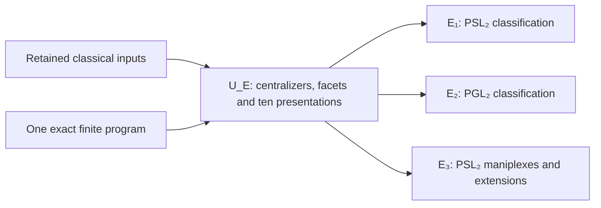

# Dihedral centralizers, polytopes and maniplexes over a projective line

**Topic E has a complete umbrella and three complete application papers.**
The first two recover the specified principal polytope classifications for
PSL₂(q) and PGL₂(q) in every rank at least four. The third recovers the
specified PSL₂ maniplex results by proving the additional interface needed
without the intersection property.

| Paper | Complete text | PDF |
|---|---|---|
| U_E: Centralizers, facets and finite amalgams on the projective line | [Umbrella](research/case_study/phase238_topic_E_umbrella.md) | [7 pages](research/case_study/phase238_topic_E_umbrella.pdf) |
| E₁: The two projective special linear four-polytopes | [PSL₂ application](research/case_study/phase238_L083_application.md) | [3 pages](research/case_study/phase238_L083_application.pdf) |
| E₂: The simplex as the unique higher-rank projective general linear polytope | [PGL₂ application](research/case_study/phase238_L079_application.md) | [2 pages](research/case_study/phase238_L079_application.pdf) |
| E₃: Centralizer extensions of projective-line maniplexes | [PSL₂ maniplex application](research/case_study/phase258_projective_maniplexes.md) | [9 pages](research/case_study/phase258_projective_maniplexes.pdf) |

The [independent review](provenance/phase122_review.md) checks the complete
arguments, all twelve rendered pages and a fresh public replay. The
[earlier combined proof](research/case_study/phase230_rank_one_classification.md)
is their provenance source; it is not an extra mathematical premise.
The [third application’s reader](PROJECTIVE_LINE_MANIPLEXES.md) and
[independent review](research/case_study/phase263_review.md) state its full
contract and literal source corrections separately.

| Intake | Main results recovered | Exclusions |
|---|---|---|
| L083: Leemans and Schulte, *Groups of type L₂(q) acting on polytopes*, retained arXiv math/0606660v1 PDF | Rank restriction, Theorems 1, 3 and 4, the full ten-row table, uniqueness and the stated geometric properties of the 11-cell and 57-cell | Introductory results about other presentations and chiral constructions remain cited background. The bound PDF also has an August 2018 typesetting date; no later edition is inferred. |
| L079: Leemans and Schulte, *Polytopes with groups of type PGL₂(q)*, arXiv:0909.1991v1 | Rank restriction and Theorem 10: the unique example in rank at least four is the 4-simplex with PGL₂(5) | The additional seventeen-case PΣL₂(25) census and Conjecture 11 remain outside this recovery. |
| L021: Leemans and Toledo, *Maniplexes with automorphism group PSL(2,q)*, May 15, 2023 author edition | All-prime-power rank and end-group restrictions, two-proper-end classification, full torus extension theorem and both stated infinite PSL families | Natural subfield qualifications and S₄/self-duality/centralizer corrections are explicit. The final PGL question is a separate answer; no complete marking census is claimed. |

Thus the matched implication is

```text
common centralizer proof + local markings + ten universal presentations
    → L083's stated principal classification
    → L079's stated principal classification.
    + proved string-generator interface + complete torus constructions
    → L021's stated principal PSL results, with source corrections.
```

The extra Conjecture 11 was [answered in later literature](research/case_study/phase240_L079_status.md)
by Connor, De Saedeleer and Leemans in 2015. Its exclusion here records a
limit of this replacement, not a currently open question.

The umbrella includes the complete common proof and the
[required finite program](research/case_study/phase230_finite_check.g).
Each application supplies its quotient exclusions and geometric
identifications without repeating the umbrella proof. The three applications
are independent consequences of U_E, with additional arguments and
certificates charged locally.



The [reviewed measurement](TOPIC_E_MEASUREMENT.md) is the frozen baseline
for E₁ and E₂, excluding E₃. It charges the full umbrella
and its program once, followed by those two complete applications. Conditional
local factors are 1.62× and 2.38×; the total written factor is 0.835×, so
these two applications have not yet repaid the umbrella. Every other topic
pays its own full umbrella. The [two detailed theorem graphs](research/case_study/phase251_dependency_dags.md)
also preserve the historical PGL₂ paper's reuse of the earlier PSL₂ table.

## The common argument

In odd characteristic, the centralizer of a dihedral subgroup generated
by two involutions whose product has order greater than two descends to
the field of those involutions. For a semisimple product represented by
A, its only possible nonidentity centralizing projectivity is represented
by A − tr(A)I/2. For a unipotent product, the centralizer is trivial.

Together with elementary rank bounds and Dickson's subgroup types, this
excludes subfield facets uniformly. A PGL₂ facet would already contain the
fourth generator. A PSL₂ facet would be normalized by it; the odd adjacent
order then forces that generator into the facet too. Both conclusions
contradict independence. Only S₄ and A₅ facets remain.

The exact finite calculation gives six local marking classes and ten
universal presentations, up to duality. Their orders, quotient exclusions
and marked intersections leave precisely the 11-cell, 57-cell and
4-simplex. The proof includes uniqueness, the specified face counts,
self-duality, local projectivity and covering universality.

## Attribution and verification

The classifications retain their attribution to Leemans and Schulte; the
11-cell and 57-cell retain their attribution to Grünbaum and Coxeter.
Dickson's subgroup classification and the group–polytope correspondence
are retained inputs. The contribution here is a common centralizer
argument and the explicit route from six local markings to both complete
principal classifications. No historical priority claim is made for the
centralizer calculation.

The independent review checks every row of the historical table and all
twelve pages of the separate papers. Fresh public execution reproduces all ten
universal group orders, the marked intersection tests and four controls
that reject altered claims. Separate field computations check the
centralizer calculation on 384 semisimple and 144 unipotent pairs.

[DihedralFacetObstruction.lean](research/case_study/formal/DihedralFacetObstruction.lean)
verifies five general steps in the facet-normalizer obstruction, using
only Lean's standard axioms. The matrix calculation, classical inputs,
finite group computations and complete classification remain outside
that formal proof. GAP's exact algorithms are part of the trust boundary.

A later [matrix formalization](research/case_study/formal/ProjectiveDihedralMatrices.lean)
adds six verified declarations for the actual semisimple and unipotent
normal forms and their trace-zero representative. Its
[independent review](research/case_study/phase241_review.md) and
[fresh public execution](provenance/phase123_review.md) are separate from
the frozen topic manuscripts. General conjugacy, the PGL interface and
field descent still require their written arguments; the full
classification is not yet formalized.


Use a new output directory:

```sh
python3 -B -O research/case_study/phase238_check.py --out /tmp/NEW-projective-line --lean LEAN --packages PACKAGES --gap GAP
```

The [replay guide](research/case_study/phase238_README.md) specifies the
versions and optional primary-source checks. The
[publication record](provenance/phase121_review.md) and
[registry addition](research/case_study/phase235_projective_line_overlay.json)
admitted two principal source results, bringing the count at that time to 23. This
recovers known theorems and adds no solved-question entry.

The first two applications and their measurement add no second credit for
either historical source. The third application adds one principal L021
recovery, bringing current coverage to 26 works. The question ledger remains
at twelve entries; the separate four-family PGL answer was admitted earlier.
