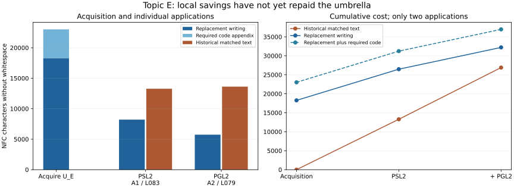

# Measured reuse in the projective-line topic

**The two local applications are shorter; the complete written package is
still longer on the designated metric.** The [independent review](research/case_study/phase252_measurement_review.md)
accepts this first measurement of one complete topic umbrella and its two
complete application papers.

The intake is the specified principal proofs of Leemans and Schulte's
*Groups of type L₂(q) acting on polytopes* (L083) and *Polytopes with groups
of type PGL₂(q)* (L079). The [complete U_E, E₁ and E₂](PROJECTIVE_LINE_POLYTOPES.md),
together with their required finite program, recover those classifications.
Separate chiral, one-Petrie and semilinear branches remain outside this scope.

| Matched proof | Historical cost | Complete local application | Factor after paying U_E |
|---|---:|---:|---:|
| L083: PSL₂ classification and geometry | 13,279 | 8,213 | 1.62× |
| L079: PGL₂ classification | 13,627 | 5,737 | 2.38× |

Costs are NFC characters without whitespace, extracted from the bound PDFs.
The **complete umbrella costs 18,264**, and its **complete required program
appendix costs 4,754**. They are charged once within this topic. Other
topics pay their own complete umbrellas, including any overlap.

The written total factor is **26,906 / 32,214 = 0.835×**. Including our
program gives a conservative artifact-inclusive **lower bound of 0.728×**.
The historical supporting-program cost, if any, is unknown, so the latter
is not an exact artifact-inclusive factor. Both comparisons condition on
the stated classical library and source-specific retained theorems.

The historical PGL₂ paper already reuses the PSL₂ paper's finite table.
That reuse is preserved in the [two theorem dependency graphs](research/case_study/phase251_dependency_dags.md)
and their [edge-by-edge evidence](research/case_study/phase251_dependency_dags.json).
The diagrams have no separate numerical weights for individual theorem nodes.
They show one acquisition and two applications, not a long-run sawtooth.

The [full report](research/case_study/phase251_report.md) gives all five
length proxies under both NFC and NFKC normalization, exact source boundaries,
retained inputs, limitations and reproduction commands. Token counts give
small written savings; character and byte counts do not. The primary metric
was fixed before computing the comparison and has not been changed.

Fresh execution reproduces every number with two independently written
measurement programs. Three altered-input controls are rejected. See the
[publication record](provenance/phase126_review.md). The mathematical and
Lean verification retain their previously stated scope. This measurement
adds no source recovery and no newly solved conjecture.
