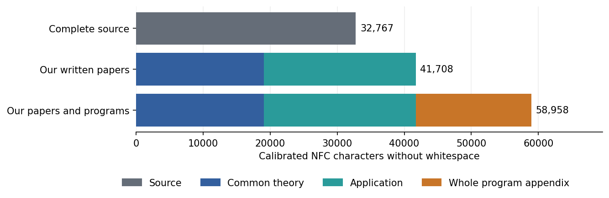

Affine constructions: common and individual compression
=======================================================

The comparison uses Hou, Feng and Leemans, *Regular 3-polytopes of order
2^n p*, arXiv:2001.02945v2, dated 14 July 2024 (L012). Its complete seventeen
pages are compared with our seven-page common paper and nine-page application.
The `mathematical admission <../admission.json>`_ specifies the principal
results recovered, corrections and exclusions. This separate length audit
adds no mathematical claim or solved-question credit.

Read the `two-page calculation <packet/measurement.pdf>`_ or its editable
`TeX source <packet/measurement.tex>`_. The primary unit is calibrated NFC
characters without whitespace in the complete extracted documents.

.. list-table:: Complete written costs
   :header-rows: 1

   * - Document
     - Characters
   * - Source L012
     - 32,767
   * - Whole common theory
     - 19,070
   * - Application AF1
     - 22,638

The combined written ratio is::

  32,767 / (19,070 + 22,638) = 32,767 / 41,708 = 0.786.

The complete written replacement is longer than its single source in this
measure. The whole common paper is charged once in this topic, including
arguments also used in another topic.

After acquiring the **whole common paper and all six complete required
programs**, the local source/application ratio is::

  32,767 / 22,638 = 1.447.

The application is shorter. Its conditional saving does not remove the
common theory from the combined cost.

Programs and other costs
------------------------

The complete eight-page program appendix costs 17,250. Adding it once gives::

  32,767 / (41,708 + 17,250) = 32,767 / 58,958 = 0.556.

Alternatively, all six raw files cost 16,682, giving 32,767 / 58,390 = 0.561.
Printed and raw programs are alternative representations, never two charges
for the same code. Every program and its embedded diagnostics remain intact.
Three complete auxiliary scripts cost 16,581 characters separately; three
formal files cost 7,958. They are explicitly outside these denominators.

The whole-source numerator is for the accepted principal contract, not every
auxiliary assertion. General Problem 1.1, the full Table 1 census and the
ancillary uniqueness claim for the two seeds of order 384 remain excluded.
The correction to the source's sign and all retained external results keep
their attribution. Nine scoped Lean declarations verify quotient, period
and sign lemmas; they do not formalize the full application.

Evidence and replay
-------------------

The `independent input review <packet/independent/README.rst>`_ checked all
41 input pages, 120 PDF metric cells and 120 separate raw-file metric cells.
It validated every excluded running header or page number and all 114 glyph
substitutions against the actual PDF encodings. The source's 163 inline
graphic marks have unknown graphic and layout cost. External proofs,
historical software and the construction of catalogues and algorithms also
have unknown costs. None is counted as zero.

The `numerical ledger <packet/results.json>`_ and both CSV tables retain
thirty coordinates: five units, NFC and NFKC, and three extraction variants.
They contain ninety combined and thirty conditional fractions. The audit
reader is separate from the scientific papers whose lengths it measures.
The original author packet records its status at submission; the subsequent
review and admission record the accepted state without changing those bytes.

The `independent arithmetic review <arithmetic_review/README.rst>`_ checks
all fractions and the reader against the accepted counts. Its exact result
is bound by `admission.json <admission.json>`_. Root adopted that review and
replayed its checker. From the repository root::

  python3 -B -O audit/topic-affine/v2/measurement/arithmetic_review/check.py \
    --packet audit/topic-affine/v2/measurement/packet \
    --author-pin cc69a9eef8d78fd7e3e3f1ef2db024aae70801750d5bef0a48127575facd1725 \
    --out /tmp/affine-fresh.json

This replay needs no primary PDFs, Lean, GAP or network connection. It checks
the arithmetic and declared boundaries; it does not repeat the earlier
mathematical review. Paired proof dependencies and passage costs remain
pending. These length ratios do not estimate total research effort or the
minimum possible proof length.
