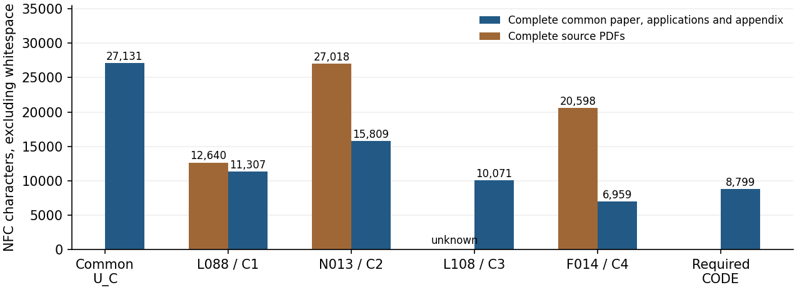

Topic C: common and individual compression
===========================================

The accepted comparison covers L088, N013, L108 and F014 at the exact
principal-result scope of the `mathematical admission <../admission.json>`_.
The forty source rows include corrections and exclusions. They are not
forty unqualified recovered claims.

The frozen `publication guide <../../../../papers/topic-c/v2/PUBLICATION.rst>`_
records the earlier proof admission. This audit supersedes its statement
that lengths have not yet been measured. Paired dependency costs remain
pending, as recorded below.

Read the `two-page calculation <packet/measurement.pdf>`_ or its editable
`TeX source <packet/measurement.tex>`_. The primary length unit is NFC text
characters excluding whitespace, after the specified PDF calibration.
The complete papers are counted, including introductions and references;
only explicitly identified running furniture is removed.

.. list-table:: Complete manuscript costs and individual comparisons
   :header-rows: 1
   :widths: 32 23 23 22

   * - Matched result
     - Original paper
     - Our application
     - Original/application
   * - L088: Janko geometries
     - 12,640
     - 11,307
     - 1.118
   * - N013: generalized cubes
     - 27,018
     - 15,809
     - 1.709
   * - L108: Petrials and faithful actions
     - Unknown: x
     - 10,071
     - Unknown
   * - F014: equal adjacent parameters
     - 20,598
     - 6,959
     - 2.960

The whole common paper costs 27,131 and the four applications total 44,146.
Thus the common written comparison is::

  (x + 60,256) / (27,131 + 44,146) = (x + 60,256) / 71,277.

The individual factors above apply after acquiring the whole common theory
and both required programs. The common paper is charged once in the combined
comparison. Its overlap with another topic earns no discount in this one.

Both complete required programs are printed in a four-page appendix costing
8,799, giving the separate comparison::

  (x + 60,256) / (71,277 + 8,799) = (x + 60,256) / 80,076.

The full raw programs cost 8,323 in the same unit, or 9,241 bytes. Substituting
those files for the printed appendix gives denominator 79,600. These are
alternative representations: they are never both charged. Every comparison
retains C3's complete application even though its source PDF is unavailable.
No numerical whole-topic factor is reported, and the authored browser text
of L108 is not silently substituted for the missing PDF.

Evidence and replay
-------------------

The `input review <packet/independent/README.rst>`_ independently re-extracts
all 64 physical pages of the nine measured PDFs, checks the calibrated font
mappings and reproduces 270 metric cells, 54 normalized text hashes and
twenty raw-program cells. Its visual review scope is stated separately.
The `arithmetic review <arithmetic_review/README.rst>`_ independently checks
all thirty combinations of five units, two Unicode normalizations and
three extraction variants. It verifies ninety symbolic combined formulas,
ninety known conditional fractions, thirty unknown conditional entries and
all 210 CSV rows. Twelve deliberately corrupted inputs are rejected.

The original numerical edition is preserved under ``previous/``. Its values
were correct, but the first presentation put the program-inclusive total
first. The current ``packet/`` restores the written comparison first and
changes no measured value. All input, arithmetic and presentation reviews
are frozen and bound by `admission.json <admission.json>`_. Source PDFs,
source text and source images are not redistributed.

From the repository root, replay the independent arithmetic without source
PDFs or network access::

  python3 -B -O audit/topic-c/v2/measurement/arithmetic_review/check.py \
    --packet audit/topic-c/v2/measurement/packet \
    --original audit/topic-c/v2/measurement/previous --out /tmp/c-fresh.json

The `standard snapshot verifier <../../../../scripts/verify_snapshot.py>`_
also checks the accepted arithmetic, public proof bindings and complete
program inventory. It does not rerun the independent source extraction,
Lean or the group census. Their separate recorded scopes remain explicit.

Paired dependency graphs are still in progress. External proofs, graphics
and formula layout have unknown costs; extracted length is not total
research effort or minimum mathematical complexity. This admission adds
no principal-result or solved-question credit and changes no proof.
