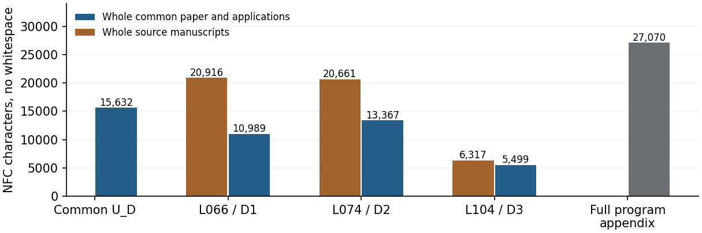

Topic D: common and individual compression
==========================================

The three-source comparison covers the independently reviewed principal
results on commuting involutions (L066), Suzuki regular polyhedra (L074)
and Hall–Janko geometries (L104). The exact 37-row contract, source corrections
and exclusions are preserved in the `mathematical admission <../admission.json>`_.
Its manuscript publication guide records the earlier proof stage; this
separate numerical admission supplies the later length comparison.

Read the `two-page calculation <packet/measurement.pdf>`_ or its editable
`TeX source <packet/measurement.tex>`_. The primary unit is NFC characters
without whitespace in the complete extracted documents. Titles, abstracts,
references and unique front matter remain. Only exact running furniture is
removed; visible-glyph repairs are tied to actual PDF occurrences.

The complete source manuscripts cost 47,894. Our whole common paper costs
15,632 and all three applications cost 29,855. The combined written factor is::

  47,894 / (15,632 + 29,855) = 47,894 / 45,487 = 1.053.

The common paper is charged once within this topic. Its overlap with another
topic earns no discount here.

.. list-table:: Each result after acquiring the common theory and all programs
   :header-rows: 1

   * - Source and matched application
     - Whole source
     - Whole application
     - Conditional factor
   * - L066 / D1: commuting involutions
     - 20,916
     - 10,989
     - 1.903
   * - L074 / D2: Suzuki polyhedra
     - 20,661
     - 13,367
     - 1.546
   * - L104 / D3: Hall–Janko geometries
     - 6,317
     - 5,499
     - 1.149

These individual comparisons assume acquisition of the **whole common theory
and all eight complete mathematical programs**: five required files and three
full diagnostics. They do not charge that acquisition a second time.

Including the complete program appendix
---------------------------------------

The whole printed appendix costs 27,070. The separate comparison including
that appendix is::

  47,894 / (45,487 + 27,070) = 47,894 / 72,557 = 0.660.

Thus the written proof is shorter by this ruler, while the full printed
program cost outweighs that saving. This measures the specified available
texts. Historical software, catalogue and algorithm construction, and other
external proof costs remain unknown; they are not assumed to be free.

All eight raw files cost 26,185 in the same unit. Substituting them for the
printed appendix gives 47,894 / 71,672 = 0.668. Printed and raw programs are
alternative representations, never two charges for the same code. No branch
or diagnostic is pruned. The two complete execution drivers cost 10,038
characters and 12,765 bytes separately; they are outside these denominators.

Scope and evidence
------------------

The whole-source numerator recovers declared main results, not every printed
assertion. In particular, L104's diagrams, full Aut/Cor groups, doubling
relation and supplement annotations remain excluded, while their extracted
source text remains counted. L066's reversal and regularity qualifications
and the retained Suzuki classification remain explicit. No M22 application
is included. The later generic Lean supplement does not change these measured
scientific PDFs or supply a complete source formalization.

The `input review <packet/independent/README.rst>`_ independently recounts
240 PDF metric cells across all 57 physical pages and 100 raw program/driver
cells. It corrected fourteen square brackets whose extracted characters
collided with brace pieces. The font has no ToUnicode stream: the error was
in interpreting its encoding. Only two calibrated UTF-8 counts changed by
28, with no change to the primary character totals. The original proposal
is retained under ``packet/previous``; the corrected inputs, accepted by
independent review, are under ``packet/inputs``.

The `arithmetic review <arithmetic_review/README.rst>`_ independently derives
all 180 fractions and CSV rows for thirty coordinates: five units, two Unicode
normalizations and three extraction variants. It checks eleven printed table
rows and rejects fourteen corruptions. Root replayed that independent check.
The complete source boundaries and both representation totals are bound by
`admission.json <admission.json>`_. Neither primary source texts nor PDFs,
font files or source rasters are redistributed.

From the repository root, replay the arithmetic without source PDFs, Lean,
GAP or network access::

  python3 -B -O audit/topic-d/v2/measurement/arithmetic_review/check.py \
    --packet audit/topic-d/v2/measurement/packet --out /tmp/d-fresh.json

The `snapshot verifier <../../../../scripts/verify_snapshot.py>`_ also checks
all accepted coordinates, public proof bindings and complete program inventory.
It does not rerun the source extraction or mathematical/formal proofs.
Paired dependency costs remain pending. Graphics, formula positioning and
outside proofs have unknown costs; extracted length is not minimum
mathematical complexity or total research effort. No mathematical credit
is added by this measurement.
