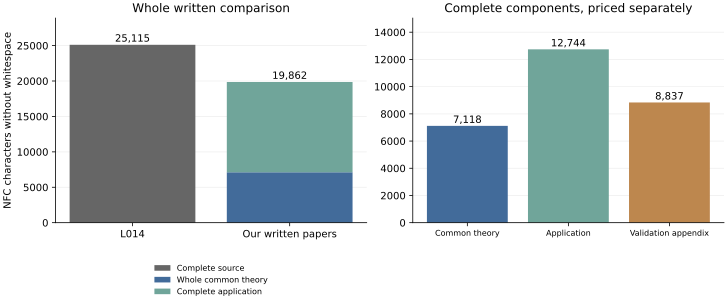

Odd kernels: common and individual compression
==============================================

This comparison uses Hou, Feng, Leemans and Qu, *String C-groups of order
4p^m*, arXiv:2407.10388v1, 15 July 2024 (L014). Its complete twelve pages
are compared with our four-page common theory and five-page application.
The `scientific admission <../admission.json>`_ specifies the principal
results recovered, the corrected marking and the excluded auxiliary claims.
This audit adds no mathematical or solved-question credit.

Read the `two-page calculation <packet/measurement.pdf>`_ or its editable
`TeX source <packet/measurement.tex>`_. The primary unit is calibrated NFC
characters without whitespace in the complete extracted documents.

.. list-table:: Complete written costs
   :header-rows: 1

   * - Document
     - Characters
   * - Source L014
     - 25,115
   * - Whole common theory U_F
     - 7,118
   * - Application F1
     - 12,744

The combined written comparison charges the whole common theory once::

  25,115 / (7,118 + 12,744) = 25,115 / 19,862 = 1.264.

After acquiring the whole common paper and complete declared validation
package, the individual source/application comparison is::

  25,115 / 12,744 = 1.971.

The individual factor measures the application after that acquisition.
It does not remove the common paper from the combined denominator. Each
separate topic pays for its own whole common theory, including overlap.

Programs and other costs
------------------------

The three programs validate finite examples; the uniform written proofs
do not depend on them as finite premises. Their complete four-page printed
appendix costs 8,837 characters. Including it gives::

  25,115 / (19,862 + 8,837) = 25,115 / 28,699 = 0.875.

The three complete raw programs cost 8,061 instead, giving
25,115 / 27,923 = 0.899. Printed and raw code are alternative representations,
never two charges. Two complete operational drivers cost 10,881 separately;
the Lean file costs 2,269. These additional files are outside the displayed
denominators and remain inventoried.

Cunningham--Pellicer's tightness classification remains a retained input
whose complete proof cost is unknown. Source graphics and formula layout,
other retained proofs and historical software also have unknown costs.
None is assigned zero. The source's introductory census and general Hughes
classification remain outside the recovered principal contract. Five scoped
Lean declarations verify supporting lemmas, not the complete application.

Evidence and replay
-------------------

The `independent input review <input_review/README.rst>`_ checked all
twenty-five input pages, 120 PDF metric cells and sixty separate raw-file
metric cells. Its calibration checks all 95 substitutions against original
encoded glyph occurrences. Only exact running headers and page numbers are
removed; title, abstract, references and contacts remain charged.

The `numerical ledger <packet/measurement.json>`_ retains thirty coordinates:
five units, two Unicode normalizations and three extraction variants. The
`independent arithmetic and reader review <arithmetic_review/README.rst>`_
checks all 120 fractions and the two-page reader. Root adopted the review
and reran its checker. To check the arithmetic without primary PDFs, GAP,
Lean or network access, run from the repository root::

  python3 -B -O audit/topic-f/v2/measurement/arithmetic_review/arithmetic.py \
    --inputs audit/topic-f/v2/measurement/inputs \
    --input-review audit/topic-f/v2/measurement/input_review \
    --input-adoption audit/topic-f/v2/measurement/input_adoption \
    --result audit/topic-f/v2/measurement/packet/measurement.json \
    --out /tmp/topic-f-arithmetic.json

To recount the documents, use pypdf 6.13.0, fontTools 4.63.0 and the original
source PDF identified by the hash in inputs/manifest.json::

  python3 -B -O audit/topic-f/v2/measurement/replay_inputs.py \
    --source-pdf /path/to/arxiv-2407.10388v1.pdf \
    --out /tmp/topic-f-recount

The adapter supplies exact published files at the paths expected by the
frozen reviewer. It temporarily copies the supplied primary and deletes
that copy on exit; no primary PDF or extracted text is published here.
To rebuild the reader, run packet/build.py with the same three input-folder
arguments, a fresh --out directory and --xelatex pointing to XeLaTeX.

The audit reader is separate from the scientific texts being measured.
Frozen author files keep their submission status; the subsequent review
and admission record acceptance. Paired proof dependencies and passage
costs remain pending. These ratios measure written length, not minimum
proof complexity or total research effort. One application supplies no
evidence of a recurring sawtooth pattern.
