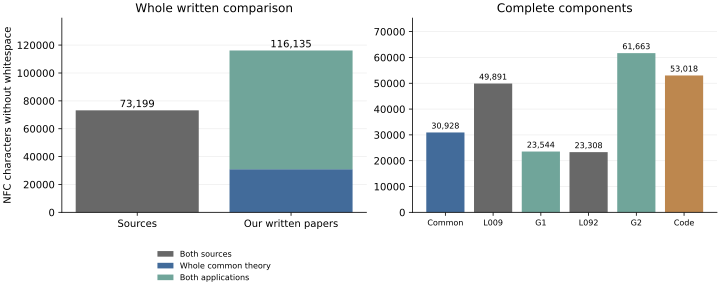

Flag relations and incidence residues: common and individual costs
=================================================================

This accepted comparison uses the two complete source PDFs and the current
common paper and applications. The `two-page calculation
<packet/measurement.pdf>`_ gives the formulas and graph; its `editable TeX
<packet/measurement.tex>`_ and `exact numerical ledger
<packet/measurement.json>`_ accompany it. The `scientific admission
<../admission.json>`_ fixes which results are recovered, corrected or excluded.

The sources are Delaby, Leemans and Tranchida, *Geometries with trialities
arising from linear spaces*, Algebraic Combinatorics 9(2) (2026), 379--402
(L009), and Leemans, *A generalization of a construction due to Van
Nypelseer*, Beiträge zur Algebra und Geometrie 46 (2005), 561--574 (L092).
Their complete principal contracts comprise 79 source records, with 34
proof contexts in the replacement. This measurement adds no result credit.

.. list-table:: Complete written costs
   :header-rows: 1
   :widths: 60 15 25

   * - Document
     - PDF pages
     - Characters
   * - L009, including the publisher identification cover
     - 25
     - 49,891
   * - L092
     - 14
     - 23,308
   * - Common theory U_G
     - 12
     - 30,928
   * - Triangle geometries G1
     - 8
     - 23,544
   * - Geometries from Steiner designs G2
     - 22
     - 61,663

The primary coordinate counts calibrated NFC characters without whitespace,
under the fixed extraction and page-furniture policy. The combined factor is
**73,199 / (30,928 + 23,544 + 61,663) = 0.630**. The current complete written
replacement is longer than its sources. After acquiring the whole common
paper and all thirteen complete programs, the individual factors are
**49,891 / 23,544 = 2.119** for L009 and **23,308 / 61,663 = 0.378** for
L092. The second application remains longer even after that acquisition.
These are length comparisons of the declared contracts, not minimum proof
complexities or evidence of a recurring sawtooth pattern.

The whole twenty-page program appendix costs 53,018, giving a combined
factor of **73,199 / 169,153 = 0.433**. Using all thirteen complete raw
programs instead costs 50,184, giving **73,199 / 166,319 = 0.440**. These
are alternative representations, never simultaneous charges. Four programs
provide finite mathematical premises, two provide witness or certificate
bridges, and seven validate the written results. All thirteen are charged.
The three operational drivers cost 14,919 separately; the six Lean files
cost 19,480 separately. Their forty supporting declarations do not formalize
the full geometric applications or the retained classification theorems.

BDL, Kantor and the other retained external proofs, historical programs and
graphics have unknown full costs. Unknown means unmeasured, not zero.
Source qualifications, excluded identifications and previously credited
question answers remain as stated in the scientific edition.

The input audit covers 101 PDF pages, 180 PDF metric cells and 220 raw-file
metric cells. Independent font reconciliation checks 75,909 calibrated
source characters. A corrected font-identity audit changes 701 evidence
entries without changing any length. ``original_inputs`` preserves the
earlier packet; ``inputs`` is the accepted corrected packet. The thirty
metric coordinates retain 90 combined and 60 individual fractions. A
separate article-only sensitivity contributes 120 further fractions; it
does not remove the publisher cover from the primary numerator.

Reproduce all 270 fractions, the numerical reader checks and nine actual
SVG bars from the public checkout, without the original PDFs::

    python3 -B -O audit/topic-g/v2/measurement/arithmetic_review/check.py \
      --inputs audit/topic-g/v2/measurement/inputs \
      --input-review audit/topic-g/v2/measurement/input_review \
      --input-adoption audit/topic-g/v2/measurement/input_adoption \
      --numbers audit/topic-g/v2/measurement/packet \
      --out /tmp/topic-g-arithmetic

For an independent recount, supply the two original PDFs separately and
use a fresh output directory outside the checkout::

    python3 -B -O audit/topic-g/v2/measurement/replay_inputs.py \
      --linear-source-pdf /path/to/linear_triality2026_published.pdf \
      --steiner-source-pdf /path/to/older_L092_gwdg.pdf \
      --out /tmp/topic-g-input-recount

The adapter verifies the hashes of all 33 public inputs and both originals,
then runs the independent extraction and font checks. Temporary source
copies are removed after the run. The original PDFs, extracted source text
and page images are not redistributed. The input audit records the required
Python packages and exact source hashes.

The `admission <admission.json>`_ binds the original and corrected input
packets, independent input review, root input adoption, numerical packet,
independent arithmetic review and root numerical adoption. Frozen candidate
wording in those historical packets records the stage at which each was
written; this admission records their accepted status. Paired proof
dependencies and exclusive passage costs remain a separate audit.
