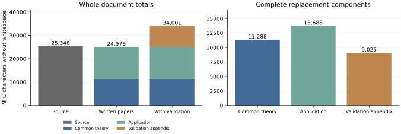

Recognizable extensions: common and individual costs
====================================================

This accepted comparison uses Antonio Díaz Ramos, Rémi Molinier and Antonio
Viruel, *Every finite group is represented by a finite incidence geometry*,
arXiv:2511.02410v2 (16 December 2025), and the current common theory and
application. The `scientific admission <../admission.json>`_ fixes the six
source blocks and thirteen proof contexts, with their corrections and
exclusions. The source's Theorem A already answers its Question 2.4; this
comparison claims no new answer.

The `two-page calculation <packet/measurement.pdf>`_, its `editable TeX
<packet/measurement.tex>`_, and the `exact ledger <packet/results.json>`_
give the full counts, formulas and graph. The primary coordinate counts
calibrated NFC characters without whitespace. Titles, references and other
document text remain paid; only the exact declared running furniture is
removed.

.. list-table:: Complete manuscript costs
   :header-rows: 1
   :widths: 60 15 25

   * - Document
     - Pages
     - Characters
   * - Source F010
     - 13
     - 25,348
   * - Common theory U_R
     - 5
     - 11,288
   * - Finite normal pairs R1
     - 5
     - 13,688
   * - Complete validation appendix
     - 4
     - 9,025

The combined written factor is **25,348 / (11,288 + 13,688) = 1.014894**.
After acquiring the whole common paper and both complete validation
programs, the individual factor is **25,348 / 13,688 = 1.851841**. The
acquisition cost is displayed and charged in the combined comparison.
Other topics pay their own complete common theory even where it overlaps.

The written difference is only 372 nonspace characters. Under calibrated
NFC UTF-8 bytes, the combined written factor becomes
**31,880 / 32,836 = 0.970886**. The small saving therefore depends on the
unit of measurement. This edition does not establish a substantial or
consistent reduction in complete written length.

Including the full printed appendix gives **25,348 / 34,001 = 0.745507**.
The two complete raw programs cost 8,310 instead, giving
**25,348 / 33,286 = 0.761521**. These representations are alternatives,
never simultaneous charges. Both programs validate bounded examples;
neither is a premise of the uniform written proof. Two historical drivers
cost 13,275 separately and two Lean files cost 5,487 separately. The twelve
supporting declarations comprise eight generic statements and four reused
local facts; the complete geometric application remains a written proof.

The current proofs preserve the corrections to chamber degrees, the
completed hexagon pair and the symmetric family's initial case. The
precise hypotheses and exclusions remain those of the scientific edition.
External proofs, historical software, graphical and formula layout, and
operational engineering have unknown full costs. They are not priced at
zero. Extracted-text length does not measure total research effort or
minimum proof complexity, and one application cannot establish a recurring
sawtooth pattern.

The accepted input audit covers all 27 PDF pages, 120 PDF metric cells,
sixty raw-file cells and 566 glyph classes in 26 actual font dictionaries.
Its 134 visible-glyph repairs include three right braces encoded as tabs;
actual whitespace is otherwise preserved. Four mapsto strokes remain
separate from adjacent arrows. All five length units, both Unicode
normalizations and all three extraction variants are retained. The thirty
coordinates yield 90 combined and thirty individual fractions.

Reproduce the 120 exact fractions and the numerical reader and graph
checks from the public checkout, without the original PDF::

    python3 -B -O audit/topic-representation/v2/measurement/arithmetic_review/check.py \
      --inputs audit/topic-representation/v2/measurement/inputs \
      --input-review audit/topic-representation/v2/measurement/input_review \
      --input-adoption audit/topic-representation/v2/measurement/input_adoption \
      --numbers audit/topic-representation/v2/measurement/packet \
      --public-root . --out /tmp/representation-arithmetic

For an independent recount, supply the original PDF separately and use a
fresh output directory outside the checkout::

    python3 -B -O audit/topic-representation/v2/measurement/replay_inputs.py \
      --source-pdf /path/to/incidence_representation_resolution2025.pdf \
      --out /tmp/representation-input-recount

The adapter verifies sixteen exact public inputs and the original PDF,
then runs the independent extraction and font checks. Temporary source
copies are removed afterward. The original PDF, extracted source text and
page images are not redistributed. The input audit specifies pypdf 6.13.0
and FontTools 4.63.0 and binds the exact source edition.

The `admission <admission.json>`_ binds all six input, review, numerical and
adoption packets. Earlier candidate wording in those frozen packets records
their original stages; this admission records their accepted status. Paired
dependencies and passage costs remain a separate audit. No source, question
answer or formal theorem is newly credited by this measurement.
