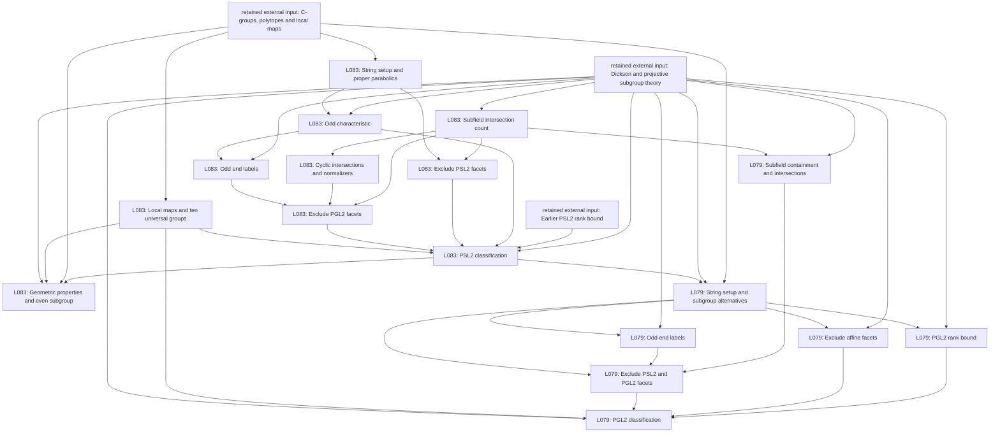
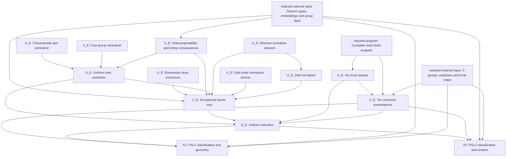

# Theorem dependencies for the projective-line comparison

Proof dependencies of the matched principal contracts, grouped at named lemmas or closely connected blocks.

Costs are measured at full selected document level. Nodes have no separate numerical weights; node counts are not complexity ratios.

External inputs remain explicit. Arrows point from a premise to its use.

## Source

## Replacement

The source graph retains three explicit forms of reuse from L083 in L079:
the characteristic-two exclusion, the subfield counting argument, and Table1.
The replacement graph has no dependency from A1 to A2; both use U_E.
